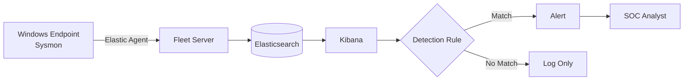

# Cyber Threat Intel

## Introduction

#### CTI seeks to answer three essential questions:

* **Who, or what, is on the other end of this alert indicator?**
* **What was their behaviour in the past?**
* **How does my organisation respond, and what should I do about it right now?**

#### Cyber Threat Intelligence Lifecycle

<figure><figcaption></figcaption></figure>

#### **Traffic Light Protocol**

* **STIX = Structured Threat Information Expression**

<table><thead><tr><th width="226">Sharing boundary</th><th>Typical SOC L1 behaviour</th><th>TLP label</th></tr></thead><tbody><tr><td>No restriction</td><td>Post to the internal wiki or platform.</td><td><strong>TLP: CLEAR</strong></td></tr><tr><td>Share with peer community but not publicly</td><td>Upload to MISP /Slack workspace restricted to partner SOCs.</td><td><strong>TLP: GREEN</strong></td></tr><tr><td>Organisation-wide, external sharing only with need-to-know clients</td><td>Keep within the company CTI platform; reference, do not copy, in tickets.</td><td><strong>TLP: AMBER</strong></td></tr><tr><td>Named recipients only</td><td>Store in an encrypted note; do not post to the ticketing system without clearance</td><td><strong>TLP: RED</strong></td></tr></tbody></table>

***

## File and Hash Threat Intel

#### Filepath Analysis

* C:\Users\Public\setup.exe
* C:\Windows\Temp\setup.exe
* C:\Windows\Temp\\
* C:\Users\<user>\AppData\Local\Temp\\
* C:\ProgramData\Microsoft\Windows\\

#### Filename Heuristics

* Double extensions : `invoice.pdf.exe`
* System binary impersonation : `scvhost.exe`&#x20;
* High-Entropy Strings : `jh8F21.exe`
* Masquerading : `backup-2300.exe`&#x20;

#### File Hash Lockup

1. Get file hash

```powershell
certutil -hashfile bl0gger.exe SHA256             #cmd
Get-Filehash -Algorithm SHA256 bl0gger.exe        #powershell
```

2. create context

```
SHA256: abc123...
File: invoice.pdf.exe
Path: C:\Users\Public\
Host: PC-102
User: Ahmed
First seen: 2026-08-10 09:14
Source: EDR
Alert: Suspicious execution
TLP: AMBER
```

## IP and Domain Threat Intel

### Domains enrichment

1. Resolving DNS Domains&#x20;
2. WHOIS / RDAP
   * Registrar
   * Registration date
   * Expiration date
   * Domain age

#### Attack Techniques Using

1. **CDN Abuse**
2. Typosquatting
3. IDN / Homograph Attacks

### IP Enrichment




