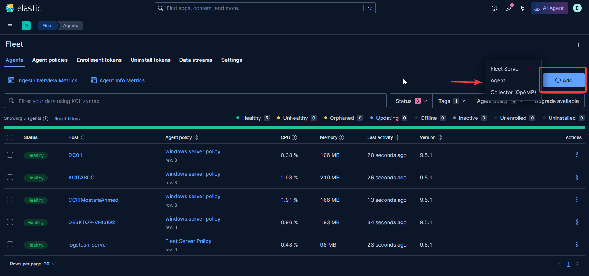
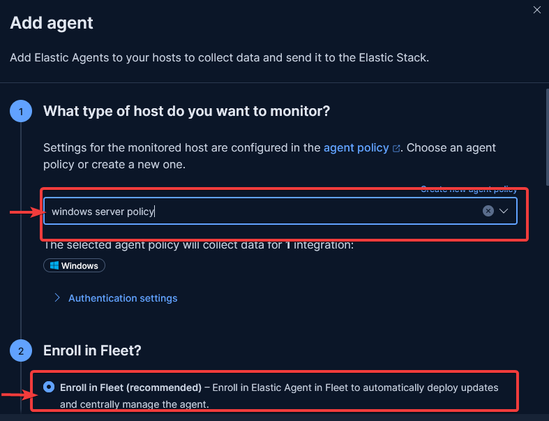

# Install Agent with Fleet


1. **Go to Fleet --> agents**

<figure><figcaption></figcaption></figure>

2. Choose an agent policy or create a new one.

<figure><figcaption></figcaption></figure>

3. Copy CA certifacate of FLEET to agent

```shellscript
mkdir C:\elastic
mkdir C:\elastic/certs
scp abdo@10.41.114.20:/home/abdo/fleet/ca.crt C:\elastic\certs\ca.crt
```

3.
4. Install Elastic Agent on your host

```powershell
$ProgressPreference = 'SilentlyContinue'
Invoke-WebRequest -Uri https://artifacts.elastic.co/downloads/beats/elastic-agent/elastic-agent-9.5.1-windows-x86_64.zip -OutFile elastic-agent-9.5.1-windows-x86_64.zip 
Expand-Archive .\elastic-agent-9.5.1-windows-x86_64.zip -DestinationPath .
cd elastic-agent-9.5.1-windows-x86_64
.\elastic-agent.exe install --url=https://<SERVER-IP>:8220 --enrollment-token=<TOKEN>
```
