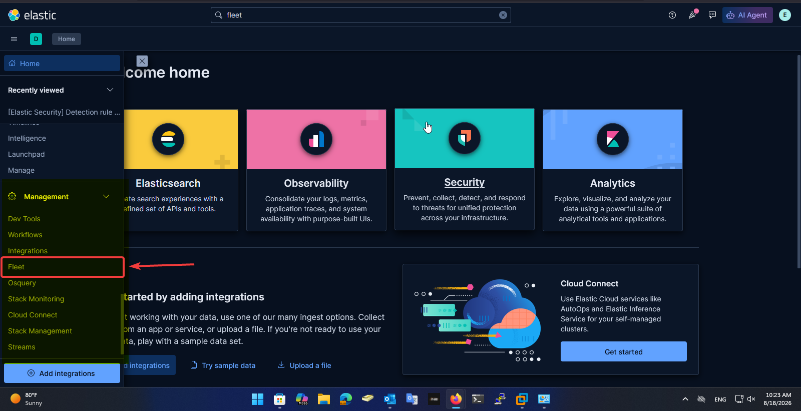
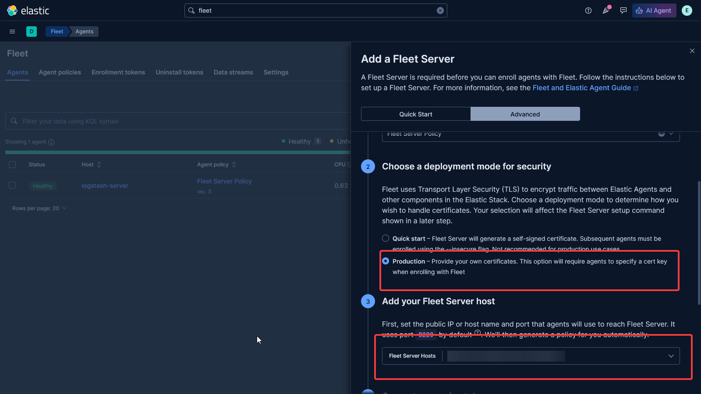
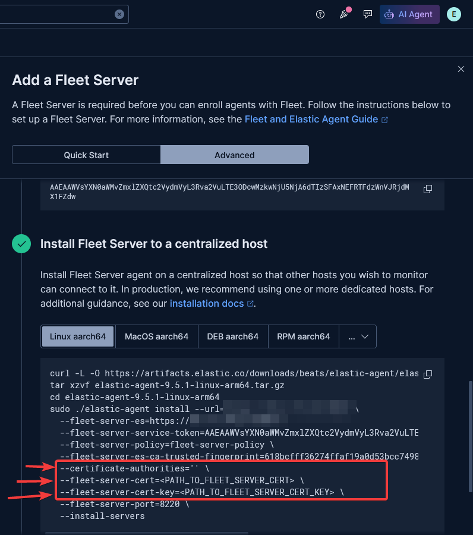

# Install fleet server

### What is Fleet Server?

**Fleet Server** is the component in the Elastic Stack that acts as the **management/control plane** between Kibana and all your Elastic Agents.

* It's basically a special **Elastic Agent** running in a dedicated mode (`--install-servers` / Fleet Server integration).
* Agents don't talk to Kibana directly — they talk to **Fleet Server**, and Fleet Server talks to **Elasticsearch** (and relays policy/config info to/from Kibana).
* It handles:
  * Agent **enrollment** (registering new agents)
  * Distributing **policies** (what integrations/inputs each agent should run)
  * Collecting **agent health/status** checks
  * Acting as a **secure proxy** so agents don't need direct access to Elasticsearch

#### Key concepts

<table><thead><tr><th width="184">Term</th><th>Meaning</th></tr></thead><tbody><tr><td><strong>Fleet Server</strong></td><td>The server component agents enroll into</td></tr><tr><td><strong>Fleet</strong> (in Kibana)</td><td>The UI/management layer for agents &#x26; policies</td></tr><tr><td><strong>Agent Policy</strong></td><td>A set of rules/integrations assigned to one or more agents</td></tr><tr><td><strong>Enrollment Token</strong></td><td>Credential an agent uses to register itself to a policy</td></tr><tr><td><strong>Service Token</strong></td><td>Credential Fleet Server itself uses to authenticate to Elasticsearch</td></tr></tbody></table>

***

## Generating TLS Certificates for Fleet Server (Custom CA)

#### Step 1 — Create Your Own CA

```shellscript
openssl genrsa -out ca.key 2048
openssl req -x509 -new -nodes -key ca.key -sha256 -days 3650 -out ca.crt \
  -subj "/CN=My-Internal-CA"
```


**What this does:**

* `ca.key` → the CA's private key (keep this safe — it's what lets you sign more certs later)
* `ca.crt` → the CA's public certificate, valid for 10 years (`-days 3650`)
* This is the "root of trust" — any certificate signed by this CA will be trusted once `ca.crt` is added to <mark style="color:$danger;">`--certificate-authorities`</mark>


#### Step 2 — Create a Key + CSR for the Fleet Server

```shellscript
openssl genrsa -out fleet-server.key 2048
openssl req -new -key fleet-server.key -out fleet-server.csr \
  -subj "/CN=<SERVER-IP>"
```


**What this does:**

* `fleet-server.key` → the private key for the Fleet Server itself
* `fleet-server.csr` → a Certificate Signing Request — basically "please sign a cert for this identity"
* `-subj "/CN=<SERVER-IP>"` sets the Common Name to the server's IP (adjust to match your actual Fleet Server address)


#### Step 3 — Define the SAN (Subject Alternative Name)

```shellscript
cat > fleet-server-ext.cnf <<EOF
subjectAltName = IP:10.41.114.20, DNS:logstash-server
EOF
```


**Why this matters:**

* Modern TLS clients (including Elastic Agent) validate certificates against the **SAN**, not just the CN
* Without a matching SAN, you'll get an error later like:

```
  x509: certificate is not valid for any names
```

* Make sure the IP and hostname here match exactly what Agents will use to connect (`--url` value)


#### Step 4 — Sign the Certificate with the CA

```shellscript
openssl x509 -req -in fleet-server.csr -CA ca.crt -CAkey ca.key -CAcreateserial \
  -out fleet-server.crt -days 825 -sha256 -extfile fleet-server-ext.cnf
```


**What this does:**

* Takes the CSR from Step 2 and signs it using the CA from Step 1
* `-CAcreateserial` generates a serial number file (`ca.srl`) to track issued certs
* `-days 825` sets the cert's validity (825 days ≈ \~2.25 years, a common max for public trust chains — adjust as needed for internal use)
* Output: `fleet-server.crt` — the final certificate, now trusted by anything that trusts `ca.crt`


#### Step 5 — Place Files in the Correct Location

```shellscript
sudo mkdir -p /etc/elastic/certs
sudo cp fleet-server.crt fleet-server.key ca.crt /etc/elastic/certs/
sudo chmod 600 /etc/elastic/certs/fleet-server.key
```

### Quick Verification

1. Confirm the cert was signed by your CA (not self-signed):

```bash
openssl x509 -in /etc/elastic/certs/fleet-server.crt -noout -subject -issuer
```

Expected:

```
subject=CN = 10.41.114.20
issuer=CN = My-Internal-CA
```

1. Confirm the SAN is embedded correctly:

```bash
openssl x509 -in /etc/elastic/certs/fleet-server.crt -text -noout | grep -A1 "Subject Alternative Name"
```

Expected:

```
X509v3 Subject Alternative Name:
    IP Address:10.41.114.20, DNS:logstash-server
```

## Installing Fleet Server in Production

#### Steps in Kibana (GUI)

1. **Go to Fleet** → `Kibana → Management → Fleet`

<figure><figcaption></figcaption></figure>

2. **Create/select a Fleet Server policy**
   * `Fleet → Agent Policies → Create policy` (or use the default `Fleet Server Policy`)
3. **Add a Fleet Server** → `Fleet → Settings → Fleet Server hosts` (or the "Add Fleet Server" flow on first setup)
   * Set the Fleet Server host URL (e.g. `https://<SERVER-IP>:8220`) — this is what Agents will use to reach it

<figure><figcaption></figcaption></figure>

4. **Generate a Service Token**

* `Fleet → Settings → Service Tokens → Generate service token`
* This token authenticates Fleet Server to Elasticsearch — copy it, used in `--fleet-server-service-token`

<figure><figcaption></figcaption></figure>

#### Adding Certificate Paths to the Install Command

```shellscript
--certificate-authorities=/etc/elastic/certs/ca.crt \
--fleet-server-cert=/etc/elastic/certs/fleet-server.crt \
--fleet-server-cert-key=/etc/elastic/certs/fleet-server.key \
```


cheack CA certificate

```shellscript
curl.exe --cacert C:\elastic\certs\ca.crt --ssl-no-revoke https://10.41.114.20:8220
```
