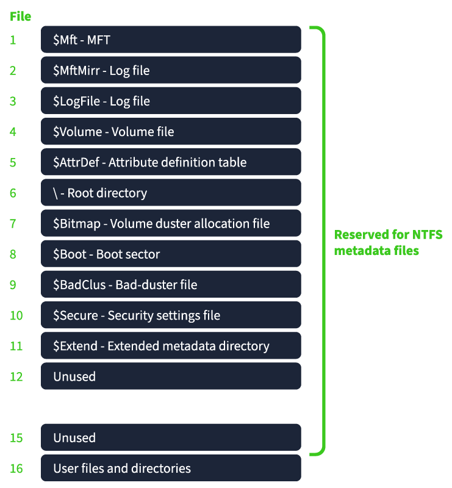
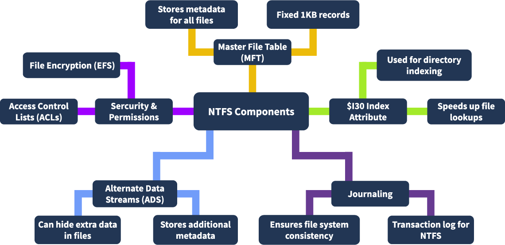
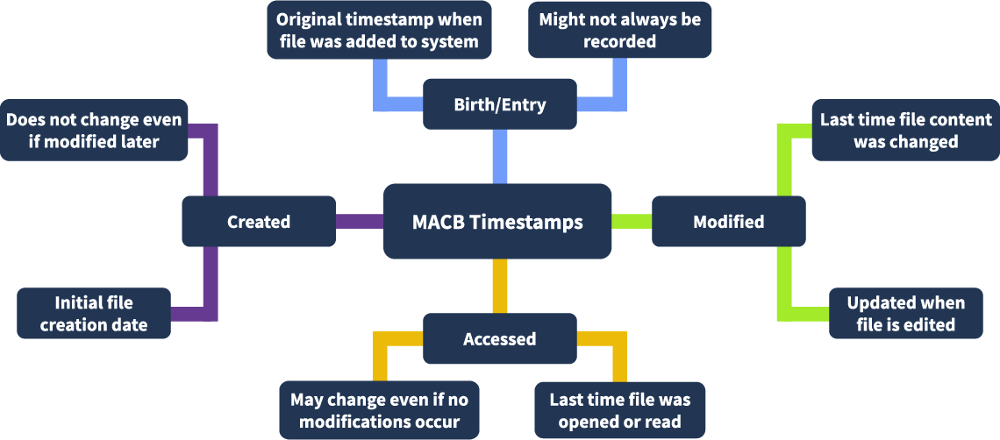

# NTFS analysis

Tools: FTK imager, `MFTECmd` , `FTK imager` , `TimeLine explorer`

## features of NTFS

* **Advanced Metadata:** NTFS maintains detailed metadata, including file creation, modification, and access times, which is invaluable for forensic investigations.
* **Journaling:** NTFS uses a journaling feature to keep track of changes. This feature helps recover data after crashes and provides a trail of file system activities. This can also be helpful for forensics investigations.
* **Security Features:** NTFS supports advanced security features like encryption (EFS) and permissions, which can be analyzed to understand access patterns and security breaches.
* **Large Volume Support:** NTFS can handle large volumes and files, making it suitable for modern storage needs.
* **Resilience:** NTFS is more resilient to corruption compared to older file systems like FAT32, thanks to its robust structure and recovery mechanisms.
* **Compatibility:** While primarily for Windows, NTFS can be read (and sometimes written) on Linux and macOS with third-party tools.
* **Compression:** It includes built-in file compression to save space.

## NTFS  file system structure

<figure><figcaption></figcaption></figure>

**$MFT :** Stores metadata records for every file and directory in the file system.\
**$MFTMirr** : A backup of the first few entries of the $MFT for recovery purposes.\
**$LogFile :** Contains a transaction log to maintain file system consistency.\
**$Bitmap :** Tracks which clusters on the volume are allocated or free.\
**$Boot :** Holds the Partition Boot Sector (PBS) and boot-related information.\
**$BadClus :** Keeps a record of bad clusters that should not be used.\
**$UpCase :** Stores uppercase character mappings for case-insensitive comparisons.\
**$Secure :** Manages file and folder security descriptors (ACLs).\
**$AttrDef :** Lists the attribute types supported by NTFS.\
**$Volume :** Contains metadata about the volume itself (e.g., version, label).\
**$Extend :** Directory containing additional system files like $ObjId, $Quota, and $Reparse.

## Partition Boot Sector (PBS)

The **Partition Boot Sector (PBS)** is located at **sector 0** of an NTFS partition. It is **not part of the NTFS file system** but exists before it.

It contains:

* Jump instruction to bootstrap code.
* Volume information such as:
  * Bytes per sector
  * size of cluster
  * Sectors per cluster
  * Location of the `$MFT` and `$MFTMirr`
* Ends with the signature `0x55AA`

### File Data Area

* **resident** data : its data may be stored **inside the MFT record**
* **non-resident:** its content is stored in **separate clusters**

### Alternate Data Stream

* A feature in NTFS that allows multiple data streams in a single file.
* ADS can store hidden or additional data without affecting the visible file size.

<figure><figcaption></figcaption></figure>

## NTFS Components

<figure><figcaption></figcaption></figure>

### Collecting the Artifacts

Earlier, we explored the key components of the NTFS. Let's use the FTK Imager to collect these logs and save the offline copy on the Desktop for further analysis. The components which we will need for the investigation are:

* $MFT (Master File Table)
* $LogFile
* $I30 (NTFS Index Attribute)
*   $Extend

    * $UsnJrn


***

## MFT Record Analysis

* **File Name:** The file's name or the directory contained within.
* **Standard Information**: Contains key information about the link count, timestamps, file attributes,
* **Attributes:** Metadata like MACB timestamp, attributes like Read-only, hidden, etc.
* **File Data:** This contains the actual data if the file is small enough to fit within the MFT record; otherwise, it points to the clusters where the data is stored.
* **File Index:** Index information that points to other files or directories.
* **Security Information**: ACL that defines the security permissions for the file or directory.

<figure><figcaption></figcaption></figure>

### Examining the MFT Record

used to parse and extract detailed metadata from the NTFS $MFT

```powershell
MFTECmd.exe -f C:\$MFT --csv C:\ --csvf C:\MFT_record.csv
```

* `-f` specifies the path to the `$MFT` file to be analyzed.
* `--csv` sets the folder where the output CSV will be saved.
* `--csvf` defines the name of the output CSV file

**important columns in the MFT record**

* **Entry Number**:\
  Unique ID for each MFT record; used to track individual files or directories.
* **Parent Entry Number**:\
  ID of the parent directory; helps reconstruct the folder structure.
* **Sequence Number**:\
  Increases when a record is reused; useful to detect reused/deleted entries.
* **File Name**:\
  The file or directory name; helps identify what was accessed or created.
* **Timestamps**:\
  Includes <mark style="color:red;">created, modified, accessed,</mark> and metadata change times; important for timeline analysis.
* **Flags**:\
  Shows if the record is a file, folder, or deleted; used to check object type and status.
* **Entry Flags**:\
  Attributes like <mark style="color:red;">Hidden, System, Read-only</mark>; useful to detect hidden/malicious files.
* **In Use**:\
  Indicates if the file is <mark style="color:red;">active or deleted</mark>; deleted files still have records here.
* **Logical Size**:\
  Actual data size in the file; can help identify if a file is fake or padded.
* **Physical Size**:\
  Disk space allocated; helps find slack space or fragmentation.

### MACB Time

* **M - Modified**: The time when the file's content was last changed.
* **A - Accessed**: The time when the file was last read or opened.
* **C - Changed (Metadata)**: The time when the file's metadata (e.g., permissions, ownership) was last altered.
* **B - Birth (Creation)**: The time when the file was first created (available in NTFS and other advanced file systems)

<figure><figcaption></figcaption></figure>

## NTFS Journaling

This technology allows the OS to maintain a transactional record of all changes made to a volume

### Types Of NTFS Journals

* **$LogFile:** It records metadata changes such as file creation, deletion, or modification before committing them to the disk
*   **$USNJrnl:** Universal Sequence Number (USN) Journal

    * **$Max**: Defines the maximum size of the journal and its allocation policy.
    * **$J**: Stores the actual change records. $J is the actual file we are interested in investigating.


<figure><figcaption></figcaption></figure>

