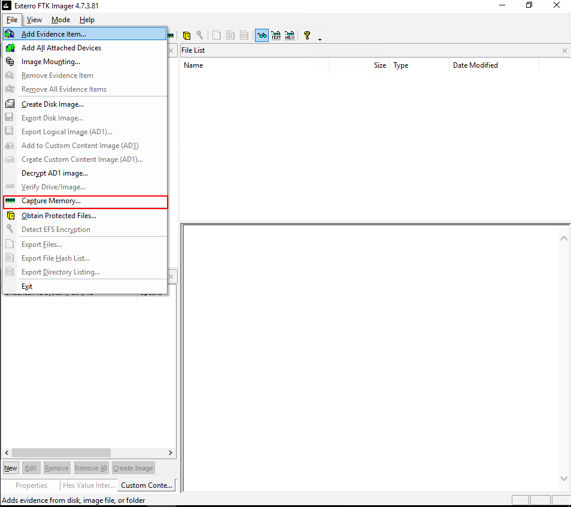

# Memory Acquisition

## Techniques, Tools and, Best Practices

#### Selecting the Right Memory Part

* **Unusual resource usage**: process dump
* **Malware infection**:  full memory capture to aid your investigation.
* **System shut down**:  the system went into hibernation instead, and you can acquire the `hiberfil.sys` file for analysis

#### File Format

* `.raw` and `.mem`: This format is a raw physical memory dump supported on most Operating Systems
* `.dmp`: This is the Windows built-in format for a memory dump
* VM formats (`.vmem`, `.vmsn`, `.vmss`, `.bin`, `.sav`): These files represent the memory state of a Virtual Machine
* `.core`: This is a process-level memory dump formatted in ELF in Linux using the `gcore` tool.
* `.lime`: This memory capture file is a structured full memory dump created with the LiME

#### Acquisition Technique

* **Local**: You take an external storage device, plug it into the target machine,
* **Remote**: You run the tools to acquire the memory and then transfer the memory capture over the network
* **Hardware**: You have installed a dedicated PCIe card that allows you to acquire memory without accessing the OS
* **RAM freezing**: RAM is volatile, and the content disappears in mere seconds after cutting the power.

## Memory Acquisition on Windows

### Full Memory Capture

* tool: FTK imager

step 1:

<figure><figcaption></figcaption></figure>

step2:

<figure><figcaption></figcaption></figure>

#### integrity of the captured file

```powershell
Get-FileHash -Path 'C:\Users\Administrator\Desktop\memdump.mem' -Algorithm MD5
```

#### Dumoit Tool

```powershell
DumpIt.exe 
```

### Process Memory Dump

* Tools: `procdump64.exe`&#x20;

```
 .\procdump64.exe -ma lsass.exe C:\Users\Administrator\Desktop -accepteula
```

#### integrity of the captured file

```
Get-FileHash -Path 'C:\Users\Administrator\Desktop\lsass.exe_250408_082640.dmp' -Algorithm MD5
```

### Crash Dump

Windows can be configured to create a memory dump during a system failure and save it to a specific location

**Steps to configure:**

1. Open **Run** and type `sysdm.cpl`.
2. In **System Properties**, go to the **Advanced** tab.
3. Under **Startup and Recovery**, click **Settings**.
4. In **System failure → Write debugging information**, choose the desired dump type.

<figure><figcaption></figcaption></figure>

<figure><figcaption></figcaption></figure>

## Memory Acquisition on Linux

### Full Memory Capture

* Tool: LIME

Install LiME

```bash
# first install necessary dependencies
sudo apt update
sudo apt install -y git build-essential linux-headers-$(uname -r)
# Clone the LiME repository
git clone https://github.com/504ensicsLabs/LiME.git
cd LiME/src
# compile LiME for use in kernel
make
```

Take Memory Dump

```bash
cd LiME/src
sudo insmod lime-6.8.0-1027-aws.ko "path=/tmp/ubuntu-150000-22042025.lime format=lime"
```

#### integrity of the captured file

```bash
md5sum tmp/ubuntu-150000-22042025.lime
```

### Process Memory dump

* Tool: gcore

Process Dump with gcore

```bash
      
 ps aux |grep bash # Search the PID number of the bash process
ubuntu     6506  0.0  0.2   5892  4096 pts/0    Ss   Apr11   0:00 bash
ubuntu    34136  0.0  0.1   3528  1792 pts/0    S+   13:57   0:00 grep --color=auto bash


sudo gcore -o /tmp/BASH-130000-10042025 6506 
    
```

Process Dump with gcore

```bash
md5sum /tmp/BASH-130000-10042025.6506 
```

### Crash dump

**Kernel crash dump**

* Enable kdump

```bash
# check status kernel crash dump utility
cat /proc/cmdline # This command verifies if the kernel crash dump is enabled or not.
crashkernel=2G-4G:320M,4G-32G:512M,32G-64G:1024M,64G-128G:2048M,128G-:4096M
# Install kdump (This is the kernel crash dump utitlity)
sudo apt install kdump-tools -y

# Reboot to enable the kdump tool
sudo -reboot

# Verify if the kdump tool is running
sudo kdump-config show
```

**Process crash dump**

configure the crash dump for systemd-managed processes

```bash
sudo mkdir -p /etc/systemd/system.conf.d
sudo nano /etc/systemd/system.conf.d/core-dumps.conf
# Add the following lines to the core-dumps.conf file and enter CTRL+o to save the file, then exit the editor by entering CTRL+x
[Manager]
DefaultLimitCORE=infinity

# Now reload the systemd service
sudo systemctl daemon-reexec
```

```bash
# Enable process dumps
ulimit -c unlimited

# Open the config file
sudo nano /etc/sysctl.d/60-core-pattern.conf

#Add the following lines to set naming template
kernel.core_pattern = /var/crash/core.%e.%p.%t
fs.suid_dumpable = 1

# Create the /var/crash folder and assign permissions if it does not exist yet
sudo mkdir -p /var/crash
sudo chmod 1777 /var/crash
```

