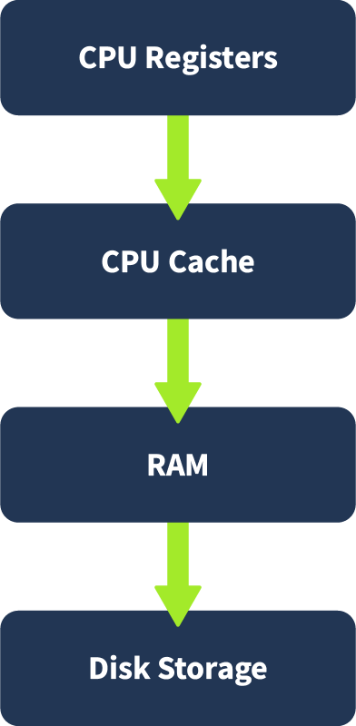
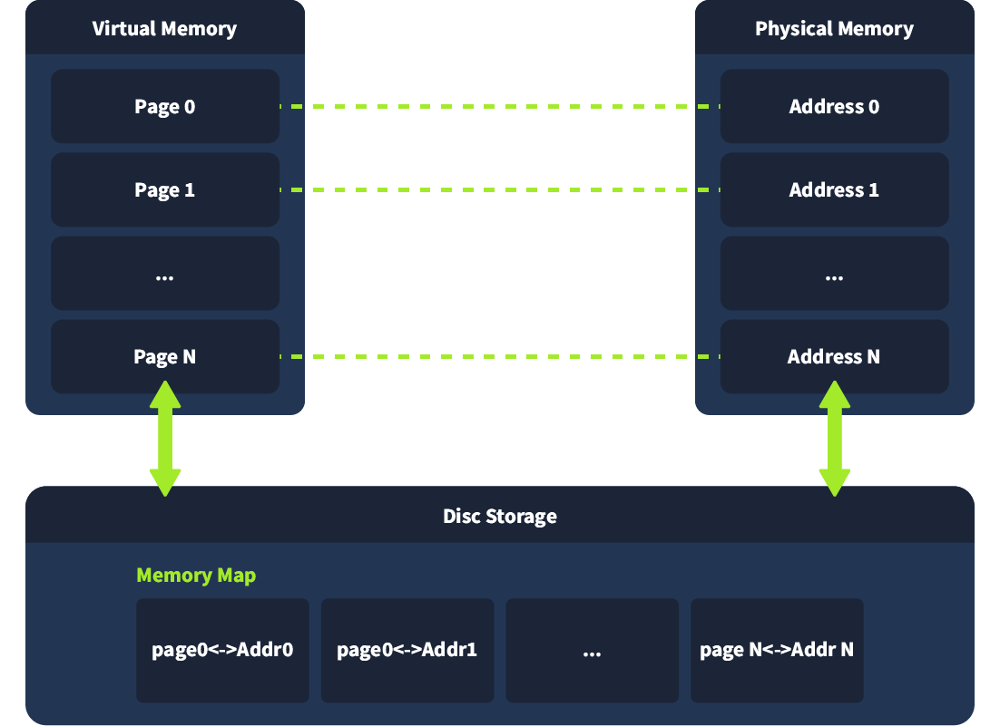

# Memory Analysis Introduction

### Volatile Memory Hierarchy

<figure><figcaption></figcaption></figure>

### RAM Structure

* **Kernel space** is reserved for the operating system and low-level services. It manages resources like device drivers and memory access.
* **User space** contains processes launched by the user or applications. Each process gets its own separate space, protected from others
  * **Stack** : Stores temporary data like function arguments and return addresses. It grows and shrinks as functions are called and returned.
  * **Heap** : Used for dynamic memory allocation during runtime, such as objects and buffers created by programs.
  * **Executable** (.text): Stores the actual code or instructions the CPU runs.
  * **Data sections:** Space to store global variables and other data the executable needs.

### Memory Map

**Memory Map** is a table maintained by the operating system that links **virtual memory addresses** (used by processes) to **physical memory addresses** (in RAM or swap space).

* **Purpose**:
  * Isolate processes for security.
  * Manage memory efficiently, allowing data to be moved between RAM and disk without affecting programs.
*   **Key Points**:

    * Each process has its own virtual address space.
    * The OS maps these virtual addresses to actual RAM or to disk-based **swap/page files** when RAM is full.
    * In forensics, parts of the memory map or its data can appear in files like `pagefile.sys` or `swapfile`, which may contain valuable artifacts such as encryption keys or commands.

<figure><figcaption></figcaption></figure>

### memory swap

**Memory Swap** (or **Swap Space**) is a reserved area on a disk that the operating system uses to store data moved from RAM when physical memory is full.

* **Purpose**:
  * Extend available memory beyond physical RAM.
  * Keep inactive memory pages on disk so active processes can use RAM.
*   **Key Points**:

    * Slower than RAM because it uses disk storage.
    * Allows systems to run more applications than RAM alone can handle.
    * In digital forensics, swap files (`pagefile.sys` in Windows, `swapfile` in Linux) can hold valuable evidence like fragments of documents, passwords, or malware code.

***

### How Memory Dumps are Created

**Creating a Memory Dump**

* **Goal**: Capture RAM contents with minimal changes during acquisition.

**Windows**:

* Built-in crash dumps → stored in `%SystemRoot%\MEMORY.DMP`.
* Hibernation file (`hiberfil.sys`) → snapshot of RAM during hibernate.
* Tools: Sysinternals RAMMap, WinPmem, FTK Imager.

**Linux/macOS**:

* Tools: LiME (Linux Memory Extractor), `dd` with `/dev/mem` or `/proc/kcore` (if kernel protections allow).

### Types of Memory Dumps

* Full Memory Dump
* Process Dump (Reverse Engineering)
* Pagefile / Swap Analysis
  * **Windows** (pagefile.sys)
  * **Linux** (swap partition)
* Hibernation File Analysis

### Challenges in Memory Acquisition

Attackers may deploy anti-forensics techniques

| Unlinked or hidden modules               | Malware may unlink itself from process lists, making it invisible to tools relying on typical OS queries.                                          |
| ---------------------------------------- | -------------------------------------------------------------------------------------------------------------------------------------------------- |
| DKOM (Direct Kernel Object Manipulation) | Alters kernel structures to hide processes, threads, or drivers from standard system tools.                                                        |
| Code injection                           | Malicious code is injected into legitimate processes (e.g., explorer.exe, svchost.exe) to blend in and evade detection.                            |
| Memory patching                          | Malware modifies memory content or system APIs at runtime to disrupt forensic tools or produce false data.                                         |
| Hooking APIs or system calls             | Intercepts and alters the output of critical functions (e.g., ReadProcessMemory, ZwQuerySystemInformation) to hide malicious behavior.             |
| Encrypted or packed payloads             | Payloads are kept encrypted or compressed in memory, only decrypting at execution time, making static analysis difficult.                          |
| Trigger-based payloads                   | Some memory-resident malware only unpacks or runs when specific conditions are met, limiting what analysts can capture during routine acquisition. |

***

### Memory-Based Threat Indicators

1. **Suspicious or malicious processes**
2. **Process Hollowing**
3. **API Hooking**
4. **Rootkits (Kernel Space)**
