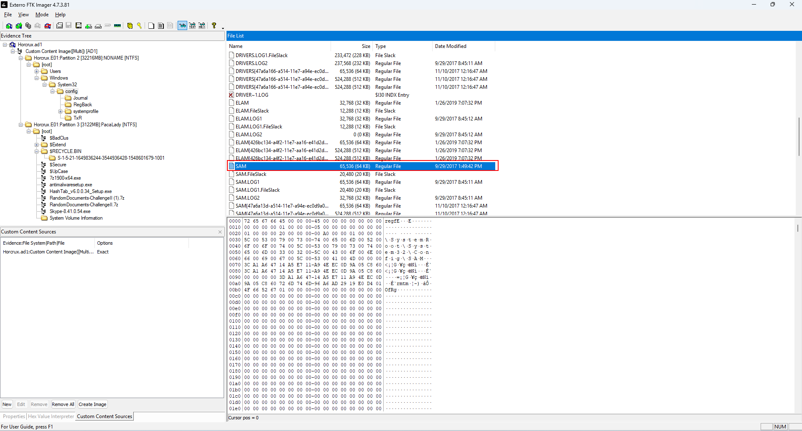
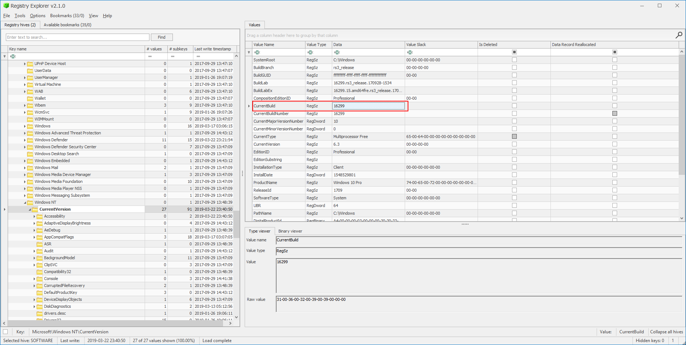
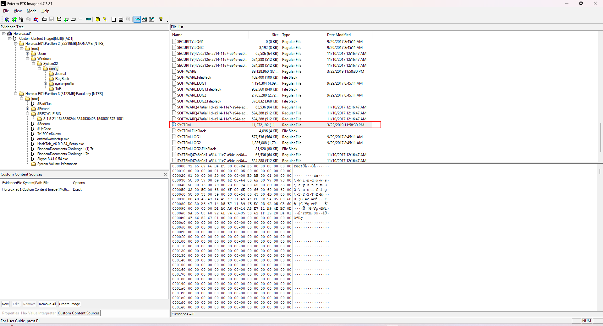
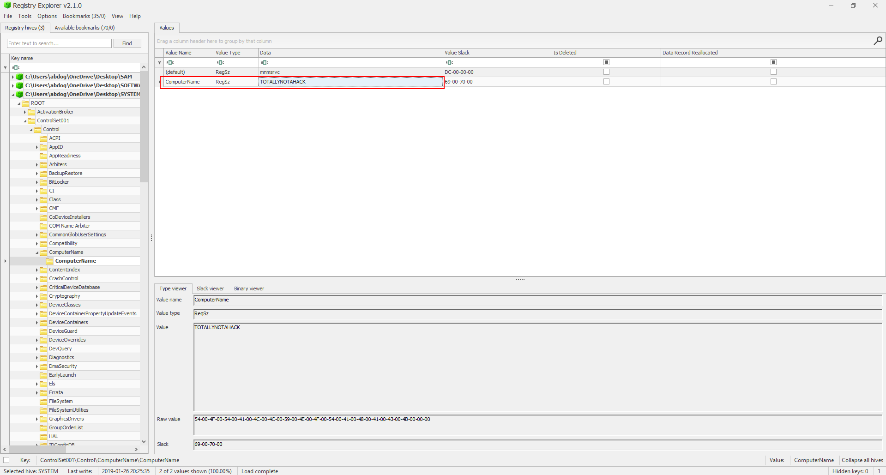
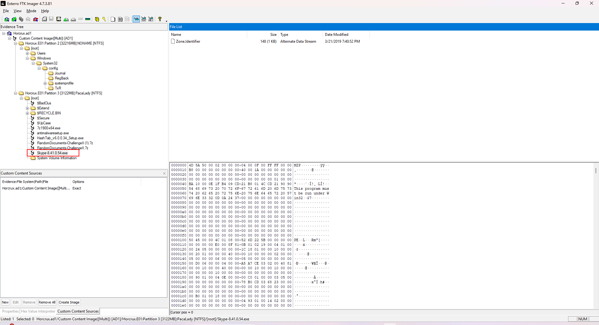

# HireMe Lab

Category: [Endpoint Forensics](https://cyberdefenders.org/blueteam-ctf-challenges/?categories=endpoint-forensics)

Tools: [FTK Imager](https://cyberdefenders.org/blueteam-ctf-challenges/?tools=ftk-imager) - [Autopsy](https://cyberdefenders.org/blueteam-ctf-challenges/?tools=autopsy) - [Registry Explorer](https://cyberdefenders.org/blueteam-ctf-challenges/?tools=registry-explorer) - [OST Viewer](https://cyberdefenders.org/blueteam-ctf-challenges/?tools=ost-viewer)

<details>

<summary><strong>Scenario</strong></summary>

Karen is a security professional looking for a new job. A company called "TAAUSAI" offered her a position and asked her to complete a couple of tasks to prove her technical competency. As a soc analyst Analyze the provided disk image and answer the questions based on your understanding of the cases she was assigned to investigate.

</details>

### **Q1:**&#x20;

#### What is the administrator's username?

**Step 1: Mount and Explore the Image**

* Open **FTK Imager**.
* Browse to the `.ad1` file and load it.
* Once loaded, navigate through the file structure to locate the `Windows\System32\Config` folder

**Step 2: Extract the SAM Hive**

* In `Config`, locate the file named **SAM** (no file extension).
* Right-click on it and choose `Export File`.
* Save it locally as `SAM`

**Step 3: Analyze the SAM Hive**

* Open **Registry Explorer**.
* Go to `File > Load Hive`, and select the extracted `SAM` file.
* The tool will prompt for a key name — you can name it anything (e.g., `SAM-Hive`).
* Now you can browse the structure and investigate:
  * `SAM\Domains\Account\Users\Names` — to view local user accounts.
  * Each user has a corresponding RID under `Users`.

<figure><figcaption></figcaption></figure>

<figure><figcaption></figcaption></figure>


Ans: karen


***

### Q2:&#x20;

#### What is the OS's build number?


* Go to `File > Add Evidence Item` and choose `Image File`.
* Open **FTK Imager** and load the `.ad1` image file.
*   Navigate to the following path inside the image:

    ```
    Windows\System32\Config\SOFTWARE
    ```
* Right-click on the `SOFTWARE` file and select **Export File** to extract the registry hive.
* Open **Registry Explorer** and go to:

```
File > Load Hive
```

* In the Registry Explorer, navigate to the following key:

```
Microsoft\Windows NT\CurrentVersion
```

* Look for the value named:
  * **CurrentBuildNumber**
* The data under `CurrentBuildNumber` is the **OS Build Number**

<figure><figcaption></figcaption></figure>

<figure><figcaption></figcaption></figure>


Ans: 16299


***

### _**Q3**_:&#x20;

#### What is the hostname of the computer?

**Steps:**

* Open **FTK Imager** and load the `.ad1` image file.
*   Navigate to the following path inside the image:

    ```
    Windows\System32\Config\SYSTEM
    ```
* Right-click on the `SYSTEM` file and **Export** it.
* Open **Registry Explorer**, then go to

```
File > Load Hive
```

* Navigate to the following registry path:

```
ControlSet001\Control\ComputerName\ComputerName
```

* Look for the value named:
  * **ComputerName**
* The data under that key is the **Hostname** of the system.

<figure><figcaption></figcaption></figure>

<figure><figcaption></figcaption></figure>


Ans: totallynotahack


***

### _**Q4:**_&#x20;

#### A messaging application was used to communicate with a fellow Alpaca enthusiest. What is the name of the software?

<figure><figcaption></figcaption></figure>


Ans: skype


***

### _**Q5:**_

#### What is the zip code of the administrator's post?

To retrieve browser-related information such as saved data and browsing history, we need to examine the file where **Google Chrome** stores its user data.

```
[root]\Users\Karen\AppData\Local\Google\Chrome\User Data\Default\Web Data
```

<figure><figcaption></figcaption></figure>


Ans: 19709


***

### Q6:

#### What are the initials of the person who contacted the admin user from TAAUSAI?

1. **Extracted the .ost file** from the image using **FTK Imager** by navigating to the appropriate user path (usually under `AppData\Local\Microsoft\Outlook`).
2. **Opened the extracted .ost file** using **Kernel OST Viewer**, a tool that allows previewing emails without requiring Outlook.
3. **Searched within the mailbox** for any email communications related to **TAAUSAI** by using the search function or manually reviewing folders like Inbox, Sent Items, or other relevant folders.
4. **Identified the sender** from TAAUSAI who had contacted the Admin user. The sender's name was found in the "From" field of the email.
5. **Noted the initials** of the sender’s name by taking the first letter of the first name and the first letter of the last name.

<figure><figcaption></figcaption></figure>

<figure><figcaption></figcaption></figure>


Ans: MS


***

### Q7:

#### How much money was TAAUSAI willing to pay upfront?

<figure><figcaption></figcaption></figure>


Ans: 15000


***

### Q8: &#x20;

#### What country is the admin user meeting the hacker group in?

<figure><figcaption></figcaption></figure>


Ans: Egypt


***

### Q9:

#### What is the machine's timezone? (Use the three-letter abbreviation)

* **Opened the hive** using **Registry Explorer** or any other registry viewer tool.
* Navigated to the following registry path:

```
ControlSet001\Control\TimeZoneInformation
```

* Located the value named `TimeZoneKeyName`, which contains the **timezone name**.

<figure><figcaption></figcaption></figure>


Ans: UTC


***

### Q10:&#x20;

#### When was AlpacaCare.docx last accessed?

<figure><figcaption></figcaption></figure>


Ans: 03/17/2019 09:52 PM


***

### Q11:

#### There was a second partition on the drive. What is the letter assigned to it?

* **Opened the hive** using **Registry Explorer** or any other registry viewer tool.
* Navigated to the following registry path:

```
SYSTEM\MountedDevices
```

<figure><figcaption></figcaption></figure>


Ans: A


***

### Q12:

#### What is the answer to the question Company's manager asked Karen?

<figure><figcaption></figcaption></figure>


Ans: TheCardCriesNoMore


***

### Q13:

#### What is the job position offered to Karen? (3 words, 2 spaces in between)

<figure><figcaption></figcaption></figure>


Ans: cyber security analyst


***

### Q14:

#### When was the admin user password last changed?

<figure><figcaption></figcaption></figure>


Ans: 03/21/2019 19:13:09


***

### Q15:

#### What version of Chrome is installed on the machine?

<figure><figcaption></figcaption></figure>


Ans: 72.0.3626.121


***

### Q16

#### What is the URL used to download Skype?

Location of History is: "\[root]\Users\Karen\AppData\Local\Google\Chrome\User Data\Default\History"

open file by sqlite

<figure><figcaption></figcaption></figure>


Ans: [https://download.skype.com/s4l/download/win/Skype-8.41.0.54.exe](https://download.skype.com/s4l/download/win/Skype-8.41.0.54.exe)


***

### Q17:&#x20;

#### What is the domain name of the website Karen browsed on Alpaca care that the file AlpacaCare.docx is based on?

<figure><figcaption></figcaption></figure>


Ans: palominoalpacafarm.com


***

<details>

<summary>Summary</summary>


#### **SAM Hive (Security Account Manager)**

* **Description**: A component of the **Windows Registry** that stores local user account information, including encrypted passwords (in NTLM or LM hash formats)..

***

#### 2. **System Hive**

* **Description**: A **Windows Registry** file containing global system settings, such as hardware configurations, system services, and boot parameters.

***

#### 3. **Software Hive**

* **Description**: A **Windows Registry** file storing installed software configurations and system-wide application settings.

***

#### 4. **Web Data File**

* **Description**: Files storing internet browsing data (e.g., cookies, history, cache), often in **SQLite** format.

***

#### 5. **OST & PST Mail Files**

* **OST (Offline Storage Table)**:
  * **Description**: Created by **Microsoft Outlook** to synchronize emails offline with an Exchange server.
* **PST (Personal Storage Table)**:
  * **Description**: Stores emails, contacts, and calendar entries locally on a user’s device.

***

#### 6. **AD1 File Extension**

* **Description**: A proprietary forensic image format used by **AccessData FTK** to store encrypted disk images or case data.

***

#### 7. **Download File in Browser**

* **Description**: Files downloaded via browsers (e.g., Chrome, Firefox) and stored in default folders (e.g., `Downloads`, `Temp`).

8. **Browser History file**
   * **Description** :Browser History Tracks URLs visited, timestamps, and downloaded files (e.g., `History` SQLite files in Chrome/Firefox).

</details>
