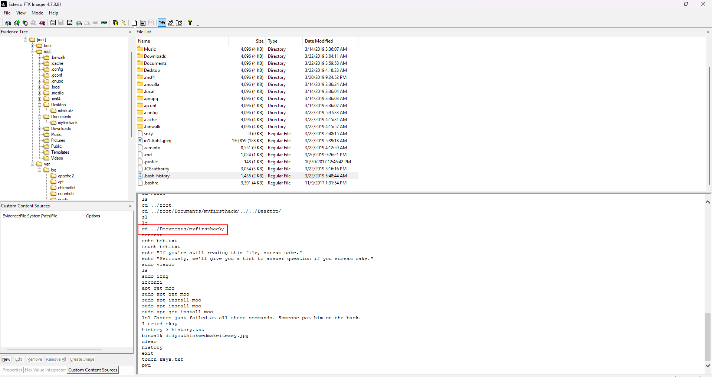

# Insider Lab

Category:[Endpoint Forensics](https://cyberdefenders.org/blueteam-ctf-challenges/?categories=endpoint-forensics)

Tactics: [Execution](https://cyberdefenders.org/blueteam-ctf-challenges/?tactics=execution) [Credential Access](https://cyberdefenders.org/blueteam-ctf-challenges/?tactics=credential-access)

Tool: [FTK Imager](https://cyberdefenders.org/blueteam-ctf-challenges/?tools=ftk-imager)

<details>

<summary><strong>Scenario</strong></summary>

After Karen started working for 'TAAUSAI,' she began doing illegal activities inside the company. 'TAAUSAI' hired you as a soc analyst to kick off an investigation on this case.

You acquired a disk image and found that Karen uses Linux OS on her machine. Analyze the disk image of Karen's computer and answer the provided questions

</details>

<details>

<summary><strong>Questions</strong></summary>

### Q1: Which Linux distribution is being used on this machine?

<figure><figcaption></figcaption></figure>

```
Ans: kali
```

### Q2: What is the MD5 hash of the Apache **access.log** file?

<figure><figcaption></figcaption></figure>

<figure><figcaption></figcaption></figure>

```
Ans: d41d8cd98f00b204e9800998ecf8427e
```

### Q3: It is suspected that a credential dumping tool was downloaded. What is the name of the downloaded file?

<figure><figcaption></figcaption></figure>

```
Ans: mimikatz_trunk.zip
```

### Q4: A super-secret file was created. What is the absolute path to this file?

<figure><figcaption></figcaption></figure>

```
Ans: /root/Desktop/SuperSecretFile.txt
```

### Q5: What program used the file **didyouthinkwedmakeiteasy.jpg** during its execution?

<figure><figcaption></figcaption></figure>

```
Ans: binwalk 
```

### Q6: What is the third goal from the checklist Karen created?

<figure><figcaption></figcaption></figure>

```
Ans: Profit
```

### Q7: How many times was Apache run?

<figure><figcaption></figcaption></figure>

```
Ans: 0
```

### Q8: This machine was used to launch an attack on another. Which file contains the evidence for this?

<figure><figcaption></figcaption></figure>

```
Ans: irZLAohL.jpeg
```

### Q9: It is believed that Karen was taunting a fellow computer expert through a bash script within the Documents directory. Who was the expert that Karen was taunting?

<figure><figcaption></figcaption></figure>

```
Ans: Young
```

### Q10: A user executed the **su** command to gain root access multiple times at 11:26. Who was the user?

<figure><figcaption></figcaption></figure>

```
Ans: postgres
```

### Q11: Based on the bash history, what is the current working directory?

<figure><figcaption></figcaption></figure>

```
Ans: /root/Documents/myfirsthack/
```


</details>

