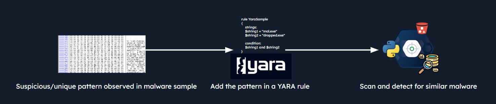
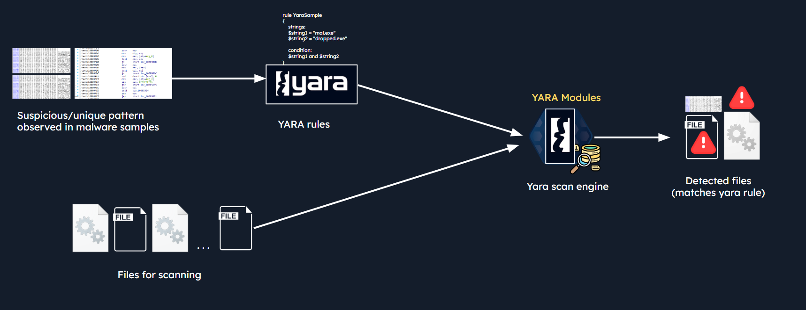
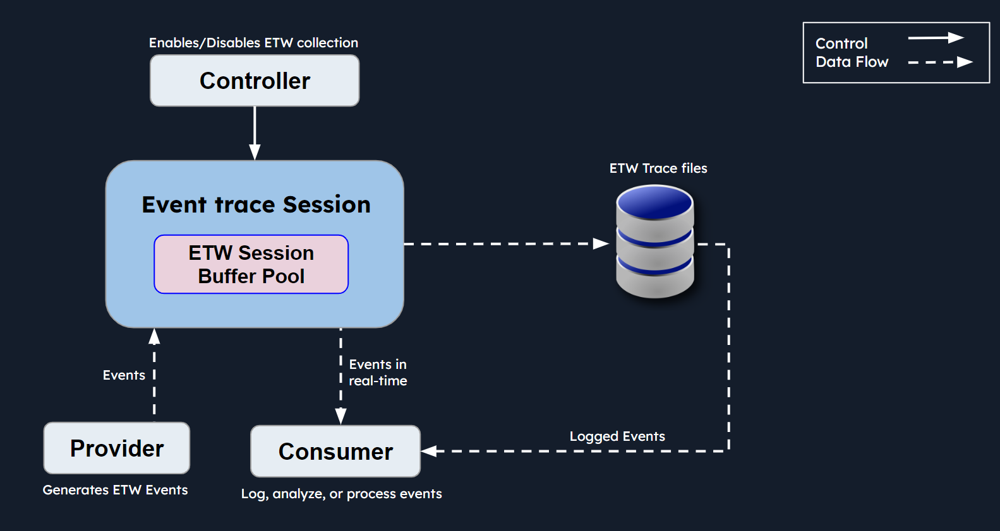
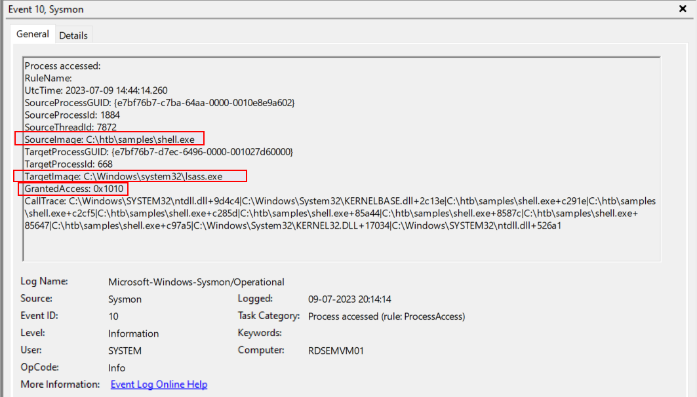

# Introduction to YARA & Sigma

## YARA and YARA Rules

<figure><figcaption></figcaption></figure>

### Usages of Yara

* **`Malware Detection and Classification`**
* **`Create Custom Security Solutions`**
* **`File Analysis and Classification`**
* **`Custom Yara Signatures/Rules`**
* **`Proactive Threat Hunting`**

### How Does YARA Work?

<figure><figcaption></figcaption></figure>

### YARA Rule Structure

```yaml
rule my_rule {

    meta:
        author = "Author Name"
        description = "example rule"
        hash = ""
    
    strings: 
        $string1 = "test"
        $string2 = "rule"
        $string3 = "htb"

    condition: 
        all of them     ## or one of them or of ($string1, $string2) 1
} 
```

## Developing YARA Rules manual

1. frist step string analysis

```
strings svchost.exe

!This program cannot be run in DOS mode.
UPX0
UPX1
UPX2
3.96
UPX!
8MZu
KERNEL32.DLL
msvcrt.dll
ExitProcess
GetProcAddress
LoadLibraryA
VirtualProtect
exit
```

> UPX (Ultimate Packer for eXecutables)&#x20;

2. create YARA rule targeting samples packed via UPX.

```yaml
rule UPX_packed_executable
{
    meta:
    description = "Detects UPX-packed executables"

    strings: 
    $string_1 = "UPX0"
    $string_2 = "UPX1"
    $string_3 = "UPX2"

    condition:
    all of them
}
```

### Developing a YARA Rule Through yarGen

1. install YarGen

```
git clone https://github.com/Neo23x0/yarGen.git
pip install -r requirements.txt
python yarGen.py --update
```

2. Put a sample file in temp directory
3. create YARA rule

```
python3 yarGen.py -m /home/htb-student/temp -o htb_sample.yar
```

### Manually Developing a YARA Rule

**Example 1: ZoxPNG RAT Used by APT17**

We want to develop a YARA rule to scan for a specific variation of the `ZoxPNG`R AT used by `APT17` based on:

* String analysis
* Imphash
* Common sample file size

```yaml
// Some codeimport "pe"

rule APT17_Malware_Oct17_Gen {
   meta:
      description = "Detects APT17 malware"
      license = "Detection Rule License 1.1 https://github.com/Neo23x0/signature-base/blob/master/LICENSE"
      author = "Florian Roth (Nextron Systems)"
      reference = "https://goo.gl/puVc9q"
      date = "2017-10-03"
      hash1 = "0375b4216334c85a4b29441a3d37e61d7797c2e1cb94b14cf6292449fb25c7b2"
      hash2 = "07f93e49c7015b68e2542fc591ad2b4a1bc01349f79d48db67c53938ad4b525d"
      hash3 = "ee362a8161bd442073775363bf5fa1305abac2ce39b903d63df0d7121ba60550"
   strings:
      $x1 = "Mozilla/4.0 (compatible; MSIE 8.0; Windows NT 6.1; WOW64; Trident/4.0; SLCC2; .NETCLR 2.0.50727)" fullword ascii
      $x2 = "http://%s/imgres?q=A380&hl=en-US&sa=X&biw=1440&bih=809&tbm=isus&tbnid=aLW4-J8Q1lmYBM" ascii

      $s1 = "hWritePipe2 Error:%d" fullword ascii
      $s2 = "Not Support This Function!" fullword ascii
      $s3 = "Cookie: SESSIONID=%s" fullword ascii
      $s4 = "http://0.0.0.0/1" fullword ascii
      $s5 = "Content-Type: image/x-png" fullword ascii
      $s6 = "Accept-Language: en-US" fullword ascii
      $s7 = "IISCMD Error:%d" fullword ascii
      $s8 = "[IISEND=0x%08X][Recv:] 0x%08X %s" fullword ascii
   condition:
      ( uint16(0) == 0x5a4d and filesize < 200KB and (
            pe.imphash() == "414bbd566b700ea021cfae3ad8f4d9b9" or
            1 of ($x*) or
            6 of them
         )
      )
}
```

***

## Hunting Evil with YARA (Windows Edition)

### Hunting for Malicious Executables on Disk&#x20;

```
yara64.exe -s C:\Rules\yara\dharma_ransomware.yar C:\Samples\YARASigma\ -r 2>null
```

* -s : Yara rules file&#x20;
* -r : recursive scan&#x20;

### Hunting for Evil Within Running Processes

1. hunt for all PID

```powershell
Get-Process | ForEach-Object {
 "Scanning with Yara for meterpreter shellcode on PID "+$_.id;
  & "yara64.exe" "C:\Rules\yara\meterpreter_shellcode.yar" $_.id 
 }
```

2. specific PID

```powershell
yara64.exe C:\Rules\yara\meterpreter_shellcode.yar 9084 --print-strings
```

### Hunting for Evil Within ETW Data with YARA

* `Controllers :`  SilkETW, Logman
* `Providers :`  Microsoft-Windows-Kernel-Process .. etc
* `Consumers :`   YARA engines , SIEM

<figure><figcaption></figcaption></figure>

### **YARA Rule Scanning on ETW (Using SilkETW)**


***

## Developing Sigma Rules

**Example 1: LSASS Credential Dumping**

<figure><figcaption></figcaption></figure>

```yaml
title: LSASS Access with rare GrantedAccess flag 
status: experimental
description: This rule will detect when a process tries to access LSASS memory with suspicious access flag 0x1010
date: 2023/07/08
tags:
    - attack.credential_access
    - attack.t1003.001
logsource:
    category: process_access
    product: windows
detection:
    selection:
        TargetImage|endswith: '\lsass.exe'
        GrantedAccess|endswith: '0x1010'
    condition: selection
```

* convert sigma rule to powershell query (sigmac)

```powershell
PS C:\Tools\sigma-0.21\tools> python sigmac -t powershell 'C:\Rules\sigma\proc_access_win_lsass_access.yml'
Get-WinEvent | where {($_.ID -eq "10" -and $_.message -match "TargetImage.*.*\\lsass.exe" -and $_.message -match "GrantedAccess.*.*0x1010") } | select TimeCreated,Id,RecordId,ProcessId,MachineName,Message
```

* Hunt to log file by powershell

```
Get-WinEvent -Path C:\Events\YARASigma\lab_events.evtx | where {($_.ID -eq "10" -and $_.message -match "TargetImage.*.*\\lsass.exe" -and $_.message -match "GrantedAccess.*.*0x1010") } | select TimeCreated,Id,RecordId,ProcessId,MachineName,Message
```

## Hunting Evil with Sigma (Chainsaw Edition)

**Example 1: Hunting for Multiple Failed Logins From Single Source With Sigma**

```cmd
\chainsaw_x86_64-pc-windows-msvc.exe hunt C:\Events\YARASigma\lab_events_5.evtx -s C:\Rules\sigma\win_security_susp_failed_logons_single_source2.yml --mapping .\mappings\sigma-event-logs-all.yml
```

<figure><figcaption></figcaption></figure>

## Hunting Evil with Sigma (Splunk Edition)

**Example 1: Hunting for MiniDump Function Abuse to Dump LSASS's Memory (comsvcs.dll via rundll32)**

```
PS C:\Tools\sigma-0.21\tools> python sigmac -t splunk C:\Tools\chainsaw\sigma\rules\windows\process_access\proc_access_win_lsass_dump_comsvcs_dll.yml -c .\config\splunk-windows.yml
(TargetImage="*\\lsass.exe" SourceImage="C:\\Windows\\System32\\rundll32.exe" CallTrace="*comsvcs.dll*")
```

**Example 2: Hunting for Notepad Spawning Suspicious Child Process**

```
PS C:\Tools\sigma-0.21\tools> python sigmac -t splunk C:\Rules\sigma\proc_creation_win_notepad_susp_child.yml -c .\config\splunk-windows.yml
(ParentImage="*\\notepad.exe" (Image="*\\powershell.exe" OR Image="*\\pwsh.exe" OR Image="*\\cmd.exe" OR Image="*\\mshta.exe" OR Image="*\\cscript.exe" OR Image="*\\wscript.exe" OR Image="*\\taskkill.exe" OR Image="*\\regsvr32.exe" OR Image="*\\rundll32.exe" OR Image="*\\calc.exe"))
```


**Example 1: YARA Rule Scanning on Microsoft-Windows-PowerShell ETW Data**

```
.\SilkETW.exe `
-t user `
-pn Microsoft-Windows-PowerShell `
-ot file `
-p ./etw_ps_logs.json `
-l verbose `
-y C:\Rules\yara '
-yo Matches

```

**Example 2: YARA Rule Scanning on Microsoft-Windows-DNS-Client ETW Data**

```
.\SilkETW.exe `
-t user `
-pn Microsoft-Windows-DNS-Client `
-ot file `
-p ./etw_dns_logs.json `
-l verbose `
-y C:\Rules\yara  `
-yo Matches
```

