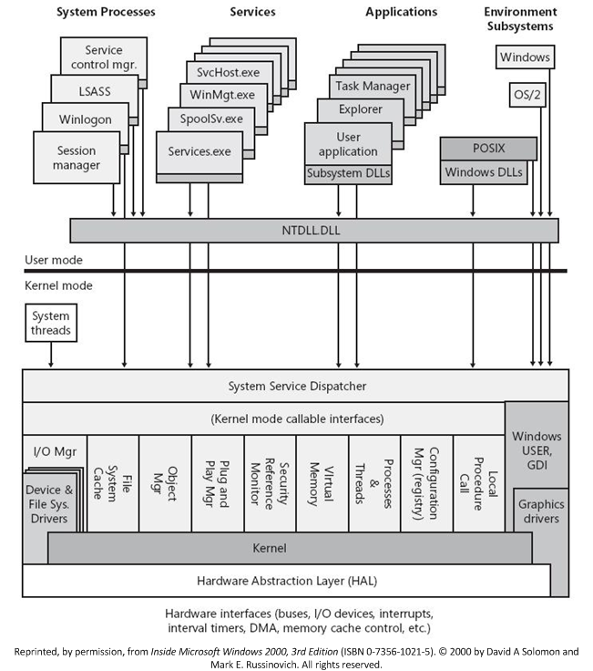
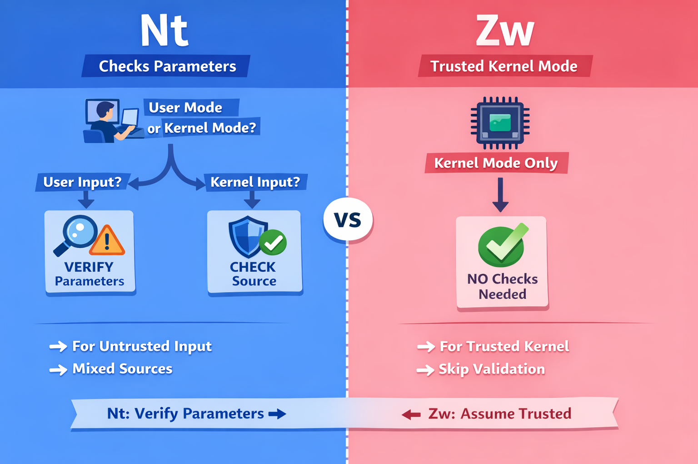
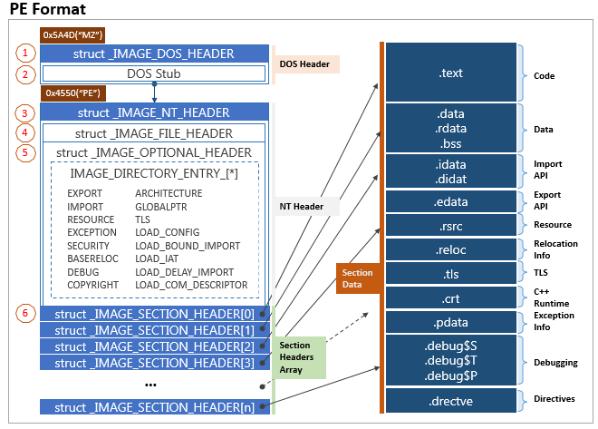
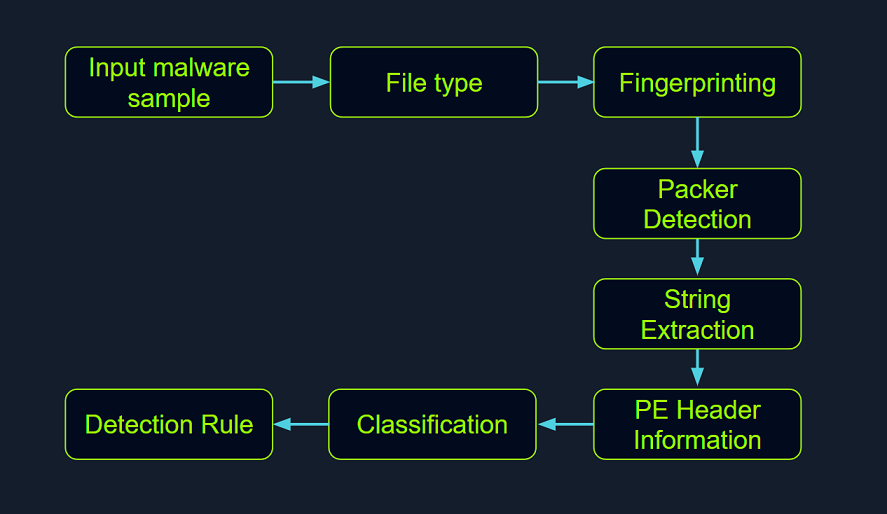
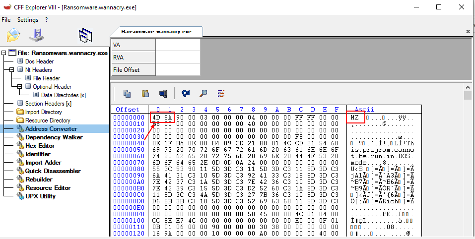
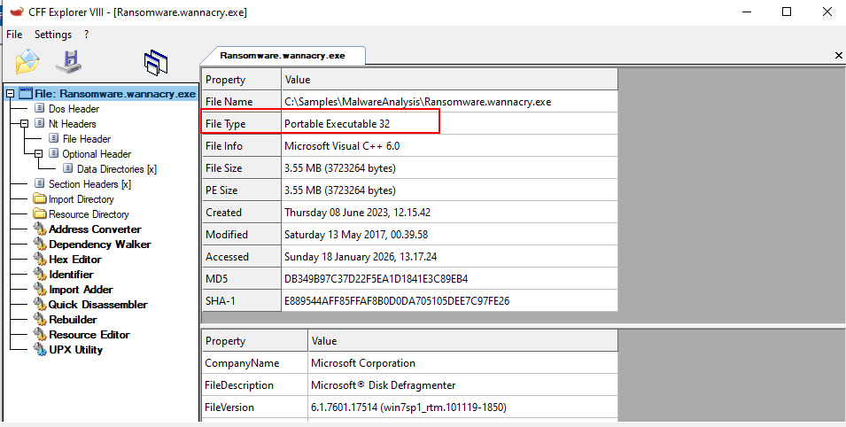

# Malware Analysis

### Malware Analysis Definition

1. Static Analysis
2. Dynamic Analysis
3. Code Analysis
4. Memory Analysis
5. Malware Unpacking

### User-mode Components

1. System Support Processes
   1. `winlogon.exe`  `smss.exe`  `services.exe`
2. Service Processes
   1. `Windows Update Service`   `Task Scheduler`   `Print Spooler`&#x20;
3. User Applications
4. Environment Subsystems
   1. `Win32 Subsystem`   `POSIX`
5. Subsystem DLLs
   1. `NTDLL.DLL`  `kernelbase.dll`  `kernelbase.dll`   `user32.dll`  `wininet.dll` `advapi32.dll`

### Kernel-mode Components

1. Executive
   1. `I/O Manager`, `Object Manager`, `Security Reference Monitor`, `Process Manager`,
2. microKernel
   1. `thread scheduling`, `interrupt and exception dispatching`, and `multiprocessor synchronization`
3. `Device Drivers`
4. `Hardware Abstraction Layer (HAL)`
5. `Windowing and Graphics System (Win32k.sys)`

<figure><figcaption></figcaption></figure>

Windows API Call Flow

<pre><code>User App
<strong> → kernel32.dll (WinAPI)    #ReadProcessMemory(...)
</strong><strong> → ntdll.dll  (NativeAPI)   #call NtReadVirtualMemory
</strong><strong> → syscall                  #ZwReadVirtualMemory
</strong> → Kernel (NtReadVirtualMemory)
 → 
</code></pre>

#### Nt vs Zw

<figure><figcaption></figcaption></figure>

#### Hooking


### Portable Executable

* Windows operating systems employ the `Portable Executable (PE)` format to encapsulate executable programs, `DLLs (Dynamic Link Libraries`
* data types including `executables (.exe)`, `dynamic link libraries (.dll)`, `kernel modules (.srv)`, `control panel applications (.cpl)`

#### PE Structure

<figure><figcaption></figcaption></figure>

#### PE Sections

* `Text Section (.text)`: The hub where the executable code of the program resides.
* `Data Section (.data)`: A storage for initialized **global and static data variables.**
* `Read-only initialized data (.rdata)`: Houses **read-only data such as constant values**, string literals, and initialized global and static variables.
* `Exception information (.pdata)`: A collection of function table entries utilized for exception handling.
* `BSS Section (.bss)`: Holds uninitialized global and static data variables.
* `Resource Section (.rsrc)`: Safeguards resources such as images, icons, strings, and version information.
* `Import Section (.idata)`: Details about functions imported from other DLLs.
* `Export Section (.edata)`: Information about functions exported by the executable.
* `Relocation Section (.reloc)`: Details for relocating the executable's code and data when loaded at a different memory address.

***

## Static Analysis On Linux

<figure><figcaption></figcaption></figure>

1. Identifying The File Type

```
file Ransomware.wannacry.exe
```

```
hexdump -C Ransomware.wannacry.exe | more
```

> On a Windows system, the presence of the ASCII string `MZ` (in hexadecimal: `4D 5A`)

### Malware Fingerprinting&#x20;

```
md5sum Ransomware.wannacry.exe
```

```
sha256sum Ransomware.wannacry.exe
```

2. File Hash Lookup

> [VirusTotal](https://www.virustotal.com/gui/home/search) after the SHA256 file hash

3. Import Hashing (IMPHASH)

```python
import sys
import pefile
import peutils

pe_file = sys.argv[1]
pe = pefile.PE(pe_file)
imphash = pe.get_imphash()

print(imphash)
```

```
python3 imphash_calc.py Ransomware.wannacry.exe
```

<figure><figcaption></figcaption></figure>

4. Fuzzy Hashing (SSDEEP)

```
ssdeep Ransomware.wannacry.exe
```

* initiate matching mode in `SSDEEP`

```
ssdeep -pb *
```

<figure><figcaption></figcaption></figure>

5. Section Hashing

```python
import sys
import pefile
pe_file = sys.argv[1]
pe = pefile.PE(pe_file)
for section in pe.sections:
    print (section.Name, "MD5 hash:", section.get_hash_md5())
    print (section.Name, "SHA256 hash:", section.get_hash_sha256())

```

```
python3 section_hashing.py Ransomware.wannacry.exe
```

<figure><figcaption></figcaption></figure>

### String Analysis

* Embedded filenames (e.g., dropped files)
* IP addresses or domain names
* Registry paths or keys
* Windows API functions
* Command-line arguments
* Unique information that might hint at a particular threat actor

```
strings -n 15 dharma_sample.exe
```

```
floss dharma_sample.exe
```

### Unpacking UPX-packed Malware

```
upx -d -o unpacked_credential_stealer.exe credential_stealer.exe
```

***

## Static Analysis On Windows

1. Identifying The File Type

<div><figure><figcaption></figcaption></figure> <figure><figcaption></figcaption></figure></div>

2. ### Malware Fingerprinting

```
Get-FileHash -Algorithm MD5 Ransomware.wannacry.exe
Get-FileHash -Algorithm SHA256 Ransomware.wannacry.exe
```
