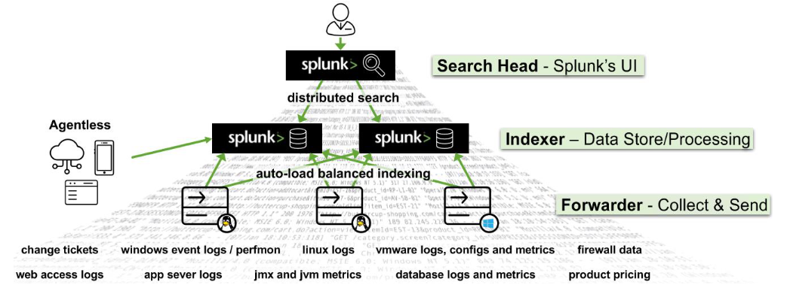

# Splunk

## Splunk Architecture

*   **Forwarders**: Forwarders are responsible for data collection.

    * `Universal Forwarder (UF)`: This is a lightweight agent that collects data and forwards
    * `Heavy Forwarder (HF)`: This agent serves the purpose of collecting data from remote sources,
    * `HTTP Event Collectors (HECs)` available for directly collecting data from applications in a scalable manner


* **Indexers**: The indexers receive data from the forwarders, organize it, and store it in indexes. While indexing data
* **Search Heads**: Search heads coordinate search jobs
* **Deployment Server**: It manages the configuration for forwarders

<figure><figcaption></figcaption></figure>

### Splunk As A SIEM Solution

1. **Basic Searching**

```splunk
index="main" "*UNKNOWN*"
```

2. **Fields and Comparison Operators**

```splunk
index="main" EventCode!=1
```

3. **The fields command**

```splunk
index="main" sourcetype="WinEventLog:Sysmon" EventCode=1 | fields - User
```

4. **The table command**

```splunk
index="main" sourcetype="WinEventLog:Sysmon" EventCode=1 | table _time, host, Image
```

5. **The rename command**

```splunk
index="main" sourcetype="WinEventLog:Sysmon" EventCode=1 | rename Image as Process
```

6. **The dedup command**

```splunk
index="main" sourcetype="WinEventLog:Sysmon" EventCode=1 | dedup Image
```

7. **The sort command**

```splunk
index="main" sourcetype="WinEventLog:Sysmon" EventCode=1 | sort - _time
```

8. **The stats command**

```splunk
index="main" sourcetype="WinEventLog:Sysmon" EventCode=3 | stats count by _time, Image
```

9. **The chart command**

```splunk
index="main" sourcetype="WinEventLog:Sysmon" EventCode=3 | chart count by _time, Image
```

10. **The eval command**

```splunk
index="main" sourcetype="WinEventLog:Sysmon" EventCode=1 | eval Process_Path=lower(Image)
```

11. **The rex command**

```splunk
	index="main" EventCode=4662 | rex max_match=0 "[^%](?<guid>{.*})" | table guid
```

12. **The lookup command**

```splunk
index="main" sourcetype="WinEventLog:Sysmon" EventCode=1 
| rex field=Image "(?P<filename>[^\\\]+)$" 
| eval filename=lower(filename) 
| lookup malware_lookup.csv filename OUTPUTNEW is_malware 
| table filename, is_malware

```

13. **The inputlookup command**

```splunk
| inputlookup malware_lookup.csv
```

14.**Time Range**

```splunk
index="main" earliest=-7d EventCode!=1
```

15. **The transaction command**

```splunk
index="main" sourcetype="WinEventLog:Sysmon" (EventCode=1 OR EventCode=3) 
| transaction Image startswith=eval(EventCode=1) endswith=eval(EventCode=3) maxspan=1m 
| table Image 
| dedup Image

```

16. **Subsearches**

```splunk
index="main" sourcetype="WinEventLog:Sysmon" EventCode=1 
NOT [ 
    search index="main" sourcetype="WinEventLog:Sysmon" EventCode=1 
    | top limit=100 Image 
    | fields Image 
] 
| table _time, Image, CommandLine, User, ComputerName

```

***

## How To Identify The Available Data

1. **Indexes**

```splunk
| eventcount summarize=false index=* | table index
```

2. Sourcetypes

<pre class="language-splunk"><code class="lang-splunk"><strong>| metadata type=sourcetypes
</strong></code></pre>

```splunk
sourcetype="WinEventLog:Security" | table _raw
```

```splunk
sourcetype="WinEventLog:Security" 
| fields Account_Name, EventCode 
| table Account_Name, EventCode
```

```splunk
sourcetype="WinEventLog:Security" | fieldsummary
```

```splunk
index="main" | stats count by sourcetype
```

## Examples of Detection via Known TTPs in Splunk

1. **Reconnaissance using native Windows binaries**

* Binaries: `net.exe`, `ipconfig.exe`, `whoami.exe`, `netstat.exe`, `tasklist.exe`

```splunk
index="main" sourcetype="WinEventLog:Sysmon" EventCode=1 Image=*\\ipconfig.exe OR Image=*\\net.exe | stats count by Image,CommandLine
```

2. **Downloading malicious payloads from trusted sites**

```spl
index="main" sourcetype="WinEventLog:Sysmon" EventCode=22 QueryName="*github*"
```

3. **PsExec usage detection**

* EventCode: 11, 13, 17, 18
* Detect service creation, remote execution, named pipes

```splunk
index="main" sourcetype="WinEventLog:Sysmon" EventCode=13 Image="C:\\Windows\\system32\\services.exe" TargetObject="HKLM\\System\\CurrentControlSet\\Services\\*\\ImagePath" | rex field=Details "(?<reg_file_name>[^\\\]+)$" | eval file_name = if(isnull(file_name),reg_file_name,(file_name)) | stats values(Image) AS Image, values(Details) AS RegistryDetails, count by file_name, ComputerName
```

```splunk
index="main" sourcetype="WinEventLog:Sysmon" EventCode=1
(Image="*psexec*" OR CommandLine="*psexec*")
| table _time ComputerName User Image CommandLine ParentImage ParentCommandLine
```

4. Using archive files for tool transfer or data exfiltration

* EventCode=11 (File Creation)

```splunk
index="main" sourcetype="WinEventLog:Sysmon" EventCode=11 Image="*powershell.exe*" | stats count by Image, TargetFilename
```

5. Downloading tools via PowerShell or MS Edge

* EventCode=11 (File Creation)

```splunk
index="main" sourcetype="WinEventLog:Sysmon" EventCode=11 Image="*powershell.exe*" | stats count by Image, TargetFilename
```

```splunk
index="main" sourcetype="WinEventLog:Sysmon" EventCode=11 Image="*msedge.exe" TargetFilename=*"Zone.Identifier" | stats count by TargetFilename
```

6. **Execution from suspicious locations**

* Example: User Downloads folder

```splunk
index="main" EventCode=1 | regex Image="C:\\\\Users\\\\.*\\\\Downloads\\\\.*" | stats count by Image
```

7. Creation of executables or DLLs outside Windows directory

* EventCode=11 (File Creation)

```splunk
index="main" EventCode=11 (TargetFilename="*.exe" OR TargetFilename="*.dll") TargetFilename!="*\\windows\\*" | stats count by User, TargetFilename
```

8. Misspelling legitimate binaries to evade detection

* Example: variations of `PSEXESVC.exe`

```splunk
index="main" sourcetype="WinEventLog:Sysmon" EventCode=1 (CommandLine="*psexe*.exe" NOT (CommandLine="*PSEXESVC.exe" OR CommandLine="*PsExec64.exe")) | table Image, CommandLine, ParentImage, ParentCommandLine
```

9. Using non-standard ports for communication or transfers

* EventCode=3 (Network Connection)

```splunk
index="main" EventCode=3 NOT (DestinationPort=80 OR DestinationPort=443 OR DestinationPort=22 OR DestinationPort=21) | stats count by SourceIp, DestinationIp, DestinationPort
```

### Crafting SPL Searches Based On Analytics

1. **`streamstats` command. real-time analytics on the data**

```splunk
index="main" sourcetype="WinEventLog:Sysmon" EventCode=3 | bin _time span=1h | stats count as NetworkConnections by _time, Image | streamstats time_window=24h avg(NetworkConnections) as avg stdev(NetworkConnections) as stdev by Image | eval isOutlier=if(NetworkConnections > (avg + (0.5*stdev)), 1, 0) | search isOutlier=1
```

2. **Detection Of Abnormally Long Commands**

```splunk
index="main" sourcetype="WinEventLog:Sysmon" Image=*cmd.exe | eval len=len(CommandLine) | table User, len, CommandLine | sort - len
```

3. **Detection Of Abnormal cmd.exe Activity**

```sparql
index="main" EventCode=1 (CommandLine="*cmd.exe*") | bucket _time span=1h | stats count as cmdCount by _time User CommandLine | eventstats avg(cmdCount) as avg stdev(cmdCount) as stdev | eval isOutlier=if(cmdCount > avg+1.5*stdev, 1, 0) | search isOutlier=1
```

4. **Detection Of Processes Loading A High Number Of DLLs In A Specific Time**

```splunk
index="main" EventCode=7 | bucket _time span=1h | stats dc(ImageLoaded) as unique_dlls_loaded by _time, Image | where unique_dlls_loaded > 3 | stats count by Image, unique_dlls_loaded
```

5. **Detection Of Transactions Where The Same Process Has Been Created More Than Once On The Same Computer**

```splunk
index="main" sourcetype="WinEventLog:Sysmon" EventCode=1 | transaction ComputerName, Image | where mvcount(ProcessGuid) > 1 | stats count by Image, ParentImage
```

6. images that are creating an unusually high number of threads

```splunk
index="main" sourcetype="WinEventLog:Sysmon" EventCode=8
| bucket _time span=1h
| stats count as ThreadCount by SourceImage
| eventstats avg(ThreadCount) as avg stdev(ThreadCount) as stdev
| eval isOutlier=if(ThreadCount > avg + (2*stdev), 1, 0)
| search isOutlier=1
| table SourceImage ThreadCount avg stdev
| sort - ThreadCount

```
