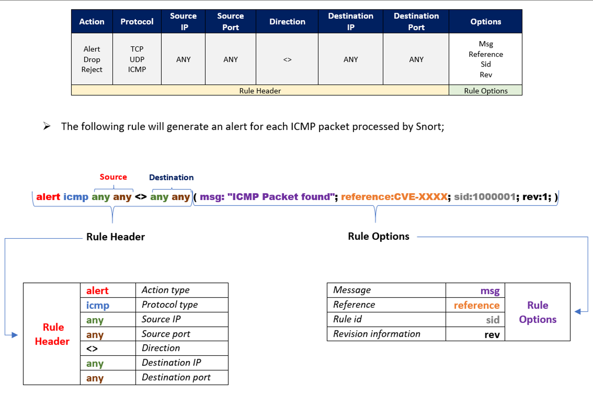

# Working with IDS/IPS

#### IDS operates in two main modes:

* signature-based detection&#x20;
* anomaly-based detection

#### IPS also operates in a similar mode to IDS and:

* takes actions such as dropping malicious packets
* blocking network traffic
* resetting the connection

## Tools

1. **Suricata**
2. **Snort**
3. **Zeek**

***

## **Suricata**

### Suricata Operation Modes

* Intrusion Detection System (IDS) mode  (silent observer.)
* Intrusion Prevention System (IPS) mode  (proactive stance)
* Intrusion Detection Prevention System (IDPS) mode
  * (continues to passively monitor traffic, it possesses the ability to actively transmit RST packets in response to abnormal activities)
* Network Security Monitoring (NSM) mode (dedicated logging mechanism)

### Suricata Inputs

1. Offline Input:
   1. &#x20;captured packets in the `LibPCAP` file format
2. **Live Input**
   1. **LibPCAP:** where packets are read directly from network interfaces.
   2. **NFQ (Netfilter Queue)** a Linux-specific inline IPS mode, collaborates with IPTables to divert packets from the kernel space into Suricata
   3. `AF_PACKET` provides a performance improvement over `LibPCAP`&#x20;

### Suricata Outputs

* logs, alerts, and additional network-related data such as DNS requests and network flows
* `EVE`, a JSON formatted log that records a wide range of event types including alerts, HTTP, DNS, TLS metadata, drop, SMTP metadata, flow, netflow, and more

### Configuring Suricata & Custom Rules

1. all the rule files

```
ls -lah /etc/suricata/rules/
```

2. configuration file

```
/etc/suricata/suricata.yaml
```

### Hands-on With Suricata Inputs

1. For offline input (reading PCAP files)

Suricata will create various logs (mainly `eve.json`, `fast.log`, and `stats.log`).

```
suricata -r /home/htb-student/pcaps/suspicious.pcap
```

bypass checksums (`-k` flag) and log in a different directory (`-l` flag).

```
suricata -r /home/htb-student/pcaps/suspicious.pcap -k none -l .
```

2. For live input, we can try Suricata’s (Live) `LibPCAP` mode

```
sudo suricata --pcap=ens160 -vv
```

3. For Suricata in Inline (`NFQ`) mode (work at linux)

```
sudo iptables -I FORWARD -j NFQUEUE
sudo suricata -q 0
```

to try Suricata in `IDS` mode with `AF_PACKET` input

```
sudo suricata -i ens160
sudo suricata --af-packet=ens160
```

observe Suricata dealing with "live" traffic (live capture from PCAP)

```
sudo suricata -i ens160
```

in new tap

```
sudo  tcpreplay -i ens160 /home/htb-student/pcaps/suspicious.pcap
```

### Hands-on With Suricata Outputs

1. Suricata records a variety of data into logs that reside in the `/var/log/suricata` directory by default.

#### Outputs

1. `eve.json :`   All Event
2. `fast.log :`  Alert
3. `stats.log :`  This is a human-readable statistics log

* `jq` command-line JSON processor

```
cat /var/log/suricata/old_eve.json | jq -c 'select(.event_type == "alert")'
cat /var/log/suricata/old_eve.json | jq -c 'select(.event_type == "dns")' | head -1 | jq .
```

Failed

1. `flow_id`: This is a unique identifier assigned by Suricata to each network flow
2. `pcap_cnt`: This is a counter that Suricata increments for each packet it processes from the network traffic or from a PCAP file

### Hands-on With Suricata Outputs - File Extraction

1. changes to the Suricata configuration file (`suricata.yaml`).

```
sudo nano /etc/suricata/suricata.yaml
```

```
file-store:
  version: 2
  enabled: yes
  force-filestore: yes
```

2. read pcap file

```
suricata -r /home/htb-student/pcaps/vm-2.pcap
```

### Updating Suricata Rulesets

```
sudo suricata-update
sudo suricata-update list-sources
sudo systemctl restart suricata
```

### Validating Suricata's Configuration

```
sudo suricata -T -c /etc/suricata/suricata.yaml
```

### Enable the http-log output in suricata.yaml

```
sudo nano /etc/suricata/suricata.yaml
```

```yml
http-log:
  enabled: yes
```

***

## Suricata Rule Development Part 1

<figure><figcaption></figcaption></figure>

### Suricata Rule Development Example 1: Detecting PowerShell Empire

```yaml
alert http $HOME_NET any -> $EXTERNAL_NET any (msg:"ET MALWARE Possible PowerShell Empire Activity Outbound"; flow:established,to_server; content:"GET"; http_method; content:"/"; http_uri; depth:1; pcre:"/^(?:login\/process|admin\/get|news)\.php$/RU"; content:"session="; http_cookie; pcre:"/^(?:[A-Z0-9+/]{4})*(?:[A-Z0-9+/]{2}==|[A-Z0-9+/]{3}=|[A-Z0-9+/]{4})$/CRi"; content:"Mozilla|2f|5.0|20 28|Windows|20|NT|20|6.1"; http_user_agent; http_start; content:".php|20|HTTP|2f|1.1|0d 0a|Cookie|3a 20|session="; fast_pattern; http_header_names; content:!"Referer"; content:!"Cache"; content:!"Accept"; sid:2027512; rev:1;)
```

* test rule

```
sudo suricata -r psempire.pcap -S local.rules -l . -k none
```

### Suricata Rule Development Example 2: Detecting Covenant C2

```yaml
alert tcp any any -> $HOME_NET any (msg:"detected by body"; content:"<title>Hello World!</title>"; detection_filter: track by_src, count 4 , seconds 10; priority:1; sid:3000011;)
```

### Suricata Rule Development Example 3: Detecting Covenant (Using Analytics)

```yaml
alert tcp $HOME_NET any -> any any (msg:"detected by size and counter"; dsize:312; detection_filter: track by_src, count 3 , seconds 10; priority:1; sid:3000001;)
```

### Suricata Rule Development Example 4: Detecting Sliver C2

```yaml
alert tcp any any -> any any (msg:"Sliver C2 Implant Detected"; content:"POST"; pcre:"/\/(php|api|upload|actions|rest|v1|oauth2callback|authenticate|oauth2|oauth|auth|database|db|namespaces)(.*?)((login|signin|api|samples|rpc|index|admin|register|sign-up)\.php)\?[a-z_]{1,2}=[a-z0-9]{1,10}/i"; sid:1000007; rev:1;)
```

***

## Suricata Rule Development Part 2 (Encrypted Traffic)

### JA3

```shellscript
ja3 -a --json /home/htb-student/pcaps/sliverenc.pcap
```

* extract all hash from PCAP

```
suricata -r /home/htb-student/pcaps/trickbot.pcap -l .
jq -r '.tls.ja3.hash // empty' eve.json | sort | uniq
```

***

## Snort&#x20;

### Snort Architecture

1. Packet Sniffer / Decoder
2. Preprocessors
3. Detection Engine
4. Logging & Alerting System
5. Output Modules

### default configuration files

* Network Variables
* Decoder Configuration
* Base Detection Engine Configuration
* Preprocessor Configuration
* Output Plugin Configuration
* Rule Set Customization

```
sudo more /root/snorty/etc/snort/snort.lua
```

### Snort (Modules)

```
snort --help-modules
snort --help-config arp_spoof
```

#### Passing configuration files to Snort

```
snort -c /root/snorty/etc/snort/snort.lua --daq-dir /usr/local/lib/daq
```

### Snort Inputs

* from PCAP file

```
sudo snort -c /root/snorty/etc/snort/snort.lua --daq-dir /usr/local/lib/daq -r /home/htb-student/pcaps/icmp.pcap
```

* from Interface

```
sudo snort -c /root/snorty/etc/snort/snort.lua --daq-dir /usr/local/lib/daq -i ens160
```

### Snort Outputs

1. Basic Statistics
   1. `Packet Statistics`
   2. `Module Statistics`
   3. `File Statistics`
   4. `Summary Statistics`
2. Alerts
   1. `-A cmg`: This option combines
   2. `-A u2`: This option is equivalent
   3. `-A csv`: This option outputs fields
3. Performance Statistics

***

## Skills Assessment - Suricata

### Suricata Rule Development Exercise: Detecting WMI Execution (Through [WMIExec](https://github.com/fortra/impacket/blob/master/examples/wmiexec.py))

```
alert tcp any any -> any any (msg:"WMI Execution Detected"; content:"Win32_ProcessStartup"; content:"powershell"; sid:2024233; rev:2;)
```

Payload maybe contain

```
Win32_Process
Create
cmd.exe
powershell.exe

```

### Snort Rule Development Exercise: Detecting Overpass-the-Hash

```
```

## Snort Rule Development

* test local rule

```
Abdo2015@htb[/htb]$ sudo snort -c /root/snorty/etc/snort/snort.lua --daq-dir /usr/local/lib/daq -R /home/htb-student/local.rules -r /home/htb-student/pcaps/patchwork.pcap -A cmg
```

***

## Intrusion Detection With Zeek

* read PCAP file

```
/usr/local/zeek/bin/zeek -C -r /home/htb-student/pcaps/psempire.pcap
```
