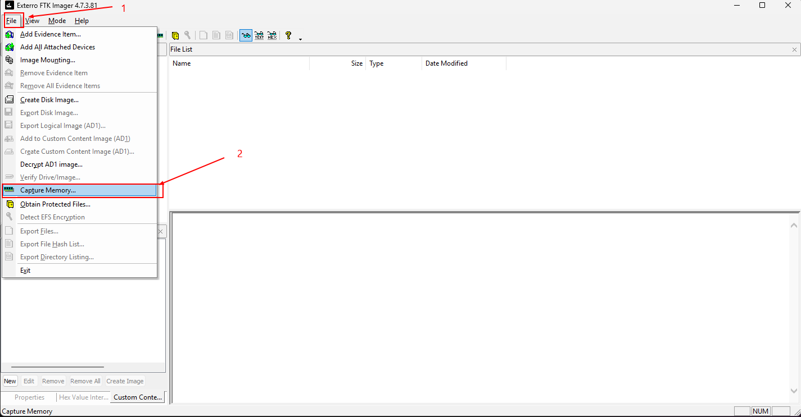

# Collecting Volatile Data

### Collecting Volatile Data manually

```
echo %date% %time% > liveIR-001.txt
tasklist >> liveIR-001.txt
tasklist /m >> liveIR-001.txt
tasklist /svc >> liveIR-001.txt
netstat -nao >> liveIR-001.txt
arp -a >> liveIR-001.txt
ipconfig /all >> liveIR-001.txt
ipconfig /displaydns >> liveIR-001.txt
route print >> liveIR-001.txt
set >> liveIR-001.txt
net user %username% >> liveIR-001.txt
net user >> liveIR-001.txt
net share >> liveIR-001.txt
net config workstation >> liveIR-001.txt
systeminfo >> liveIR-001.txt

```

***

### Collecting Volatile Data RAM (FTK-imager)

Step1:

<figure><figcaption></figcaption></figure>

Step2:

<figure><figcaption></figcaption></figure>

***

### Task 1: Collecting Volatile Data Manually

Create a directory on the desktop named "**Cases**." After that, inside that directory, create another directory named "**Case01-PolicyViolation**". All our work on the current case will be saved in this newly created directory.

In this part of the lab, we will be running a couple of CLI commands to gather as much of the volatile information from the system as possible. The commands used in this lab are not the whole list of commands, but they are the most commonly used.

Start your command line (cmd.exe); I assume you know how to do that? We will be redirecting all our command results the output to a file named "_liveIR-050517.txt_".

**\[Note:]** Make sure that you start using the double arrows "**>>**" from the second command when redirecting your output to the "liveIR-050517.txt" file.

The first command we will use is to store the date and time of the system.

```
# echo %date% %time% > liveIR-050517.txt
```

Now let's take a snapshot of the currently running tasks:

```
# tasklist >> liveIR-050517.txt
# tasklist /m >> liveIR-050517.txt
# tasklist /svc >> liveIR-050517.txt
```

Now let's take a snapshot of the currently available network connections:

```
# netstat -nao >> liveIR-050517.txt
```

Now, the currently available MAC addresses that are in the system's ARP Cache:

```
# arp -a >> liveIR-050517.txt
```

The system's network configuration:

```
# ipconfig /all >> liveIR-050517.txt
```

The DNS configurations:

```
# ipconfig /displaydns >> liveIR-050517.txt
```

Routing configurations:

```
# route print >> liveIR-050517.txt
```

What system variables have been set:

```
# set >> liveIR-050517.txt
```

System user information too:

```
# net user %username% >> liveIR-050517.txt
# net user >> liveIR-050517.txt
```

The system's network shares:

```
# net share >> liveIR-050517.txt
```

General workstation information:

```
# net config workstation >> liveIR-050517.txt
```

And finally the general system information:

```
# systeminfo >> liveIR-050517.txt
```

### Task 2: Dumping the System's Memory

Acquiring a memory image using FTK Imager, is very simple and straightforward. To do that, follow the steps below:

1. First, make sure you open AccessData's FTK Imager \[You can find it on the Desktop].
2. Now go to File -> Capture Memory
3. A window like the one below will pop-up.\
   
4. In the "**Destination path:**" field, click on Browse and choose the\ directory you created for this case "**Case01-PolicyViolation**".
5. Under the case directory, make a new directory for the volatile data.
6. In the "**Destination filename:**" field, make sure you name the memory as: Case1Memdump.mem\
   \
   **Note:** since we won't be going through memory forensics during this course, we can leave the _pagefile.sys_ unchecked and not include it within our acquisition.\
   <br>
7. When you finish all the steps above, click on the "**Capture Memory**" button.
8. Wait until the acquisition is complete to move to the next step.

### Task 3: Creating a Custom Forensic Image

In this lab, we will continue to use AccessData's FTK Imager to create an image file of specific system files to use for analysis. The custom image and files will be used to start the investigation process until a full system image comes through if possible. To create a custom forensic image, do the following:

1. First, start by opening FTK Imager. A window, like the screenshot displayed below, will appear:\
   
2. Now either go to **File** -> "**Add Evidence Item**" or click on the first icon with a single green plus on it. Both will lead to the same as the window seen below\
   
3. At this step, select the first choice titled "**Physical Drive,**" since we want to not only deal with the available files but even those that might have been deleted, and then click **Next**.
4. From the drop-down list, make sure you choose the correct drive, especially if there are more than one drive on the system and then click **Finish**.
5. Now, let's navigate inside the system and extract the files that we will be using for our analysis. Expand the second partition and make sure you are inside the "**\[root]**" directory. You should see something similar to the image below.\
   
6. I assume you are aware that the first partition is the one that Windows uses to store the system files (remember when installing Windows, the installer will create two partitions, a hidden reserved partition and the system drive "C:")
7. Let's start the process of creating a custom image for the Windows system of our interest. Windows has different artifacts stored in different places. In this lab, if some of the artifacts that you will be extracting seem vague to you, don't worry, we will come to them later in the course and we will explain them in detail.
8.  The artifacts of interest can be categorized as:

    a. File System Files

    b. Windows Registry Files

    c. Recycle Bin Files

    d. Log Files

    e. Link Files

    f. User Files

    g. Task Files
9.  The first artifacts we will add to our custom image is the file system files: $MFT, $LogFile, $UsnJrnl. The first two files $MFT and $LogFile can be found immediately on the root of the file system (directly under the C:\ drive). Select the first file, then press the "**Ctrl**" key and select the other. Now, right click on the selection and choose "**Add to Custom Content Image (AD1)**". The figures below both represent the actions that have been done.<br>

    \
    <br>
10. Navigate to "**C:\Windows\System32\Config**" and select the files below, then add them to the custom image the same way by right-clicking on -them and "**Add to Custom Content Image (AD1)**":

    a. SAM

    b. SYSTEM

    c. SOFTWARE

    d. SECURITY

    e. DEFAULT
11. Now, navigate to the "**C:\Windows**" directory and, right-click on the "**Tasks**" directory and add it to the custom image.
12. Now, let's select the Recent File Cache which we can find under the directory "**C:\Windows\AppCompat\Programs**" named "**RecentFileCache.bcf**." \[Skip this if you can't locate it on the Win10 machine]
13. Now, let's take a copy of the "**setupapi.dev.log**" file which is found under the "**\[root]\Windows\inf\\**" directory.
14. Now, let's take a copy of all the Windows link **(.lnk)** files and log **(.evtx)** files. In the lower left corner of the FTK Imager, there is a button "**New**", click it. A wildcard selection will be created.
15. Now select the wildcard entry in the "**Custom Content Sources**" window, and click on the "**Edit**" button.
16. Since we are interested in the **.lnk** files, make sure you have **"\*.lnk"** in the white field.
17. Also, make sure the "**Ignore Case**" and "**Match All Occurrences**" are both selected. Then click Ok. By selecting this, it will search all of the drive for any matching occurrences and add it to the image file. With such an option, even if you don't know the exact location of the files, and all you know is the file extension, then FTK Imager will do the rest for you.\
    
18. Do the same for the log files (**.evtx**) and then move on.
19. Now, let's extract some user artifacts. Navigate to the user of interest and then right-click on the directory and add it to the custom image. Repeat this process for all the users you are interested in investigating.
20. Now, we have all the files we need for our custom image, let's move on and create the image. In the low left corner, you can see a "**Create Image**" button, click it.
21. A window similar to the one in the figure below will appear.\
    
22. Now, click the "Add" button. A Window similar to the figure below will appear.
23. Now, fill in the fields properly and when you finish click the **Next** button to proceed. a. **Case Number:** write the number of this case. b. **Evidence Number:** write the number which is used to represent this evidence. c. **Unique Description:** write what is unique about the evidence in this case. d. **Examiner:** write your name e. **Notes:** write any useful notes related to the evidence.
24. In the new window, select the destination that you want to use to store your evidence. Usually, this will be an external drive, or a drive wiped for evidence usage. For this lab, we will be using a location on our system for storage. The figure below represents the new window.\
    
25. Click on the Browse button and choose the same location you used to store the memory (the Cases\Case1-PolicyViolation directory).
26. In the "Image Filename" field, give the image a name. For example: triage\_image.
27. Leave the Image Fragment Size in this part of the lab to its default size "1500" and even the Compression ratio.
28. Now, since handling digital evidence must be done properly and securely, or you might violate or jeopardize the privacy of the suspect, make sure you select the "**Use AD Encryption**." After that, click **Finish** to proceed.
29. A new window prompts you to enter the password that will be used for this evidence image. Use the password **DFIR4AB2016** then click Ok. (**Note:** if you forget the password, then you're on your own, especially if you choose to use another password).
30. Before pressing **Start**, there is another useful option to select "**Create a directory listing of all files in the image after they are created**." Make sure you select it and then click **Start**. Wait until the imaging process is finished.
31. When the imaging process is complete, make sure that the imaging was successful. You can verify that by checking for the computed and reported hashes. They both must show a "**Match**" just like the figure below.\
    
32. Close all the windows, but the last one where you will find an "**Image Summary**" button. Check the results there.
33. After finishing the imaging process, in order to explore the contents, we will need to mount the forensic image. This will be done in lab #3.

### Task 4: Creating a Full System Image

In this task, we will be showing you how to use AccessData's FTK Imager to create a full image file of the entire hard disk drive.

We remind you that for performance reasons you are not required to take a forensic image of the machine's C: drive; this would take hours to complete, and there is not enough space to save the forensic image. This task's purpose is to show you how you could take a forensic image of a machine's entire disk, in a step-by-step manner.

To complete this task, do the following steps:

1. Make sure you have started the Access FTK.\
   
2. We are taking a forensic image of the "C:" drive.
3. In FTK Imager, choose **File** from the drop-down menu and then, "**Create Disk Image**."
4. When the Select Source window appears, select "**Physical Drive**" and **Next**.\
   
5. When the Select Drive window appears, click on the drop-down menu and select the drive letter of the C: drive, for example, "**\\\\.\PHYSICALDRIVE1**" and then click **Finish.**\
   
6. When the "Create Image" window appears, click on the **Add** button\
   
7. When the "Select Image Type" window appears, select **Raw (dd)** and **Next**\
   
8. When the "Image Destination" folder appears, click the "**Browse**" button, navigate to our "**Cases\Case1-PolicyViolation**" directory and then click **OK.**
9. In the "Image Filename" field, type **"hdd\_serial\_no"** and then click **Finish.**
10. When the "Create Image" window appears, click **Start** and wait for the image to finish.
11. After the image file has been created successfully, click the **Close** button.
12. Then, open Windows Explorer and navigate to **Cases\Case1-PolicyViolation.**
13. We should confirm that the following two files have been created: a. hdd\_serial\_no.S01 b. hdd\_serial\_no.S01.txt (text file)
14. Now you have an FTK Image file that can be opened and examined using AccessData's Forensic Toolkit (FTK) or any other forensic suite like Autopsy.

### Task 5: Automated Live Response

To get started, open the "**LiveResponseCollection-Bambiraptor**" folder \[C:\DFP\Tools\LiveResponseCollection-Bambiraptor\Windows\_Live\_Response]. Then:

1. Go to the Windows Live Response directory.
2. Double click on the "**Windows Live Response Collection.exe**" file.
3. A window will appear, similar to the one below:\
   
4. Reading through the description below each option, I will assume that it is clear to you what each one does. Also, I assume the difference between the first three options and the rest is clear too; if you have trouble figuring out what each does? Don't hesitate to ask your instructor.
5. Now, just to do a quick test, let's use the third option titled "**Secure-Triage**" and then click the "**Run Selected Windows Live Response Script**."
6. It will take some time to complete and then you will be presented with a "**Press any key to continue**." Before you press the Enter key; make sure you have recorded the key to open the encrypted 7zip archive. Without this key you won't be able to open the final archive; you have been warned.
7. I recommend that you open the archive and check its contents. the 7zip is not installed and can be found here: C:\DFP\Tools\LiveResponseCollection-Bambiraptor\Windows\_Live\_Response\Tools\7zip
