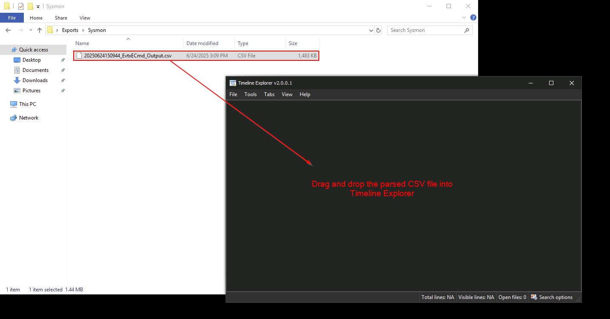
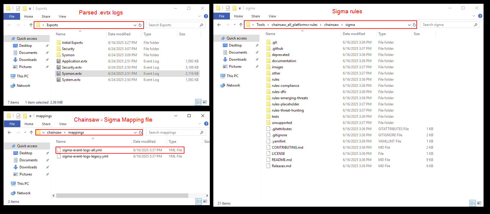

# windows event log analysis

### Exporting Windows Event Logs Using `wevtutil`

1. display all Logs

```
wevnuti.exe el
```

2. extract log

```powershell
wevtutil.exe epl Security "C:\Users\Abdo\Desktop\wevnuti\security.evtx"
wevtutil.exe epl Microsoft-Windows-Sysmon/Operational "C:\Users\Abdo\Desktop\wevnuti\security.evtx"
```

1. Logon events

```
Get-WinEvent -Path security.evtx | Where-Object {$_.Id -eq 4624}
```

***

### Parsing Event Logs with `EvtxECmd`

```
.\EvtxECmd.exe -f C:\Users\Abdo\Desktop\wevnuti\security.evtx --csv "C:\Users\Abdo\Desktop"
```

<figure><figcaption></figcaption></figure>

```
.\EvtxECmd.exe -f C:\Users\Abdo\Desktop\wevnuti\sysmon.evtx --csv "C:\Users\Abdo\Desktop"
```

<figure><figcaption></figcaption></figure>

### Timeline Analysis with **Timeline Explorer**

#### Load a Parsed CSV File

<figure><figcaption></figcaption></figure>

***

### Threat Detection with **Chainsaw** and **Sigma** Rules

<figure><figcaption></figcaption></figure>

```
.\chainsaw_x86_64-pc-windows-msvc.exe hunt C:\Users\Administrator\Desktop\Exports\Sysmon.evtx
 -s C:\Users\Administrator\Desktop\Tools\chainsaw_all_platforms+rules\chainsaw\sigma\
 --mapping C:\Users\Administrator\Desktop\Tools\chainsaw_all_platforms+rules\chainsaw\mappings\sigma-event-logs-all.yml
 --csv --output Output\sysmon
```

* The `-s` flag specifies the path of the directory containing the Sigma rules.
* The `--mapping` flag specifies the Sigmap mapping file.
* The `--csv` and `--output` flags specify the format of the output and the output destination
