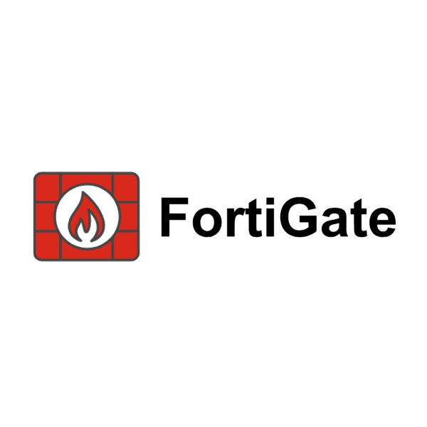

# FortiGate

<figure><figcaption></figcaption></figure>

[CH\_1: initial configuration](initial-configuration.md)

[CH\_2: Firewall policy](firewall-policy.md)

[CH\_3: NAT](nat.md)

[CH\_4: Firewall Authentication](user-authentication.md)

[CH\_5: Certificate Operation](certificate-operation.md)

[CH\_6: Logging And Monitoring](logging-and-monitoring.md)

[CH\_7: Security Profiles](security-profiles.md)
