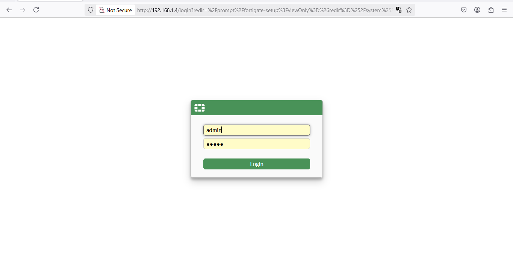
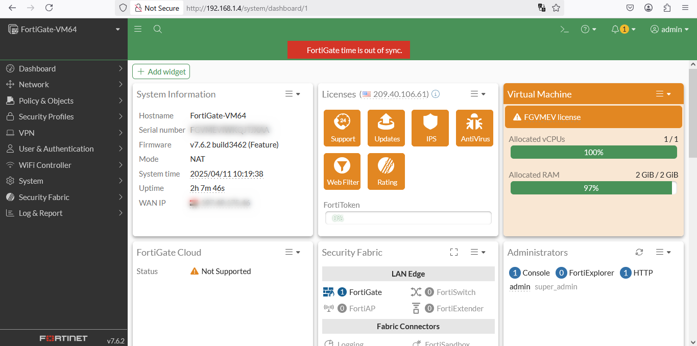

# Initial configuration

<figure><figcaption></figcaption></figure>

1. Basic Command CLI
2. Initial configuration
3. admin profile
4. administrator
5. Backup , restore and Revision


```
config system ntp
set ntpsync disable
set type custom 
end
```

## Basic Command CLI

```
get system status
get system interface physical
get system session list
config system interface 
show system interface port1
show full system interface port1
set allowaccess ping http ssh https
append allowaccess telnet
next
end
```

## Initial configuration

### for wan network

```
FortiGatw-VM64 # config system interface
FortiGatw-VM64 (interface) # edit port1
FortiGatw-VM64 (port1) # set mode dhcp
FortiGatw-VM64 (port1) # set allowaccess ping https ssh http
FortiGatw-VM64 (port1) # set role wan
FortiGatw-VM64 (port1) # set alais wan
FortiGatw-VM64 (port1) # next
```

### for lan network

```svg
FortiGatw-VM64 (interface) # edit port2
FortiGatw-VM64 (port1) # set mode static
FortiGatw-VM64 (port1) # set ip 10.0.0.1 
FortiGatw-VM64 (port1) # set role lan
FortiGatw-VM64 (port1) # set alais lan
FortiGatw-VM64 (port1) # end
```

## access fortigate with GUI

<figure><figcaption><p>login page</p></figcaption></figure>

<figure><figcaption></figcaption></figure>

## admin profile

#### A set of permissions assigned to each administrative user. This allows you to control what each user can do within FortiGate.

System → Admin → Admin Profiles → Create New

<figure><figcaption></figcaption></figure>

<figure><figcaption></figcaption></figure>

## administrator

#### It is the user (or account) that logs into the FortiGate device to perform management and settings.

System → Admin → administrator  → Create New

New administrator

* username
* type
* Tow-factor Authentication
* Restrict-login to trusted hosts

<figure><figcaption></figcaption></figure>

<figure><figcaption></figcaption></figure>

## Backup , restore and Revision

### Revision

#### It is a feature that stores a log of every modification made to the device settings, and you can return to any previous version.

<figure><figcaption></figcaption></figure>

<figure><figcaption></figcaption></figure>

## Fortigate Mode

NAT mode

```
config system settings
set opmode nat
set IP
set gateway 
set device lan
end

```

transparent mode

```
config system settings
set opmode transparent
set manageip
set gateway 
end

```
