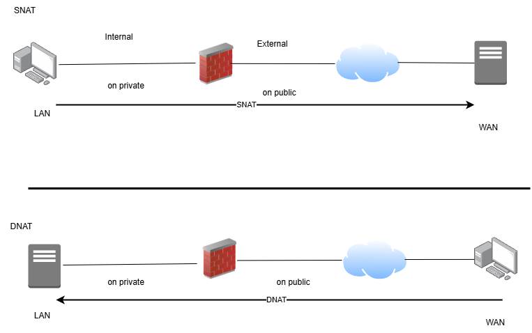
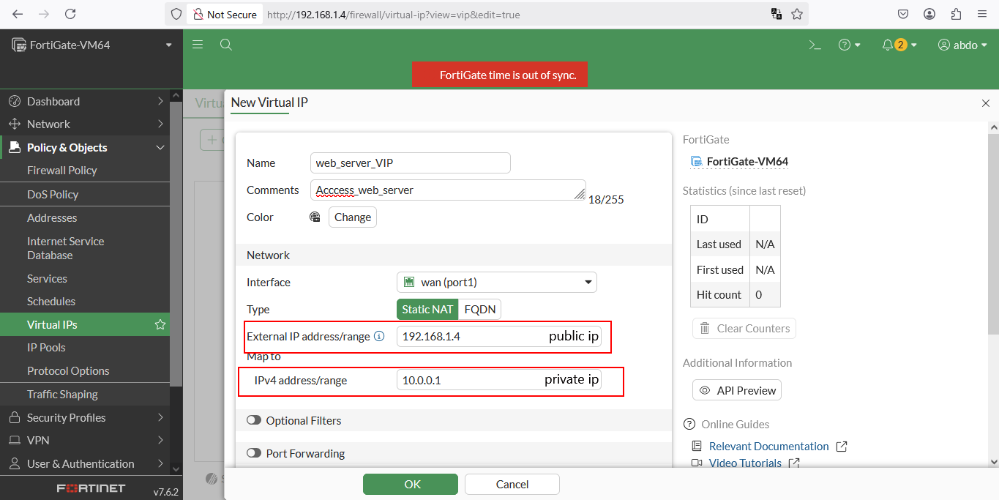

# NAT

## Firewall ploicy NAT

#### SNAT and DNAT must be configured for each firewall ploicy

* SNAT uses the Outgoing interface address or configured ip pool
* DNAT uses the configured virtual ip (VIP) as the destination address

## Central policy NAT

#### &#x20;SNAT and DNAT  configuration are done per virtual domain

* SNAT rule is configured from central SNAT policy
* DNAT is configured  from DNAT and VIP

<figure><figcaption></figcaption></figure>

### Policy SNAT&#x20;

### Outdoing interface : Using PAT (port address translation)

## IP Pool

* Overload (private IP for Range Public IP)
* one to one (private IP for Range Public IP - no use different port )
* fixed port range (fixed private IP for fixed Range Public IP )
* port block allocation

<figure><figcaption></figcaption></figure>

### policy DNAT

#### uses the configured virtual ip (VIP)

<figure><figcaption></figcaption></figure>

