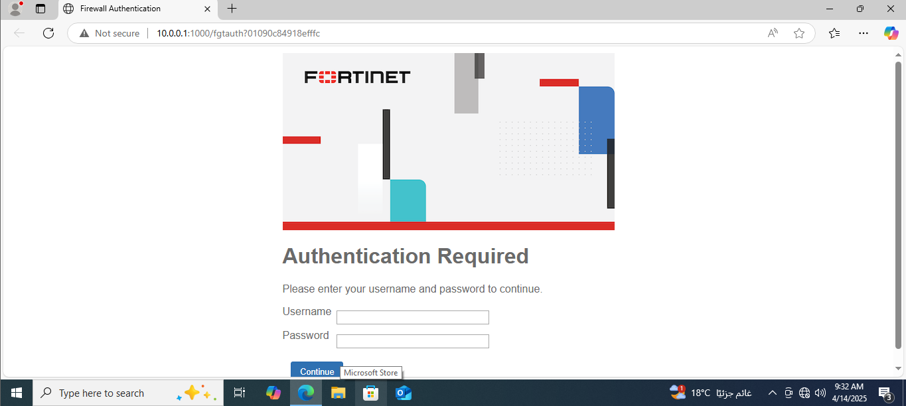
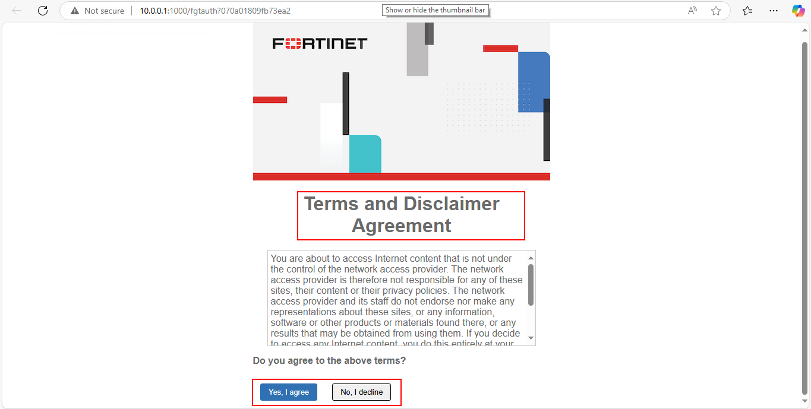

# User Authentication

## User definition

user authentication firewall policy

* Local Users
* LDAP / Active Directory
* RADIUS
* TACACS+

***

## Steps to Configure User Authentication on FortiGate (Local Users)

* **Create a Local User**
  * Go to: `User & Authentication > User Definition`
  * Click **Create New**
  * Enter the username and password (e.g., username: `user1`, password: `123`)
* **Create a User Group**
  * Go to: `User & Authentication > User Groups`
  * Click **Create New**
  * Give the group a name (e.g., `InternetUsers`)
  * Add the user you created to this group
*   **Edit Firewall Policy to Enable Authentication**

    * Go to: `Policy & Objects > IPv4 Policy`
    * Select the internet access policy and click **Edit**
    * Scroll down to the **Authentication** section
    * Enable **Authentication**
    * Under **User Group**, select the group you created (e.g., `InternetUsers`)
    * Choose **Authentication Method**: Browser-based (for web login prompt


<figure><figcaption></figcaption></figure>

<figure><figcaption></figcaption></figure>

<figure><figcaption></figcaption></figure>

***

## Steps to Configure User Authentication on FortiGate (LDAP / Active Directory)

1. #### Get Active Directory Information

Before you begin, gather the following from your AD server:

* **Domain Name:** `cairo.local`
* **AD Server IP:** `192.168.1.100`
* **Bind User:** A domain user account used for LDAP binding (e.g., `admin@cairo.local`)
* **Base DN:** Distinguished Name for search (e.g., `DC=example,DC=local`)
* **Common Name (CN)** or **Organizational Unit (OU)** where users are located

#### 2.  Add LDAP Server to FortiGate

**Go to:**\
`User & Authentication > LDAP Servers > Create New`

**Fill in:**

* **Name:** `AD_Server`
* **Server IP/Name:** `192.168.1.10`
* **Common Name Identifier:** `samaccountname`
* **Distinguished Name (DN):** `DC=cairo,DC=local`
* **Bind Type:** Regular
* **Username:** `admin@cairo.local`
* **Password:** \[password of ldapuser]
* **Server Port:** 389 (default for LDAP), or 636 if using LDAPS

#### 3. Create a User Group Linked to LDAP

**Go to:**\
`User & Authentication > User Groups > Create New`

**Name:** `LDAP_Users`

Under **Remote Server**, choose the LDAP server you added.

Then:

* Choose **"All Groups"** or specify a particular AD group (e.g., `CN=ITUsers,OU=Users,DC=cairo,DC=local`)

#### Apply User Group in a Firewall Policy

**Go to:**\
`Policy & Objects > IPv4 Policy`

Edit or create a policy for internet access or internal access.

Under **source**, do the following:

* Select **User Group:** `LDAP_Users`&#x20;


<figure><figcaption></figcaption></figure>

<figure><figcaption></figcaption></figure>

<figure><figcaption></figcaption></figure>

<figure><figcaption></figcaption></figure>

***

## captive portal

#### user authentication firewall port

## Steps to Configure Captive Portal on FortiGate

#### 1. Create Local Users or Connect LDAP (optional)

> Go to: `User & Authentication > User Definition`

* Create local users that will authenticate through the portal
* OR connect to LDAP/Active Directory (if available)

#### 2. Create User Group

> Go to: `User & Authentication > User Groups`

* Click **Create New**
* Name the group (e.g., `Internet_Users`)
* Add the users or LDAP group to it

#### 3. Enable Captive Portal on Interface

> Go to: `Network > Interfaces > [choose the LAN interface] > Edit`

* **Role:** LAN
* **Addressing mode:** Manual or DHCP
* **Security Mode:** Enable
* Authentication portal : (local or external)
* User access : (Restricted Group or allow all )
* Exempt source (if you have printer)


<figure><figcaption></figcaption></figure>

<figure><figcaption></figcaption></figure>

## Disclaimer


```
FortiGate-VM64 # config firewall policy
FortiGate-VM64 (policy) # edit 1
FortiGate-VM64 (1) # set disclaimer enable 
FortiGate-VM64 (1) # end
```

<figure><figcaption></figcaption></figure>
