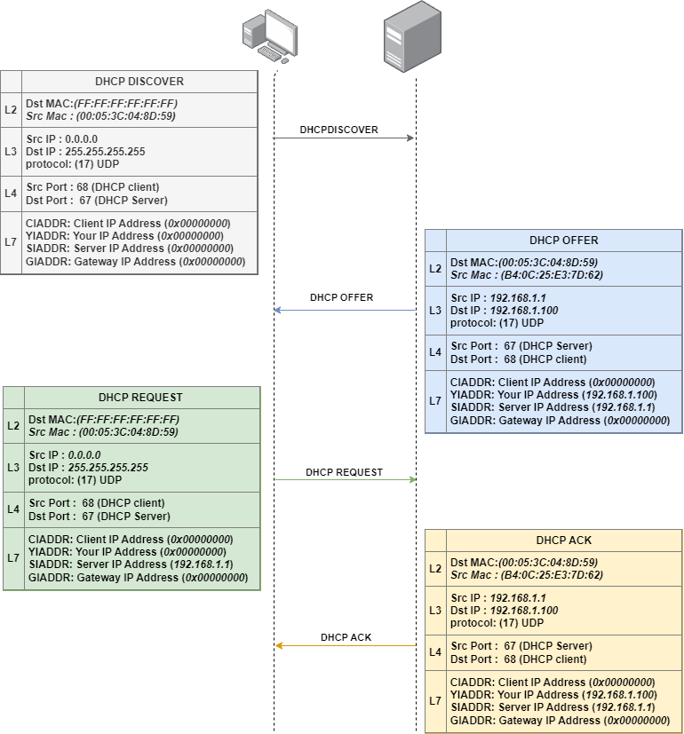

# DHCP

The Dynamic Host Configuration Protocol (DHCP) is used to automatically assign IP addresses and network configurations to devices. The DHCP process follows a 4-step DORA (Discover, Offer, Request, Acknowledge) sequence.

## **Step-by-Step: How DHCP Works**

### **Step 1: DHCPDISCOVER (Client → Broadcast)**

* The client device **sends a broadcast** message (`DHCPDISCOVER`) to find a DHCP server.
* This message is sent to **255.255.255.255** (or `0.0.0.0` if the client has no IP yet).
* The message contains:
  * `XID (Transaction ID)` → To track the request.
  * `CHADDR (Client Hardware Address)` → MAC address of the client.
  * `CIADDR (Client IP Address)` → `0.0.0.0` (because the client doesn’t have an IP).

### **Step 2: DHCPOFFER (Server → Client)**

* The **DHCP server responds** with a `DHCPOFFER` message.
* It **offers an available IP address** to the client.
* The message includes:
  * `YIADDR (Your IP Address)` → The offered IP.
  * `SIADDR (Server IP Address)` → The DHCP server’s IP.
  * `Lease Time` → How long the client can keep the IP

### **Step 3: DHCPREQUEST (Client → Broadcast)**

* The client **accepts the offered IP** by sending a `DHCPREQUEST` message.
* It **requests the same IP** that was offered in `DHCPOFFER`.
* This ensures that **only one DHCP server** finalizes the lease.
* The message includes:
  * `Requested IP Address` → The IP from `DHCPOFFER`.
  * `Server Identifier` → The DHCP server's IP

### **Step 4: DHCPACK (Server → Broadcast/Unicast)**

* The **DHCP server confirms the lease** with a `DHCPACK` message.
* The client is now officially assigned the IP.
* The message includes:
  * `Assigned IP Address`
  * `Lease Time`
  * `Subnet Mask, Default Gateway, and DNS Server Info`

<figure><figcaption></figcaption></figure>

## DHCP Attacks

### DHCP Starvation Attack

#### How It Works

* The attacker **floods the DHCP server** with thousands of fake **DHCPDISCOVER** messages.
* The server **runs out of available IP addresses**, preventing legitimate users from getting IP

```
yersinia dhcp -attack 1
```

### **Rogue DHCP Server Attack**

#### **How It Works**

* The attacker sets up a fake DHCP server and responds faster than the legitimate one.
* Victims receive incorrect IP settings, such as:
  * A malicious gateway (to intercept traffic).
  * A fake DNS server (for phishing attacks).
* Can be executed using:
  * Rogue DHCP server tools
  * MITM attacks via tools like `Ettercap`
