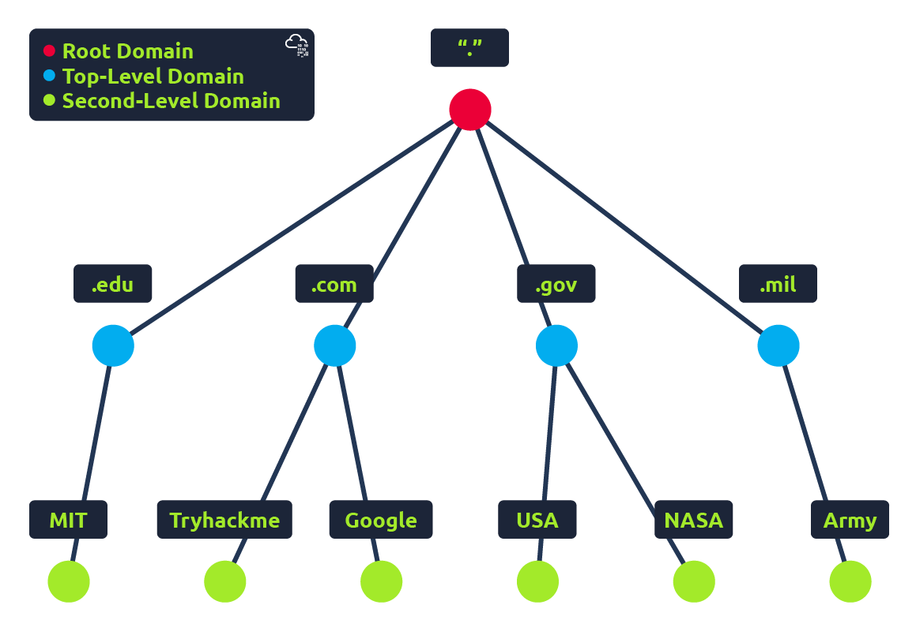

# DNS

<figure><figcaption></figcaption></figure>


## Domain Hierarchy

<figure><figcaption></figcaption></figure>


## أول حاجه أيه هو ال DNS؟

**هو نظام بيترجم ال Domain الي IP يعني انا لو عايز اطلب google.com مش بروح عليه direct لازم استخدم ال IP عشان ده اللي بيفهما أجهزة الكمبيوتر علي الانترنت فا بيعمل استعلام علي google.com و بيرجع ال IP  (142.250.181.203), ده نوع من انواع ال DNS اللي هو أسمه A Recor**d

### DNS Record Types

| **A Record**     | records resolve to IPv4 addresses                                                                   | `example.com → 192.168.1.1`                          |
| ---------------- | --------------------------------------------------------------------------------------------------- | ---------------------------------------------------- |
| **AAAA Record**  | records resolve to IPv6 addresses                                                                   | `example.com → 2606:4700:20::1`                      |
| **CNAME Record** | records resolve to another domain name                                                              | `store.example.com → shopify.com`                    |
| **MX Record**    | records resolve to the address of the servers that handle the email for the domain you are querying | `example.com → mail.example.com`                     |
| **TXT Record**   | TXT records are free text fields (DKIM - SPF SPF)                                                   | example.com → "v=spf1 include:\_spf.google.com \~all |

Tools

### **عندي tools اقدر استخدمها في windows و linux اقدر استعلم بيها عن DNS**

window&#x20;

<pre class="language-powershell"><code class="lang-powershell"><strong>nslookup -type=A example.com
</strong>nslookup -type=MX example.com
nslookup -type=TXT example.com
</code></pre>

Linux&#x20;

```bash
dig A example.com
dig MX example.com
dig TXT example.com
```


### أشهر خدمات ال DNS

* Google DNS (8.8.8.8 or 8.8.4.4)
* Cloudflare DNS (1.1.1.1)
* OpenDNS (208.67.222.222 or 208.67.220.220 )
* Quad9 DNS (9.9.9.9)


## أزاي بيشتغل ال DNS ؟


### Recursive DNS Server

### **Root DNS Server (13 in the world)**

### **Top-Level-Domain (TLD) DNS server**&#x20;

### **Authoritative DNS Server**

### **ترتيب البحث في ال DNS cash**

1. **Browser Cache**
2. **Local DNS Cache**

<pre><code><strong>windows >> ipconfig /displaydns
</strong>windows >> ipconfig /flushdns
Linux   >> systemd-resolve --statistics
Linux   >> sudo systemd-resolve --flush-caches
</code></pre>

1. **Local Host File**

```
Linux (/etc/hosts)
windows (C:\Windows\System32\Drivers\etc\hosts)
```

1. **Router Cash**
2. **ISP DNS Server**
3. **Recursive DNS Server And Root Server**


**ده**&#x20;

**DNS & TTL (Time To Live)**

كل سجل يحتوي علي TTL يحدد كم الوقت اللي يتم في تخزين العنوان في ال cash يعني لو TTL=3600 هيتخزن في ال cash لمده ساعه


امتي يشتغل TCP وامتي يشتغل UDP

