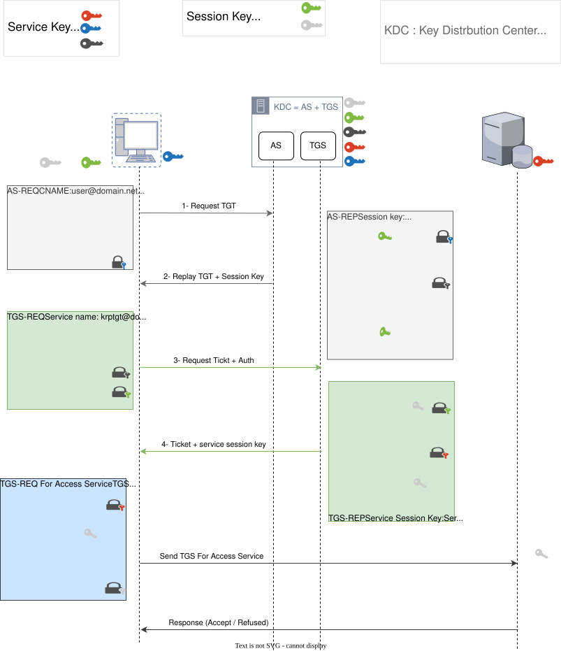

# Kerberos

<figure><figcaption></figcaption></figure>

## Introduction to Kerberos Protocol

**Kerberos** is a secure authentication protocol used in **Windows Active Directory (AD)** and other systems to provide **secure authentication** over **untrusted networks**. It was developed by MIT and is widely used in enterprise environments to ensure **strong, mutual authentication** between users and services.

## Common Terminology

* **Ticket Granting Ticket (TGT)** - A ticket-granting ticket is an authentication ticket used to request service tickets from the TGS for specific resources from the domain.
* **Key Distribution Center (KDC**) - The Key Distribution Center is a service for issuing TGTs and service tickets that consist of the Authentication Service and the Ticket Granting Service.
* **Authentication Service (AS**) - The Authentication Service issues TGTs to be used by the TGS in the domain to request access to other machines and service tickets.
* **Ticket Granting Service (TGS**) - The Ticket Granting Service takes the TGT and returns a ticket to a machine on the domain.
* **Service Principal Name (SPN)** - A Service Principal Name is an identifier given to a service instance to associate a service instance with a domain service account. Windows requires that services have a domain service account which is why a service needs an SPN set.(MYSQL/domain.local:1433)
* **KDC Long Term Secret Key (krbtgt Key)** - The KDC key is based on the KRBTGT service account. It is used to encrypt the TGT and sign the PAC.
* **Client Long Term Secret Key (Client Key)** - The client key is based on the computer or service account. It is used to check the encrypted timestamp and encrypt the session key.
* **Service Long Term Secret Key (Service Key)** - The service key is based on the service account. It is used to encrypt the service portion of the service ticket and sign the PAC.
* **Session Key** - Issued by the KDC when a TGT is issued. The user will provide the session key to the KDC along with the TGT when requesting a service ticket.
* **Privilege Attribute Certificate (PAC)** - The PAC holds all of the user's relevant information, it is sent along with the TGT to the KDC to be signed by the Target LT Key and the KDC LT Key in order to validate the user.

## **Kerberos Authentication Steps**

### **Step 1: Initial Authentication (AS Request & Response)**

1. **Client Requests Authentication from the Authentication Server (AS)**

The client sends an authentication request to the Authentication Server (AS), which is part of the Key Distribution Center (KDC).

* This request includes:
  * CNAME (Client Name – the username of the user logging in).
  * SNAME (Service Name – usually the Ticket Granting Service).
  * Realm (Domain Name).
  * Timestamp (to prevent replay attacks).

2. **Timestamp Encryption**

* The Timestamp is encrypted using the client’s key before being sent.
* The Client Key is derived from the user's password, which is converted into a hash using one of the following encryption algorithms:
  * NTLM Hash
  * AES (Advanced Encryption Standard)

3. **AS Verifies User Credentials**

* The AS decrypts the timestamp using the stored client key (which it derives from the user’s password stored in AD).
* If decryption is successful, this confirms the client’s identity.
* The AS then issues a Ticket Granting Ticket (TGT), which includes:
  * The session key&#x20;
  * The expiration time of the ticket.
  * The user’s access permissions (PAC Data)

***

### **Step 2: Service Ticket Request (TGS Request & Response)**

Now that the client has a Ticket Granting Ticket (TGT), it can request access to a specific service. This process happens through the Ticket Granting Service (TGS), which is also part of the Key Distribution Center (KDC).

1. **Client Requests a Service Ticket from TGS (TGS Request)**

* The client wants to access a network service (e.g., a file server, database, or web service), so it sends a request to the Ticket Granting Service (TGS).

**The request includes:**

* TGT (Ticket Granting Ticket) – This proves the client is authenticated.
* Authenticator – A timestamp encrypted with the user’s session key (issued in Step 1).
* SNAME (Service Name) – The name of the service the client wants to access.

2. TGS Verifies the Client and Issues a Service Ticket (TGS Response)

**The TGS does the following:**

* Verifies the TGT – It decrypts the TGT using its own key (issued by the AS in Step 1).
* Decrypts the Authenticator – It checks if the timestamp is valid to prevent replay attacks.
* Issues a Service Ticket (TGS) – If everything is valid, the TGS generates a new ticket for the requested service, encrypted with the service’s key.

**The Service Ticket (TGS) contains:**

* Client’s identity
* Session key for communication with the service
* Expiration time
* Service name

***

### **Step 3: Accessing the Service (Authorization)**

Now that the client has received a **Service Ticket (TGS)** from the **Ticket Granting Service (TGS)**, it can finally request access to the actual service (e.g., a file server, database, or web application).

#### **1. Client Sends the Service Ticket to the Target Service**

The client wants to access the requested service, so it sends a request to the service server (e.g., `fileserver.example.local`).

The request includes:

* Service Ticket (TGS) – Issued by the TGS and encrypted with the service’s key.
* Authenticator – A new timestamp encrypted with the session key from the TGS response.

This ensures that the request is **fresh** and prevents replay attacks.

2. **The Service Verifies the Client’s Identity**

The service (server) does the following:

* Decrypts the Service Ticket (TGS) using its Service session key (issued by the KDC).
* Extracts the Service session key from the ticket
* Decrypts the Authenticator using the Service session key to verify the client’s identity and timestamp.

3. **The Service Optionally Sends Mutual Authentication**

If mutual authentication is required, the service:

* Encrypts the timestamp from the client’s Authenticator using the Service session key.
* Sends it back to the client as proof that it also trusts the client.

## Attacking Kerberos

* Initial enumeration using tools like Kerbrute and Rubeus
* Kerberoasting Attack
* AS-REP Roasting with Rubeus and Impacket
* Golden/Silver Ticket Attacks
* Pass the Ticket
* Skeleton key attacks using mimikatz

<figure><figcaption></figcaption></figure>
