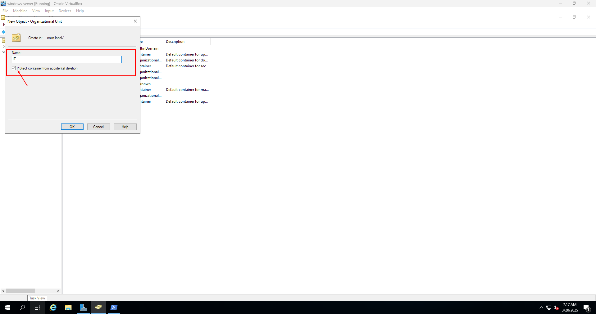
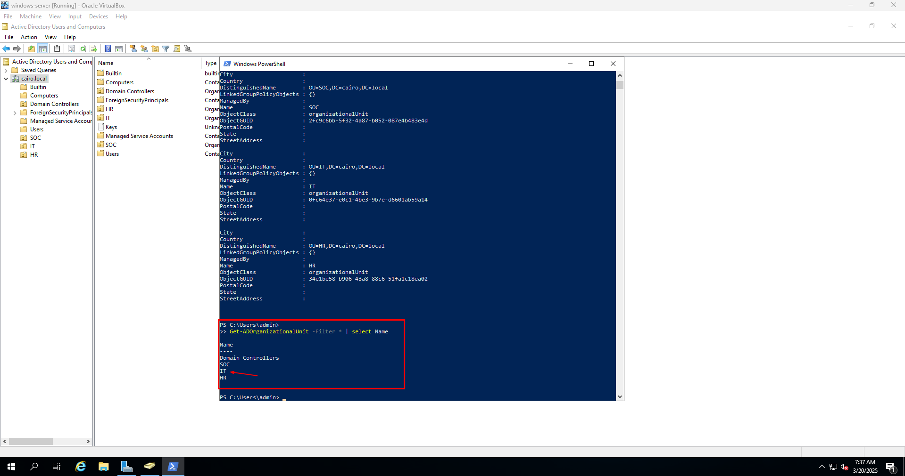
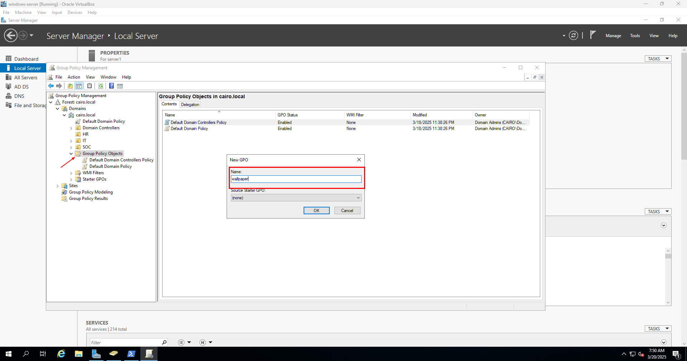
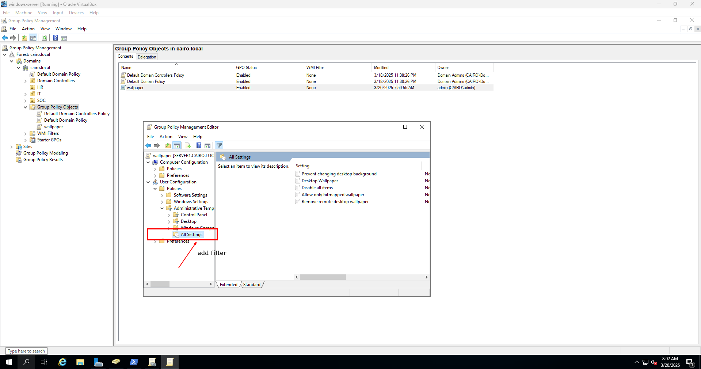
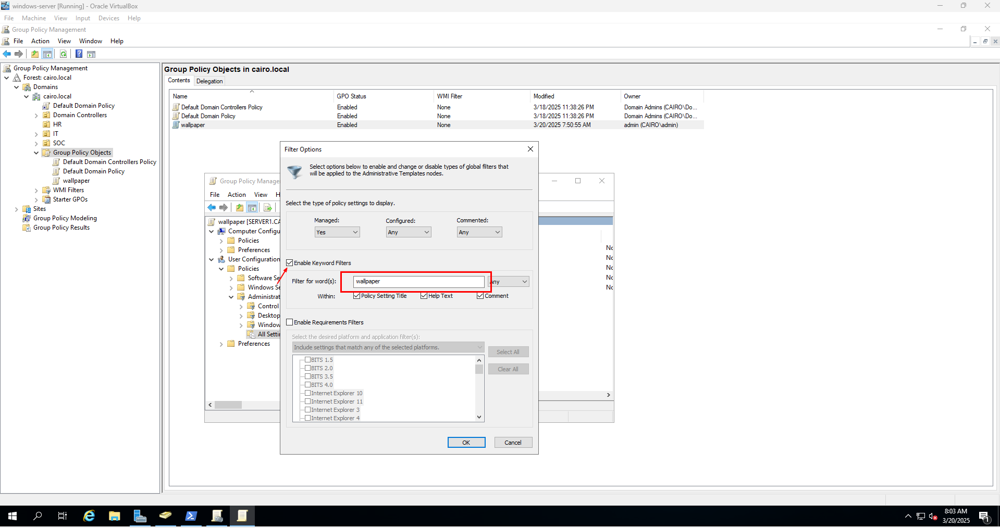
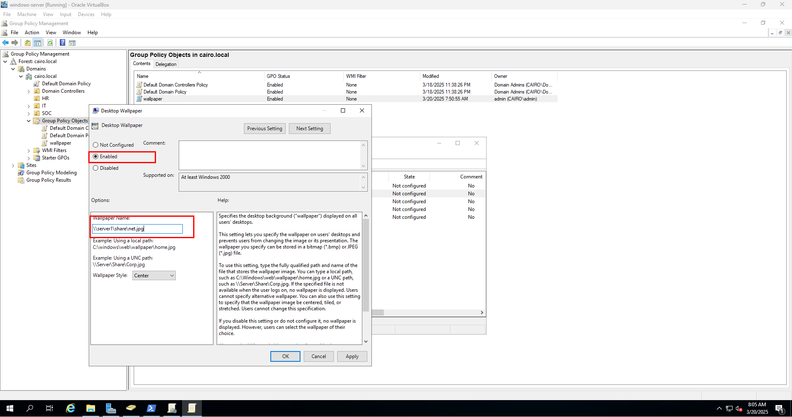
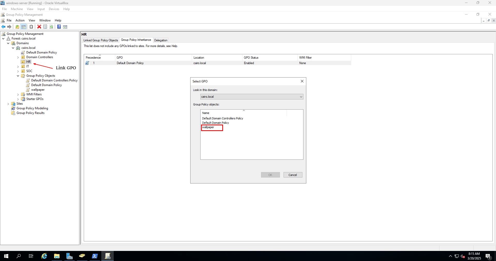
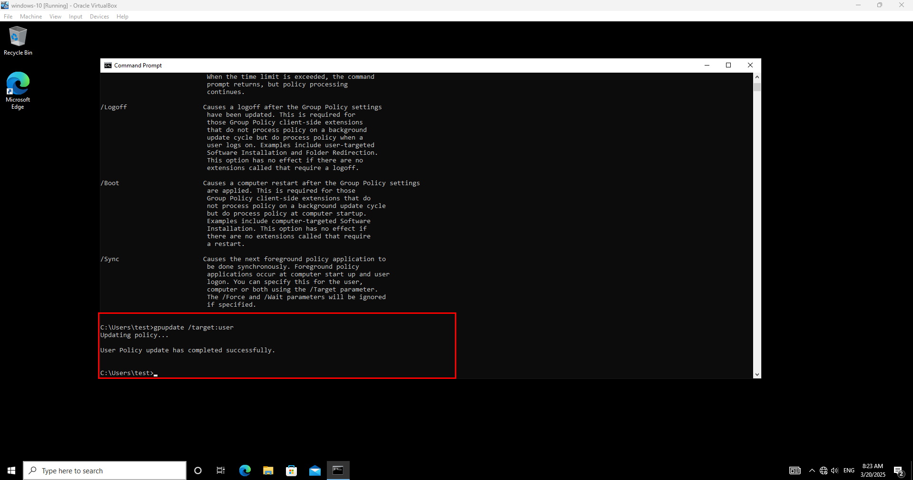

# Group Policy

<figure><figcaption></figcaption></figure>

## Introduction to Group Policy and Organizational Units (OU) in Active Directory

**1. Organizational Unit (OU)**

An **Organizational Unit (OU)** is a logical container within **Active Directory (AD)** that helps **organize** users, groups, and computers. OUs allow administrators to:\
✅ Apply **Group Policies** to specific users or devices.\
✅ **Delegate administration** (e.g., IT team manages only certain users).\
✅ **Structure AD** based on departments, locations, or roles

Example:

```javascript
cairo.local  
 ├── IT Department (OU)  
 ├── HR Department (OU)  
 ├── Sales Department (OU)  

```

**2. Group Policy (GPO - Group Policy Object)**

**Group Policy** is a feature in AD that **controls** settings for users and computers across the domain. It is applied to **OUs, sites, or domains** to enforce security, software settings, and configurations.

✅ **Examples of Group Policy Usage:**

* Restrict USB access.
* Enforce password policies.
* Set desktop backgrounds.
* Auto-map network drives

**How They Work Together?**

1️⃣ **Create an OU** (e.g., `IT Department`).\
2️⃣ **Apply a Group Policy Object (GPO)** to that OU.\
3️⃣ Users and computers **inside that OU** inherit the policy settings.

## **Step-by-Step: Create an Organizational Unit (OU) in Active Directory**

An **Organizational Unit (OU)** in Active Directory (AD) helps organize users, groups, and computers. Below are the step-by-step methods to create an **OU** using **GUI** and **PowerShell**.

#### **Using GUI (Active Directory Users and Computers - ADUC)**

#### **Step 1: Open Active Directory Users and Computers (ADUC)**

1. **Press** `Win + R`, type `dsa.msc`, and **press** `Enter`.
2. **Expand** the domain name (e.g., `cairo.local`).

***

#### **Step 2: Create a New Organizational Unit**

1. **Right-click** on the domain name or an existing **OU** where you want to create a new one.
2. **Select** `New` → `Organizational Unit`.
3. **Enter the OU Name** (e.g., `IT`).
4. **Check/Uncheck** the box **"Protect container from accidental deletion"** (recommended).
5. **Click** `OK`.

<figure><figcaption></figcaption></figure>

#### **How to Verify the OU Exists?**

* Open **ADUC (`dsa.msc`)** and check if the **OU appears**.
* Use PowerShell to list all OUs:

```powershell
Get-ADOrganizationalUnit -Filter * | Select Name
```

<figure><figcaption></figcaption></figure>

## Step-by-Step: Creating and Applying a Group Policy Object (GPO) to the HR OU in Active Directory

#### **🛠 Step 1: Edit the GPO Settings**

1️⃣ Right-click on group policy object → Click **new**.\
2️⃣ set name of **policy**\
3️⃣Right-click on the newly created GPO → Click **Edit**\
4️⃣Navigate to **Computer Configuration** or **User Configuration**, depending on what you want to configure\
5️⃣  Modify the required settings (wallpaper policy). AND Close the editor

Right-click on group policy object → Click **new**. set name of **policy**

<figure><figcaption></figcaption></figure>

Right-click on the newly created GPO → Click **Edit**

Navigate to **Computer Configuration** or **User Configuration**, depending on what you want to configure

<figure><figcaption></figcaption></figure>

<figure><figcaption></figcaption></figure>

Modify the required settings (wallpaper policy). AND Close the editor

in this step make a share folder and put the wallpaper in server&#x20;

<figure><figcaption></figcaption></figure>

#### **🛠 Step 2: Link the GPO to the IT OU**

1️⃣ In **GPMC**, locate the HR **OU** under your domain.\
2️⃣ Right-click **HR OU** → Click **Link an Existing GPO**.\
3️⃣ Select the **GPO** you created (`wallpaper`).\
4️⃣ Click **OK**

<figure><figcaption></figcaption></figure>

**🛠 Step 3: Force the GPO Update (Optional)**

```
gpupdate /target:user /force
```

<figure><figcaption></figcaption></figure>
