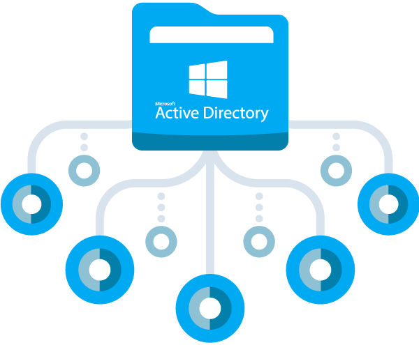
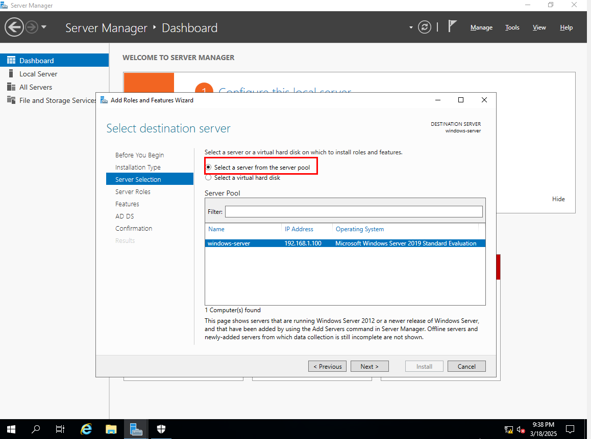
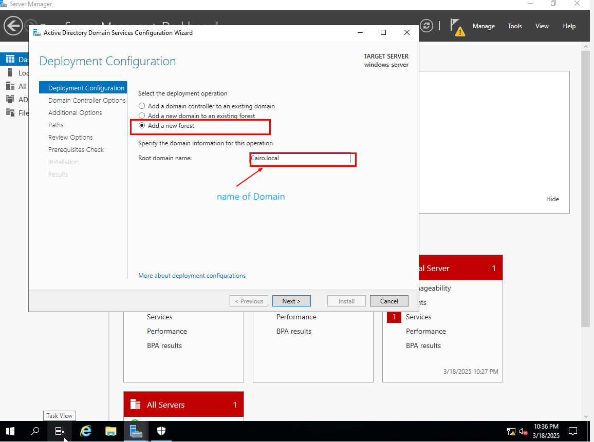

# Install Active Directory

<figure><figcaption></figcaption></figure>

## **First, configure the static IP address and DNS**

* Open **Server Manager** and click on **Local Server**.
* Click on **Ethernet** to open the **Network and Sharing Center**.
* Select **Change adapter settings** on the left panel.
* Right-click on your active network adapter and choose **Properties**.
* Select **Internet Protocol Version 4 (TCP/IPv4)** and click **Properties**.
* Choose **Use the following IP address** and enter:
  * **IP Address**: (e.g., `192.168.1.100`)
  * **Subnet Mask**: (e.g., `255.255.255.0`)
  * **Default Gateway**: (e.g., `192.168.1.1`)
* In the **Preferred DNS server**, enter your **own IP address** or **local adress**.
* Click **OK**, then **Close**, and restart the network adapter for changes to take effect

<figure><figcaption></figcaption></figure>

## **Steps to Install Active Directory on Windows Server**

**1. Installing the Active Directory Role**

* &#x20;select **Add Roles and Features**.
* Choose **Role-based or feature-based installation** and click **Next**.
* Select **Select a server from the server pool**, ensure the correct server is chosen, then click **Next**.
* In the **Server Roles** window, check **Active Directory Domain Services**.
* A prompt will appear to install additional features. Click **Add Features**, then click **Next**.
* Continue clicking **Next** until you reach the confirmation screen, then click **Install** and wait for the installation to complete.

&#x20;select **Add Roles and Features**

<figure><figcaption></figcaption></figure>

Choose **Role-based or feature-based installation** and click **Next**

<figure><figcaption></figcaption></figure>

Select **Select a server from the server pool**, ensure the correct server is chosen, then click **Next**.

<figure><figcaption></figcaption></figure>

In the **Server Roles** window, check **Active Directory Domain Services**

<figure><figcaption></figcaption></figure>

A prompt will appear to install additional features. Click **Add Features**, then click **Next**

<figure><figcaption></figcaption></figure>

Continue clicking **Next** until you reach the confirmation screen, then click **Install** and wait for the installation to complete.

<figure><figcaption></figcaption></figure>

**2. Promoting the Server to a Domain Controller**

* Once installed, open **Server Manager**. A notification will appear prompting you to promote the server to a **Domain Controller**. Click **Promote this server to a domain controller**.
* Choose:
  * **Add a new forest** (if creating a new domain).
  * **Add a domain controller to an existing domain** (if adding the server to an existing domain).
* Enter the domain name, such as `ِabdo.local`, and click **Next**.
* In the **Domain Controller Options** window, select:
  * **Domain Name System (DNS) Server**.
  * **Global Catalog (GC)**.
  * Set a password for **Directory Services Restore Mode (DSRM)** and click **Next**.
* Continue clicking **Next** with default settings until the confirmation screen appears, then click **Install**.
* The server will restart after the installation is complete.

open **Server Manager**. A notification will appear prompting you to promote the server to a **Domain Controller**. Click **Promote this server to a domain controller**

<figure><figcaption></figcaption></figure>

**Add a new forest** (if creating a new domain).

Enter the domain name, such as `cairo.local`, and click **Next**

<figure><figcaption></figcaption></figure>

In the **Domain Controller Options** window, select:

* **Domain Name System (DNS) Server**.
* **Global Catalog (GC)**

Set a password for **Directory Services Restore Mode (DSRM)** and click **Next**.

<figure><figcaption></figcaption></figure>

Continue clicking **Next** with default settings until the confirmation screen appears, then click **Install**

<figure><figcaption></figcaption></figure>

The server will restart after the installation is complete

**3. Verifying the Installation**

Use the following PowerShell command to check the domain details: `Get-ADDomain`

<figure><figcaption></figcaption></figure>

