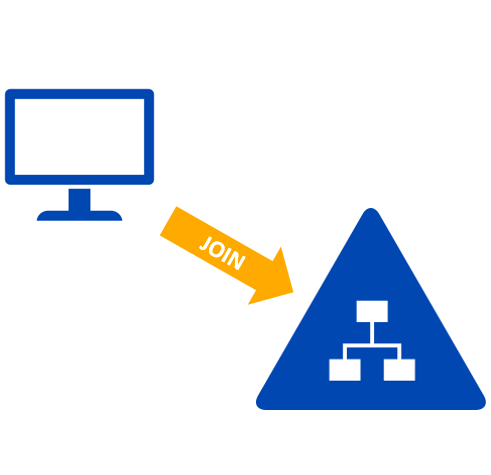
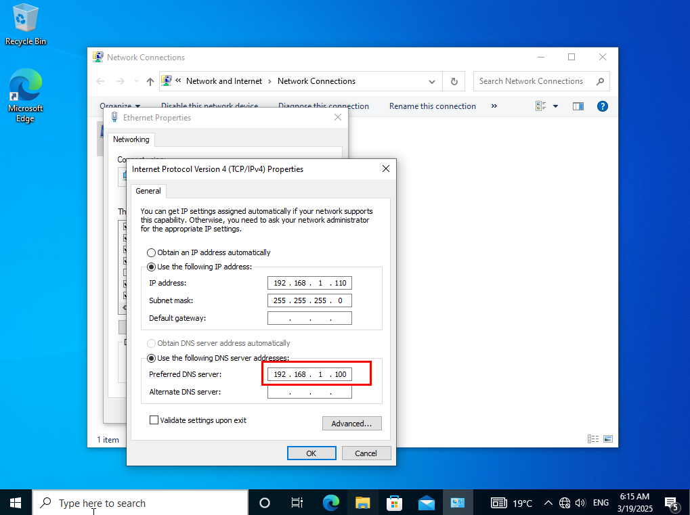

# Join Domain

<figure><figcaption></figcaption></figure>


first config  DNS of the domain in host machine

<figure><figcaption></figcaption></figure>

## <mark style="color:red;">**Method 1: Using System Properties (GUI Method)**</mark>

1. **Open System Settings:**
   * Press `Win + R`, type `sysdm.cpl`, and press **Enter**.
2. **Change Computer Name:**
   * Click **Change settings** under **Computer Name, Domain, and Workgroup Settings**.
3. **Join the Domain:**
   * Click **Change**, select **Domain**, and enter the domain name (`cairo.local`).
4. **Enter Credentials:**
   * When prompted, enter a domain admin username and password.
5. **Restart the Machine:**
   * Click **OK**, then **Restart Now** to apply changes.


Press `Win + R`, type `sysdm.cpl`, and press **Enter**.

<figure><figcaption></figcaption></figure>

Click **Change settings** under **Computer Name, Domain, and Workgroup Settings**

<figure><figcaption></figcaption></figure>

Click **Change**, select **Domain**, and enter the domain name (`cairo.local`)

<figure><figcaption></figcaption></figure>

When prompted, enter a domain admin username and password.

<figure><figcaption></figcaption></figure>

Click **OK**, then **Restart Now** to apply changes

<figure><figcaption></figcaption></figure>


## <mark style="color:red;">**Method 2: Using PowerShell**</mark>

1. **Open PowerShell as Administrator.**
2. **Run the following command:**

```powershell
Add-Computer -DomainName "cairo.local" -Credential Administrator@cairo.local -Restart

```

3. **Enter Admin Credentials** when prompted.
4. The system will restart automatically and join the domain

<figure><figcaption><p>automatic restart after join</p></figcaption></figure>

## <mark style="color:red;">**Method 3: offline Offline Domain Join**</mark>

**Step 1: Create a Domain Join File on a Domain Controller**

1. Log in to a domain controller (DC) with **administrator** privileges.
2. Open **Command Prompt** (cmd) with **Administrator** rights.
3. Run the following command to generate the **provisioning file**

```powershell
DJoin /Provision /Domain cairo.local /Machine PC1 /SaveFile C:\join.txt /Reuse

```

* _Replace `cairo.local` with your domain name._
* _Replace `PC1`with the actual computer name._
* _The `/savefile` parameter specifies the location where the join file is stored._
* _The `/reuse` flag ensures that the computer account is reused if it already exists._

4. Copy the generated file (`C:\join.txt`) to the target machine that needs to be joined to the domain

**Step 2: Apply the Join File on the Target Machine**

1. Log in to the **target computer** using a local administrator account.
2. Open **Command Prompt** as Administrator.
3. Run the following command to join the domain using the offline file

```powershell
djoin /requestODJ /loadfile C:\join.txt /windowspath C:\Windows /localos
```

* This command applies the domain join settings to the computer.

**Step 3: Restart the Computer**

1. Restart the computer for the changes to take effect:

```powershell
shutdown /r /t 0
```

