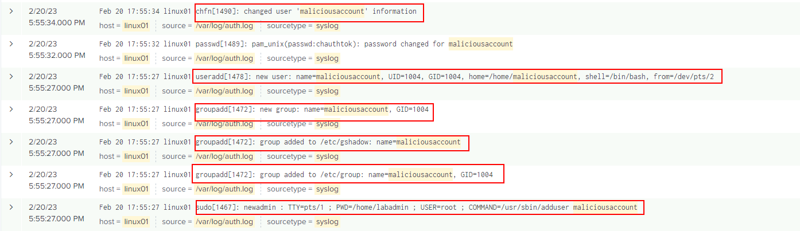

# linux log

create a new user for presistance technics


```
sudo adduser labadmin
```


```
sudo tail -f /var/log/auth.log
```

```
Apr 24 01:39:22 ubuntu sudo:     abdo : TTY=pts/1 ; PWD=/home/abdo ; USER=root ; COMMAND=/usr/sbin/adduser labadmin
Apr 24 01:39:22 ubuntu sudo: pam_unix(sudo:session): session opened for user root by (uid=0)
Apr 24 01:39:22 ubuntu groupadd[2636]: group added to /etc/group: name=labadmin, GID=1001
Apr 24 01:39:22 ubuntu groupadd[2636]: group added to /etc/gshadow: name=labadmin
Apr 24 01:39:22 ubuntu groupadd[2636]: new group: name=labadmin, GID=1001
Apr 24 01:39:22 ubuntu useradd[2642]: new user: name=labadmin, UID=1001, GID=1001, home=/home/labadmin, shell=/bin/bash, from=/dev/pts/1
Apr 24 01:39:33 ubuntu passwd[2654]: pam_unix(passwd:chauthtok): password changed for labadmin
Apr 24 01:39:33 ubuntu passwd[2654]: gkr-pam: couldn't update the login keyring password: no old password was entered
Apr 24 01:39:42 ubuntu chfn[2656]: changed user 'labadmin' information
Apr 24 01:39:45 ubuntu sudo: pam_unix(sudo:session): session closed for user root
```

<figure><figcaption></figcaption></figure>

***

```
tshark -r /desktop/lab/file.pcap -Y "icmp" -T fields -e data > icmp_data.txt
xxd -r -p icmp_data.txt icmp_extract.bin
```
